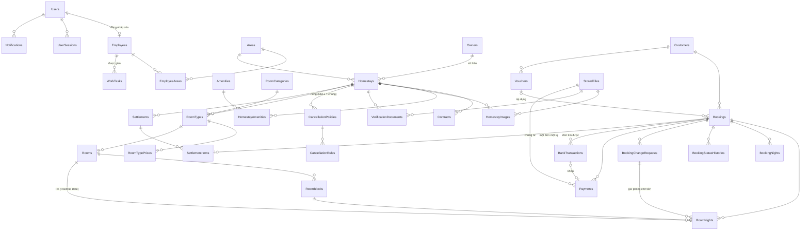

# HOMESTAY DESKTOP — ĐẶC TẢ THIẾT KẾ TỔNG THỂ

| Mục | Nội dung |
|---|---|
| Tên dự án | Ứng dụng quản lý Homestay trên máy tính (C# WinForms) |
| Phiên bản tài liệu | 0.4 — bỏ vai trò Chủ homestay (D9, mục 12.7). 0.3: đã chốt Q01–Q20 (trừ định dạng tệp sao kê); học theo đồ án WinForms tham khảo: gộp form, không thư viện ngoài, quy chuẩn giao diện, khung báo cáo |
| Ngày lập | 26/10/2026; cập nhật 27/10/2026 |
| Trạng thái | **Thiết kế, chưa triển khai.** Chưa có mã nguồn, chưa có database |
| Phạm vi tài liệu | Nghiệp vụ, kiến trúc, database, phân quyền, màn hình, quy trình, kế hoạch triển khai |

Tài liệu này tự đầy đủ: mọi quy tắc nghiệp vụ dùng cho ứng dụng desktop đều được viết lại ở đây, không cần mở tài liệu hay mã nguồn khác.

---

## Mục lục

0. [Cách đọc tài liệu](#0-cách-đọc-tài-liệu)
1. [Mục tiêu, phạm vi và mô hình vận hành](#1-mục-tiêu-phạm-vi-và-mô-hình-vận-hành)
2. [Công nghệ, phiên bản và môi trường phát triển](#2-công-nghệ-phiên-bản-và-môi-trường-phát-triển)
3. [Kiến trúc GUI – BLL – DAL – DTO](#3-kiến-trúc-gui--bll--dal--dto)
4. [Chức năng theo vai trò](#4-chức-năng-theo-vai-trò)
5. [Ma trận phân quyền](#5-ma-trận-phân-quyền)
6. [Thiết kế database](#6-thiết-kế-database)
7. [Quy tắc nghiệp vụ và trạng thái](#7-quy-tắc-nghiệp-vụ-và-trạng-thái)
8. [Màn hình](#8-màn-hình)
9. [Quy trình nghiệp vụ](#9-quy-trình-nghiệp-vụ)
10. [Bảo mật, transaction, chống đặt trùng, xử lý lỗi](#10-bảo-mật-transaction-chống-đặt-trùng-xử-lý-lỗi)
11. [Kế hoạch triển khai](#11-kế-hoạch-triển-khai)
12. [Quyết định, giả định và câu hỏi còn mở](#12-quyết-định-giả-định-và-câu-hỏi-còn-mở)
13. [Thuật ngữ](#13-thuật-ngữ)
14. [Khung báo cáo đồ án](#14-khung-báo-cáo-đồ-án)

---

## 0. Cách đọc tài liệu

### 0.1. Nhãn trạng thái của từng quyết định

| Nhãn | Ý nghĩa |
|---|---|
| **[ĐÃ CHỐT]** | Người đặt hàng đã yêu cầu hoặc đã duyệt cho ứng dụng desktop (mục 12). Không tự thay đổi |
| **[KẾ THỪA]** | Quy tắc nghiệp vụ đã được duyệt và đang chạy ở hệ thống web tham khảo. Mặc định áp dụng cho desktop; muốn khác thì phải chốt lại |
| **[ĐỀ XUẤT]** | Lựa chọn kỹ thuật (thư viện, cách cài đặt) do người phân tích đề xuất, không thay đổi nghiệp vụ. Dùng làm phương án mặc định khi viết code; được đổi nếu có lý do kỹ thuật, phải ghi lại |
| **[CHƯA CHỐT]** | Còn câu hỏi mở, có đánh số `Qxx` ở mục 12. Không được coi là yêu cầu đã duyệt |

### 0.2. Quy ước viết

- Tên bảng, cột, mã trạng thái: tiếng Anh, `PascalCase`. Nhãn hiển thị: tiếng Việt.
- Tiền: đồng Việt Nam, số nguyên. Tỷ lệ: số thập phân, `0.30` = 30%.
- "Đêm" của đơn: khoảng `[CheckIn, CheckOut)`, tức ngày nhận phòng tính, ngày trả phòng không tính.
- "Ngày nghiệp vụ": ngày theo giờ Việt Nam (UTC+7). Thời điểm lưu trong database theo UTC.

---

## 1. Mục tiêu, phạm vi và mô hình vận hành

### 1.1. Mục tiêu

1. **[ĐÃ CHỐT]** Xây dựng ứng dụng C# WinForms quản lý homestay, **độc lập**, có **database SQL Server riêng**. Không sửa mã nguồn hoặc database của hệ thống web hiện có.
2. **[ĐÃ CHỐT]** Ưu tiên trải nghiệm và công việc hằng ngày của **nhân viên**: tra phòng, tạo đơn, xử lý đơn, ghi nhận thu tiền nhanh, ít thao tác.
3. **[ĐÃ CHỐT]** Cung cấp **đầy đủ** chức năng cho **quản lý**, **kế toán** trong phạm vi nghiệp vụ đã thống nhất. Không thu gọn hai vai trò này thành chức năng phụ. Chủ homestay **không** dùng ứng dụng (D9): việc của chủ do nhân viên/quản lý ghi nhận thay.
4. **[ĐÃ CHỐT]** Kiến trúc GUI – BLL – DAL – DTO; kiểm tra quyền và nghiệp vụ trong BLL, không chỉ ẩn nút trên giao diện.
5. **[ĐÃ CHỐT]** Nhiều máy WinForms cùng kết nối một database của hệ thống desktop.

### 1.2. Hệ thống tham khảo (bối cảnh)

Nghiệp vụ lấy từ hệ thống web "Fuji Homestay" đang vận hành. Phần tóm tắt dưới đây đủ để hiểu mô hình; mọi quy tắc chi tiết được viết lại ở mục 7 và 9.

- Fuji Homestay là **đơn vị trung gian** đặt phòng cho nhiều homestay thuộc nhiều chủ khác nhau, ở nhiều khu vực/tỉnh.
- Khách đặt phòng qua Fuji (trên web, hoặc gọi điện/Zalo/Messenger cho nhân viên Fuji).
- Khách **đặt cọc 30%** vào **tài khoản ngân hàng của Fuji**; **70% còn lại khách trả trực tiếp cho chủ homestay** khi đến ở.
- Chủ homestay xác nhận đơn trong 30 phút sau khi có cọc.
- Fuji hưởng **hoa hồng** theo **hợp đồng** với từng homestay; hai kỳ mỗi tháng Fuji lập **bảng đối soát** và chuyển cho chủ phần cọc còn lại sau khi trừ hoa hồng.
- Hệ thống web có: khách tự đặt online, mã QR chuyển khoản tự đối chiếu qua dịch vụ theo dõi tài khoản ngân hàng, đăng nhập Google, tự đăng ký làm đối tác, đánh giá homestay, nhắc lịch qua SMS/Zalo (đang giả lập).

### 1.3. Mô hình vận hành áp dụng cho desktop

| Câu hỏi | Trả lời | Nhãn |
|---|---|---|
| Nhân viên thuộc đâu? | Nhân viên (tư vấn, kế toán, quản lý) là **nhân viên của Fuji** — đơn vị trung gian, **không** thuộc từng cơ sở. Người vận hành tại cơ sở là **chủ homestay** — đối tác có hồ sơ trong hệ thống, **không có tài khoản**, liên lạc với Fuji qua điện thoại/Zalo | [KẾ THỪA]; chủ không dùng ứng dụng: [ĐÃ CHỐT] D9 |
| Ai nhận đặt phòng? | Nhân viên Fuji tạo đơn thay khách (khách gọi điện, Zalo, Messenger, đến văn phòng). Ứng dụng desktop **không** có cổng cho khách tự đặt | [ĐÃ CHỐT] |
| Ai duyệt đơn (xác nhận nhận khách)? | **Chủ homestay** quyết định nhận/không nhận trong 30 phút sau khi đơn có cọc. Nhân viên gọi điện cho chủ rồi ghi nhận xác nhận/từ chối **thay chủ** trên ứng dụng, bắt buộc ghi chú | [KẾ THỪA]; chỉ còn đường thay chủ: [ĐÃ CHỐT] D9 |
| Ai nhận/trả phòng? | **Chủ homestay** đón/trả khách tại cơ sở và báo qua điện thoại; nhân viên ghi nhận thay chủ (đã nhận phòng, đã trả phòng, không đến), bắt buộc ghi chú | [KẾ THỪA]; [ĐÃ CHỐT] D9 |
| Ai thu tiền cọc? | Tiền cọc vào **tài khoản Fuji**. Nhân viên **ghi nhận** khoản khách báo đã chuyển (kèm ảnh chứng từ); **kế toán xác minh** với sao kê ngân hàng | [ĐÃ CHỐT] |
| Ai thu 70% còn lại? | Chủ homestay thu trực tiếp tại cơ sở. Fuji **không** quản lý và **không ghi nhận** khoản này | [ĐÃ CHỐT] Q07 |
| Ai chi tiền ra? | **Kế toán** chi hoàn cọc, khoản bù trùng phòng, tiền đối soát cho chủ, và ghi nhận đã chi | [KẾ THỪA] |
| Ai duyệt ngoại lệ? | **Quản lý**: duyệt yêu cầu đổi ngày/đổi loại phòng/hủy đơn đã cọc, cấp voucher xin lỗi, quyết định phương án trùng phòng, duyệt homestay, ký hợp đồng | [KẾ THỪA] |
| Hai bước duyệt khi có tiền | Đổi đơn cần thu thêm tiền: **Quản lý** duyệt nghiệp vụ → **Kế toán** xác nhận tiền. Người gửi không tự duyệt | [KẾ THỪA] |

### 1.4. Vai trò

| Vai trò | Mã | Mô tả |
|---|---|---|
| Nhân viên | `Staff` | Nhân viên tư vấn đặt phòng của Fuji. Vai trò dùng nhiều nhất |
| Kế toán | `Accountant` | Nhân viên kế toán của Fuji |
| Quản lý | `Manager` | Quản lý vận hành của Fuji. Có mọi quyền thao tác của Nhân viên, cộng quyền giám sát, phê duyệt, quản trị |
| Hệ thống | `System` | Tác vụ tự động (hết hạn giữ phòng, cảnh báo…). Không phải tài khoản đăng nhập |

- **[ĐÃ CHỐT] Q01** Không có vai trò "Quản trị hệ thống" riêng như bản web: việc tạo/khóa tài khoản, danh mục, cấu hình giao cho **Quản lý**.
- **[ĐÃ CHỐT] D9** Không có vai trò Chủ homestay: chủ là đối tác có hồ sơ (`Owners`), không có tài khoản đăng nhập. Ứng dụng có đúng **ba vai trò** đăng nhập: Nhân viên, Kế toán, Quản lý.
- **[ĐÃ CHỐT]** Một tài khoản chỉ có một vai trò.

### 1.5. Phạm vi

**Trong phạm vi desktop:**

- Danh mục: khu vực, tiện nghi, danh mục loại phòng, ngày lễ, chính sách hủy chung, cấu hình nghiệp vụ.
- Hồ sơ chủ homestay (không có tài khoản), homestay, giấy tờ pháp lý, hợp đồng và hoa hồng, duyệt homestay.
- Loại phòng, phòng, giá ba mức có lịch sử, tiện nghi, hình ảnh, chính sách hủy riêng, khóa phòng.
- Khách hàng, đơn đặt phòng, giữ phòng, cọc, xác nhận, nhận/trả phòng, hủy, hoàn tiền, đổi ngày/loại phòng, trùng phòng, voucher xin lỗi.
- Ghi nhận và xác minh thu tiền, nhập sao kê ngân hàng và đối chiếu, chi hoàn, chi khoản bù, đối soát với chủ, sổ thu chi, công nợ.
- Tài khoản, nhân viên, phạm vi khu vực, phân công việc, thông báo trong ứng dụng, nhật ký thao tác, báo cáo.

**Ngoài phạm vi (không làm ở desktop):**

| Hạng mục | Lý do | Nhãn |
|---|---|---|
| Khách tự đặt phòng, tra cứu đơn, tự hủy | Desktop là công cụ nội bộ | [ĐÃ CHỐT] |
| Webhook ngân hàng tự động (SePay/Casso), QR động | Cần máy chủ công khai nhận webhook; desktop dùng **nhập sao kê** thay thế | [ĐÃ CHỐT] |
| Đăng nhập Google, OTP qua SMS | Không cần cho người dùng nội bộ | [ĐÃ CHỐT] |
| Chủ tự đăng ký làm đối tác online | Nhân viên/Quản lý nhập hồ sơ chủ | [ĐÃ CHỐT] |
| Chủ homestay dùng ứng dụng (xác nhận đơn, nhận/trả phòng, khóa phòng, xem đối soát, doanh thu) | Chủ báo qua điện thoại; nhân viên/Quản lý ghi nhận thay; Kế toán gửi bảng đối soát bằng bản in/CSV | [ĐÃ CHỐT] D9 |
| Khách đánh giá homestay, chủ trả lời đánh giá | Không có cổng khách | [ĐÃ CHỐT] |
| Gửi SMS/Zalo thật | Chưa có nhà cung cấp; chỉ thông báo trong ứng dụng | [ĐÃ CHỐT] |
| Đồng bộ dữ liệu với hệ thống web | Hai hệ thống độc lập | [ĐÃ CHỐT] |
| Buồng phòng (dọn phòng), kho, nhân sự–lương | Không có trong nghiệp vụ tham khảo | [ĐỀ XUẤT] |
| Dịch vụ phát sinh (ăn sáng, đưa đón…) | Nghiệp vụ tham khảo chưa có | [ĐÃ CHỐT] Q08 chưa làm — giữ thiết kế module tùy chọn (mục 6.3.H) để mở rộng sau |

### 1.6. Đối chiếu chức năng

"Đã có" = đã triển khai ở hệ thống web tham khảo; "Thiếu" = web chưa có hoặc chỉ giả lập; "Desktop" = cách làm ở desktop.

| Nhóm | Đã có (web) | Thiếu ở web | Desktop |
|---|---|---|---|
| Tra phòng trống | Bảng phòng trống mọi homestay, ≤ 31 đêm; lịch tháng cho chủ/quản lý | Nhân viên không có lịch dạng lưới | Bảng phòng trống **và** lịch phòng dạng lưới cho nhân viên [ĐỀ XUẤT] |
| Đặt phòng | Đặt theo loại phòng, hệ thống gán phòng, giữ 15 phút; nhân viên đặt hộ | — | Giữ nguyên; thêm chọn phòng cụ thể trong loại |
| Thu cọc | Webhook tự khớp; khách tải ảnh bill; kế toán duyệt bill | Kết nối ngân hàng thật | Nhân viên ghi nhận + kế toán xác minh; nhập sao kê tự khớp; nhận cả tiền mặt tại văn phòng |
| Xác nhận đơn | Chủ ≤ 30 phút; nhân viên thay chủ; cảnh báo quá hạn | — | Chỉ nhân viên/Quản lý ghi nhận thay chủ (D9); giữ cảnh báo quá hạn |
| Nhận/trả phòng | Chủ hoặc nhân viên | — | Nhân viên ghi nhận thay chủ (D9); bảng "Đón/trả khách hôm nay" |
| Hủy, hoàn tiền | Chính sách hủy theo số ngày; hàng chờ hoàn cho kế toán | Phiếu chi chính thức | Tạo phiếu chi chờ chi ngay khi hủy |
| Đổi ngày/loại phòng | Đầy đủ, hai bước duyệt | — | Giữ nguyên |
| Trùng phòng | Ba phương án, khoản bù | — | Giữ nguyên |
| Voucher xin lỗi | Đầy đủ | — | Giữ nguyên |
| Đối soát | Tự lập 2 kỳ/tháng, gửi, chủ xác nhận, ghi nhận đã trả | — | Bỏ bước chủ xác nhận trên ứng dụng (D9): Nháp → Đã gửi (in/CSV cho chủ) → Đã trả |
| Phiếu thu/chi, sổ quỹ | — | Không có sổ thu chi, số phiếu | Số phiếu PT/PC, sổ thu chi [ĐỀ XUẤT] |
| Công nợ | Dữ liệu rời rạc (đối soát chưa trả, hoàn chưa chi) | Không có màn tổng hợp | Màn công nợ tổng hợp [ĐỀ XUẤT] |
| Phân công | Giao đơn cho nhân viên | Không giao việc ngoài đơn; không phạm vi khu vực | Giao đơn + việc (WorkTasks) + phạm vi theo khu vực (Q02) |
| Quản lý nhân viên | Quản trị viên tạo/khóa; Quản lý chỉ xem | — | Quản lý tạo/khóa/đặt lại mật khẩu (Q01) |
| Báo cáo | Đơn, doanh thu, hoa hồng, tỷ lệ hủy, hiệu suất nhân viên, điểm homestay | Công suất phòng | Thêm công suất phòng [ĐỀ XUẤT] |
| Lịch sử thao tác | Nhật ký thay đổi, lịch sử trạng thái đơn | Màn "lịch sử thao tác của tôi" | Có [ĐỀ XUẤT] |

---

## 2. Công nghệ, phiên bản và môi trường phát triển

**[ĐÃ CHỐT 27/10/2026]** Học theo đồ án WinForms tham khảo: **chỉ dùng thư viện có sẵn của .NET**, không thêm gói ngoài. Ngoại lệ duy nhất là trình điều khiển SQL Server `Microsoft.Data.SqlClient` (trên .NET 10 trình điều khiển này không còn nằm sẵn trong framework). Project test được dùng xUnit vì không đi kèm bản phát hành. Các dòng còn lại trong bảng là [ĐỀ XUẤT].

| Thành phần | Lựa chọn | Lý do |
|---|---|---|
| Ngôn ngữ, nền tảng | C#, **.NET 10 (LTS)**, `net10.0-windows` cho GUI, `net10.0` cho BLL/DAL/DTO | LTS, cùng nền với hệ thống tham khảo |
| Giao diện | **Windows Forms**; mọi form mở và kéo thả được trong VS Designer | Yêu cầu đồ án |
| Thư viện control | **Control chuẩn WinForms**, không dùng Guna.UI2 hay thư viện có phí — [ĐÃ CHỐT] Q15 | Tránh phụ thuộc bản quyền |
| Database | **SQL Server 2022** trở lên. Phát triển: Developer hoặc Express; LocalDB cho test | Yêu cầu SQL Server |
| Truy cập dữ liệu | **ADO.NET thuần**: `SqlConnection`, `SqlCommand` có tham số, `SqlTransaction`, `SqlDataReader` (gói `Microsoft.Data.SqlClient` 6.x). DAL tự ánh xạ dòng → DTO bằng vài hàm trợ giúp dùng chung (`GetString/GetDecimal/GetNullable…`) | Kiểm soát câu lệnh, transaction, khóa — quan trọng cho chống đặt trùng; giống đồ án tham khảo |
| Quản lý schema | Script SQL đánh số trong thư mục `database/`, bảng `SchemaVersions` ghi script đã chạy | Không phụ thuộc ORM; dễ đọc khi chấm đồ án |
| Lắp ráp lớp, cấu hình | Không dùng thư viện DI: lớp `AppServices` trong GUI tạo DAL và BLL một lần lúc khởi động rồi truyền vào form. `appsettings.json` đọc bằng `System.Text.Json` (có sẵn) | Ít phụ thuộc |
| Ghi log tệp | Lớp `FileLogger` tự viết: một tệp mỗi ngày, xóa tệp quá 30 ngày, khóa ghi giữa các luồng | Không cần gói ngoài |
| Mã hóa chuỗi kết nối | DPAPI `ProtectedData`, có sẵn trong Windows Desktop runtime; gọi ở GUI (BLL/DAL không phụ thuộc Windows) | Không để mật khẩu SQL dạng rõ |
| Băm mật khẩu | `Rfc2898DeriveBytes.Pbkdf2` (có sẵn trong .NET) | Không cần gói ngoài |
| Xuất tệp | CSV UTF-8 có BOM (Excel mở đúng tiếng Việt); xuất các dòng đang chọn, không chọn thì toàn bộ kết quả lọc | Như đồ án tham khảo |
| Nhập tệp | CSV; XLSX đọc bằng `System.IO.Compression` + `System.Xml.Linq` (có sẵn), không cần cài Excel; tệp mẫu tải từ chính phần mềm; dòng lỗi được liệt kê kèm lý do, dòng đúng vẫn nhập | Dùng cho sao kê ngân hàng |
| In | `PrintDocument` có sẵn của WinForms cho phiếu thu/chi và bảng đối soát (Q17) | Không cần gói ngoài |
| Biểu đồ | Không dùng thư viện. Báo cáo dạng bảng + thẻ chỉ số; cột tỉ lệ vẽ bằng `System.Drawing` trong ô của lưới khi cần | .NET mới không có sẵn control Chart |
| Kiểm thử | xUnit (chỉ project test); test BLL chạy trên SQL Server thật (LocalDB/Developer), mỗi test trong transaction rollback | Chống trùng dựa vào khóa SQL Server, không mô phỏng được bằng in-memory |
| IDE | Visual Studio 2026 (hỗ trợ .NET 10), SQL Server Management Studio | |
| Quản lý mã nguồn | Git, nhánh theo giai đoạn | |

**Môi trường:**

| Môi trường | Database | Ghi chú |
|---|---|---|
| Phát triển | `HomestayDesktop_Dev` trên máy lập trình | Có dữ liệu mẫu |
| Kiểm thử tự động | `HomestayDesktop_Test` (LocalDB) | Tạo lại từ script trước mỗi lượt chạy |
| Demo/chạy thật | `HomestayDesktop` trên một máy chủ SQL Server trong mạng LAN | Nhiều máy WinForms kết nối |

---

## 3. Kiến trúc GUI – BLL – DAL – DTO

### 3.1. Tổng quan

```text
 Máy trạm 1..n (Windows)                                  Máy chủ CSDL
┌──────────────────────────────────────────────┐        ┌──────────────────────┐
│ Homestay.GUI   (Forms, UserControls)          │        │ SQL Server           │
│   │ gọi service, nhận DTO / BusinessException │        │  HomestayDesktop     │
│   ▼                                           │        │  - bảng, ràng buộc   │
│ Homestay.BLL   (nghiệp vụ, phân quyền,        │        │  - khóa chính chống  │
│   │             transaction, tính tiền, job)  │  TDS   │    trùng phòng       │
│   ▼                                           │ ─────► │  - rowversion        │
│ Homestay.DAL   (ADO.NET thuần, kết nối,       │        │  - quyền SQL tối     │
│                 unit of work)                 │        │    thiểu cho ứng dụng│
│ Homestay.DTO   (dùng chung mọi lớp)           │        └──────────────────────┘
└──────────────────────────────────────────────┘
```

- **[ĐÃ CHỐT]** Bốn lớp GUI – BLL – DAL – DTO.
- **[ĐÃ CHỐT] Q03, D9** Mô hình **hai tầng** (máy trạm nối thẳng SQL Server) trong LAN văn phòng Fuji. Bỏ vai trò Chủ nên không còn người dùng ở xa, **không dùng Tailscale**. Rủi ro đã chấp nhận: người có quyền quản trị máy trạm có thể lấy thông tin kết nối và bỏ qua BLL; giảm thiểu bằng các biện pháp ở mục 10.1. BLL viết không phụ thuộc WinForms để sau này đặt sau một máy chủ API mà không viết lại (khi cần truy cập từ xa hoặc khi chạy thật).

### 3.2. Cấu trúc solution

```text
HomestayDesktop/
├── HomestayDesktop.sln
├── HOMESTAY_DESKTOP_SPEC.md
├── database/
│   ├── 001_schema.sql            bảng, khóa, CHECK, FK
│   ├── 002_indexes.sql
│   ├── 003_views.sql             view dẫn xuất (trạng thái thanh toán, tình trạng phòng, sổ thu chi)
│   ├── 004_security.sql          role SQL của ứng dụng, GRANT/DENY
│   ├── 010_seed_reference.sql    danh mục, cấu hình, chính sách hủy chung, Quản lý đầu tiên (không mật khẩu thật)
│   ├── 020_seed_demo.sql         dữ liệu mẫu, một tài khoản mẫu cho mỗi vai trò
│   ├── install_demo.sql          MỘT tệp gộp 001–020: chạy một lần trên SQL Server là dùng được (sinh tự động)
│   └── migrations/               script thay đổi về sau: NNN_mo_ta.sql
├── src/
│   ├── Homestay.DTO/             class library net10.0
│   │   ├── Enums/                BookingStatus, PaymentType, Role…
│   │   ├── Auth/                 LoginRequest, SessionInfo
│   │   ├── Bookings/             BookingListItem, BookingDetail, CreateBookingRequest, PriceQuote…
│   │   ├── Catalog/  Homestays/  Rooms/  Customers/  Finance/  Settlements/  Reports/  Staff/
│   │   └── Common/               PagedResult<T>, PageRequest, Lookup
│   ├── Homestay.DAL/             class library net10.0
│   │   ├── Infrastructure/       ConnectionFactory, UnitOfWork, SqlErrorTranslator, DbClock
│   │   └── Repositories/         BookingRepository, RoomNightRepository, PaymentRepository…
│   ├── Homestay.BLL/             class library net10.0
│   │   ├── Infrastructure/       ICurrentSession, Authorizer, Permission, DataScope, AuditWriter,
│   │   │                         BusinessException, ConcurrencyException, SettingsProvider
│   │   ├── Security/             PasswordHasher, AuthService, SessionService
│   │   ├── Rules/                PricingCalculator, RefundCalculator, SettlementCalculator,
│   │   │                         BookingStateMachine, VoucherCalculator, StatementParser
│   │   ├── Services/             BookingService, AvailabilityService, PaymentService,
│   │   │                         ChangeRequestService, OverbookingService, SettlementService,
│   │   │                         HomestayService, RoomService, CustomerService, StaffService,
│   │   │                         ContractService, VoucherService, ReportService, TaskService,
│   │   │                         NotificationService, CatalogService, FileService
│   │   └── Jobs/                 JobRunner + các tác vụ định kỳ
│   └── Homestay.GUI/             WinForms net10.0-windows
│       ├── Program.cs            AppServices, cấu hình, bắt lỗi toàn cục
│       ├── Shell/                FrmLogin, FrmMain, FrmChangePassword, menu theo vai trò
│       ├── Common/               UserControl dùng chung: lưới có phân trang, ô tìm kiếm, chọn ngày,
│       │                         hộp thoại lỗi, định dạng tiền/ngày, AsyncLoader (chống tải cũ)
│       ├── Staff/  Manager/  Accountant/
│       └── appsettings.json
└── tests/
    ├── Homestay.BLL.Tests/       nghiệp vụ + đồng thời trên SQL Server thật
    └── Homestay.Rules.Tests/     công thức tiền, máy trạng thái (không cần database)
```

Quy tắc tham chiếu giữa project:

| Project | Được tham chiếu | Không được tham chiếu |
|---|---|---|
| DTO | (không) | BLL, DAL, GUI |
| DAL | DTO | BLL, GUI |
| BLL | DAL, DTO | GUI, System.Windows.Forms |
| GUI | BLL, DTO | **DAL** (GUI không gọi thẳng DAL, không viết SQL) |

### 3.3. Trách nhiệm từng lớp

| Lớp | Làm | Không làm |
|---|---|---|
| **GUI** | Hiển thị, nhập liệu, kiểm tra định dạng sơ bộ (bắt buộc nhập, kiểu số), gọi service bất đồng bộ, hiển thị lỗi, ẩn/khóa nút theo quyền để dễ dùng | Tính tiền, quyết định quyền, mở transaction, viết SQL |
| **BLL** | Kiểm tra quyền và phạm vi dữ liệu **ở mọi hàm public**; kiểm tra nghiệp vụ; tính tiền; chuyển trạng thái; mở transaction qua UnitOfWork; ghi AuditLog, lịch sử trạng thái, thông báo trong cùng transaction; dịch lỗi SQL sang thông báo tiếng Việt | Biết đến control WinForms |
| **DAL** | Mở kết nối, chạy SQL tham số hóa, ánh xạ dòng → DTO, quản lý transaction, đọc giờ máy chủ CSDL, phân loại lỗi SQL (trùng khóa, vi phạm CHECK, deadlock, timeout) | Quyết định nghiệp vụ, kiểm tra quyền |
| **DTO** | Dữ liệu trao đổi giữa các lớp; enum; kết quả phân trang | Logic |

- **[ĐỀ XUẤT]** Không có lớp "entity" riêng: DAL ánh xạ thẳng sang DTO. Chỉ tách DTO đọc (ListItem, Detail) và DTO ghi (Request) khi hình dạng khác nhau.

### 3.4. Luồng một thao tác — ví dụ "Tạo đơn"

```text
GUI FrmBookingCreate ── CreateBookingRequest ──► BLL BookingService.CreateAsync
  1. Authorizer.Require(Permission.BookingCreate)              → không đủ quyền: ForbiddenException
  2. Kiểm tra dữ liệu (ngày, số khách, SĐT E.164, kênh)         → BusinessException
  3. using var uow = UnitOfWork.Begin()                        (transaction READ COMMITTED)
  4. DAL: sp_getapplock 'RoomType:{id}' (khóa theo loại phòng, tự nhả khi kết thúc transaction)
  5. DAL: đọc giờ máy chủ; nhả các giữ phòng đã quá hạn của loại phòng này
  6. Rules: tính giá từng đêm, tổng, cọc, voucher, hoa hồng, chọn chính sách hủy
  7. DAL: chọn phòng trống → INSERT Bookings, BookingNights, RoomNights (PK chặn trùng)
  8. DAL: trừ số dư voucher (kiểm rowversion), sinh mã đơn từ Counters
  9. BLL: ghi BookingStatusHistories, AuditLogs, Notifications
 10. uow.Commit()  → trả BookingDetail
     Lỗi bất kỳ → rollback toàn bộ, không có dữ liệu dở dang
```

### 3.5. Cấu hình kết nối

**[ĐỀ XUẤT]**

- `appsettings.json` (cùng thư mục chạy, **không** chứa mật khẩu):

  ```json
  {
    "Database": {
      "Server": "TEN-MAY-CHU\\SQLEXPRESS",
      "Name": "HomestayDesktop",
      "Encrypt": true,
      "TrustServerCertificate": false,
      "CommandTimeoutSeconds": 30
    },
    "Logging": { "Folder": "%LOCALAPPDATA%\\HomestayDesktop\\logs", "RetainDays": 30 }
  }
  ```

- Tên đăng nhập và mật khẩu SQL của ứng dụng lưu trong tệp `connection.dat` mã hóa bằng **DPAPI phạm vi máy** (`DataProtectionScope.LocalMachine`). Tệp do màn "Cấu hình kết nối" tạo khi cài đặt lần đầu; màn này chỉ mở được khi chưa có tệp, hoặc bằng tham số dòng lệnh `--configure` chạy dưới quyền quản trị Windows.
- [ĐÃ CHỐT] Q04: dùng tài khoản SQL riêng của ứng dụng + DPAPI, không dùng Windows Authentication.
- Không đưa `connection.dat`, chuỗi kết nối thật, mật khẩu vào Git.
- `TrustServerCertificate=true` chỉ được dùng ở môi trường phát triển.

### 3.6. Phiên đăng nhập

**[ĐỀ XUẤT]**

- Đăng nhập: tên đăng nhập là **mã nhân viên** (ví dụ `NV0012`) + mật khẩu.
- Thành công → BLL tạo `SessionInfo` (UserId, vai trò, EmployeeId, họ tên, danh sách khu vực được giao, `SecurityStamp`, `SessionId`) và giữ trong `ICurrentSession` (singleton trong tiến trình). GUI không tự sửa.
- Mỗi lần đăng nhập ghi một dòng `UserSessions`. Tối đa **một phiên đang mở** mỗi tài khoản: đăng nhập máy khác thì phiên cũ bị đánh dấu kết thúc (`Replaced`). [ĐÃ CHỐT] Q05.
- **Kiểm tra phiên còn hiệu lực:** trước mọi thao tác **ghi**, BLL đọc lại `Users.Status`, `Users.SecurityStamp`, trạng thái làm việc và `UserSessions.EndedAt`. Khác lúc đăng nhập (bị khóa, đổi mật khẩu, đổi chức vụ, phiên bị thay) → `SessionExpiredException`, GUI đưa về màn đăng nhập. Thao tác chỉ đọc kiểm tra mỗi 60 giây cùng lượt cập nhật `LastSeenAt`.
- Không thao tác **30 phút** → khóa màn hình, nhập lại mật khẩu để tiếp tục (cấu hình `Session.IdleMinutes`).
- Đăng xuất: ghi `EndedAt`, `EndReason = Logout`, xóa `ICurrentSession`.

### 3.7. Kiểm tra quyền trong BLL

**[ĐỀ XUẤT]**

- Enum `Permission` liệt kê mọi hành động ở mục 5.2. Bảng ánh xạ vai trò → quyền viết cứng trong `Authorizer` (không lưu trong database), là nguồn duy nhất cho cả BLL và GUI.
- Mỗi hàm public của service bắt đầu bằng `Authorizer.Require(Permission.X)` rồi `DataScope.Ensure…(id)` cho phạm vi dữ liệu (mục 5.1).
- Danh sách đọc luôn lọc phạm vi **trong câu SQL** (ví dụ khu vực được giao `WHERE h.AreaId IN (…)`), không tải hết rồi lọc ở GUI.
- Truy cập đối tượng ngoài phạm vi trả lỗi **"Không tìm thấy"**, không tiết lộ đối tượng có tồn tại.
- GUI gọi `Authorizer.Can(Permission.X)` chỉ để ẩn/khóa nút; ẩn nút không thay cho kiểm tra ở BLL.

### 3.8. Xử lý lỗi

| Loại | Nguồn | GUI hiển thị |
|---|---|---|
| `BusinessException` | Vi phạm quy tắc nghiệp vụ | Thông báo tiếng Việt cụ thể, ví dụ "Đã hết phòng loại này trong khoảng ngày đã chọn" |
| `ForbiddenException` | Không đủ quyền | "Bạn không có quyền thực hiện thao tác này" |
| `NotFoundException` | Không có hoặc ngoài phạm vi | "Không tìm thấy dữ liệu" |
| `ConcurrencyException` | `rowversion` lệch, `UPDATE` có điều kiện trả 0 dòng | "Dữ liệu vừa được người khác thay đổi. Đã tải lại, vui lòng kiểm tra và thao tác lại" — GUI tự tải lại |
| `SessionExpiredException` | Phiên hết hiệu lực | Về màn đăng nhập |
| Lỗi SQL đã biết | 2627/2601 (trùng khóa), 547 (CHECK/FK), 1205 (deadlock), -2 (timeout), mất kết nối | DAL dịch: trùng khóa/CHECK → `BusinessException` theo tên ràng buộc; deadlock → BLL thử lại toàn bộ thao tác tối đa 3 lần; timeout/mất kết nối → "Mất kết nối máy chủ dữ liệu, vui lòng thử lại" |
| Lỗi không lường trước | Còn lại | "Có lỗi xảy ra (mã lỗi: XXXXXXXX). Vui lòng báo quản lý." Mã lỗi khớp với dòng log |

- Bắt lỗi toàn cục: `Application.ThreadException`, `AppDomain.CurrentDomain.UnhandledException`, `TaskScheduler.UnobservedTaskException`; đặt `Application.SetUnhandledExceptionMode(UnhandledExceptionMode.CatchException)`.
- Không hiện stack trace, câu SQL, chuỗi kết nối cho người dùng.
- Mọi nút ghi dữ liệu bị khóa trong lúc chờ kết quả (chống bấm hai lần).
- Mỗi màn tải dữ liệu bất đồng bộ dùng **bộ đếm phiên bản tải**: kết quả của lần tải cũ về sau lần tải mới thì bỏ qua (tránh hiển thị chi tiết của dòng đã bỏ chọn).

### 3.9. Ghi nhật ký

| Loại | Lưu ở | Nội dung | Không ghi |
|---|---|---|---|
| Log kỹ thuật | Tệp trên máy trạm, cuộn theo ngày, giữ 30 ngày | Mức Information trở lên, lỗi kèm mã lỗi, tên máy, UserId | Mật khẩu, hash, chuỗi kết nối, nội dung ảnh, số CCCD đầy đủ |
| Nhật ký nghiệp vụ `AuditLogs` | Database | Ai, lúc nào, máy nào, hành động gì, bảng/bản ghi nào, giá trị cũ/mới (JSON) | Như trên |
| Lịch sử trạng thái đơn `BookingStatusHistories` | Database | Từ → đến, người, ghi chú | |
| Phiên đăng nhập `UserSessions` | Database | Đăng nhập, lần hoạt động cuối, kết thúc và lý do | |

- AuditLog ghi **trực tiếp trong service, cùng transaction** với thay đổi nghiệp vụ. Không dùng trigger.
- Tài khoản SQL của ứng dụng bị **DENY UPDATE, DELETE** trên `AuditLogs`, `BookingStatusHistories`, `UserSessions` (chỉ được thêm, và cập nhật `UserSessions.LastSeenAt/EndedAt` qua quyền cột riêng).
- Đăng nhập sai cũng ghi AuditLog (`Auth.LoginFailed`) với tên đăng nhập đã nhập, không ghi mật khẩu.

### 3.10. Mật khẩu

**[ĐỀ XUẤT]**

- Băm bằng **PBKDF2-HMAC-SHA256**, 600.000 vòng, salt ngẫu nhiên 16 byte, kết quả 32 byte. Lưu một chuỗi: `PBKDF2-SHA256$600000$<salt base64>$<hash base64>` để sau này tăng số vòng mà vẫn đọc được hash cũ (đăng nhập thành công với số vòng cũ thì băm lại).
- So sánh bằng `CryptographicOperations.FixedTimeEquals`.
- Chính sách: tối thiểu 8 ký tự, có chữ và số; không trùng tên đăng nhập.
- Tài khoản mới hoặc được đặt lại mật khẩu: Quản lý nhập/sinh **mật khẩu tạm**, `MustChangePassword = 1`, người dùng phải đổi ngay ở lần đăng nhập kế tiếp. Mật khẩu tạm chỉ hiện một lần trên màn hình Quản lý, không lưu, không ghi log.
- Sai 5 lần liên tiếp → khóa tạm 15 phút (`LockoutEndUtc`). Thông báo lỗi đăng nhập chung "Tên đăng nhập hoặc mật khẩu không đúng" (không tiết lộ tên đăng nhập có tồn tại).
- Đổi mật khẩu → đổi `SecurityStamp` → mọi phiên khác của tài khoản hết hiệu lực.

### 3.11. Tác vụ định kỳ khi có nhiều máy

Không có máy chủ ứng dụng; SQL Server Express không có SQL Agent. **[ĐỀ XUẤT]** hai cơ chế bổ sung nhau:

1. **Kiểm tra tại chỗ (bảo đảm đúng):** trước khi tra phòng trống, tạo đơn, khóa phòng, BLL nhả các giữ phòng đã quá hạn của đúng loại phòng/phòng liên quan. Vì vậy tính đúng của lịch phòng **không phụ thuộc** việc có máy nào đang mở.
2. **JobRunner (cảnh báo, dọn dẹp):** mỗi máy đang đăng nhập chạy bộ hẹn giờ 60 giây; mỗi lượt gọi `sp_getapplock 'Jobs', 'Exclusive', 'Session', timeout 0` — chỉ một máy giành được khóa và chạy, máy khác bỏ qua. Mọi tác vụ là câu `UPDATE` có điều kiện, chạy lặp không gây sai.

| Tác vụ | Chu kỳ | Việc |
|---|---|---|
| Hết hạn giữ phòng | 1 phút | Đơn `AwaitingPayment` quá `HoldExpiresAt` và không có phiếu thu đang chờ → `Expired`, nhả phòng, trả voucher |
| Hết hạn giữ phòng của yêu cầu đổi | 1 phút | Yêu cầu `AwaitingPayment` quá `PaymentDeadlineAt` và không có phiếu thu đang chờ → `Expired`, nhả phòng giữ |
| Cảnh báo chủ chậm xác nhận | 1 phút | Đơn `Deposited` quá `ConfirmDeadlineAt`, chưa cảnh báo → thông báo nhân viên phụ trách (hoặc mọi Quản lý nếu chưa giao), đặt `ConfirmAlertSentAt` |
| Cảnh báo phiếu thu chờ xác minh lâu | 15 phút | Phiếu thu `Pending` quá 2 giờ làm việc → thông báo Quản lý và Kế toán, một lần |
| Hết hạn hợp đồng | 1 giờ | Hợp đồng `Active` có `EndDate` < hôm nay → `Expired`, báo Quản lý |
| Hết hạn voucher | 1 giờ | `Active`/`UsedUp` quá `ExpiresOn` → `Expired` |
| Hủy khoản bù không còn điều kiện | 1 giờ | Khoản bù `Pending` của đơn thay thế đã `Cancelled/Rejected/Expired/NoShow` → `Rejected` kèm lý do |
| Lập nháp đối soát | 1 giờ | Các kỳ đã qua hạn chờ (mục 7.6.6) chưa có bảng → lập `Draft` |

Mọi tác vụ dùng **giờ của máy chủ SQL** (`SYSUTCDATETIME()`), không dùng giờ máy trạm (các máy có thể lệch giờ).

### 3.12. Lưu tệp (ảnh homestay, chứng từ chuyển khoản, giấy tờ, tệp sao kê)

- **[ĐÃ CHỐT] Q06** Lưu **trong database**, bảng `StoredFiles` (`varbinary(max)`), mỗi tệp ≤ 5 MB. Lý do: nhiều máy dùng chung, không cần thư mục chia sẻ, sao lưu database là đủ, quyền đọc tệp đi qua BLL.
- Chỉ nhận JPG, PNG, WEBP, PDF (ảnh/giấy tờ) và CSV, XLSX (sao kê). Kiểm tra **chữ ký tệp (magic bytes)**, không tin phần mở rộng. Lưu SHA-256 để phát hiện tải trùng.
- Ảnh chứng từ chuyển khoản và giấy tờ pháp lý là **dữ liệu nhạy cảm**: chỉ người có quyền trên đơn/homestay tương ứng mới mở được.

### 3.13. Triển khai nhiều máy

**[ĐỀ XUẤT]**

- Một máy chủ trong LAN cài SQL Server (bật TCP/IP, mở cổng tường lửa chỉ cho dải mạng nội bộ). Database bật `READ_COMMITTED_SNAPSHOT ON` để người đọc không chặn người ghi.
- Các máy trạm cài bản phát hành `dotnet publish` dạng self-contained (không cần cài .NET riêng), hoặc bộ cài đơn giản. Cập nhật: thay thư mục chương trình; ứng dụng kiểm tra `SchemaVersions` lúc khởi động và từ chối chạy nếu database cũ hơn hoặc mới hơn phiên bản nó hỗ trợ.
- Chỉ dùng trong LAN văn phòng; không mở cổng SQL Server ra Internet, không cài máy trạm ngoài văn phòng. Cần truy cập từ xa về sau → thêm máy chủ API (mục 3.1). [ĐÃ CHỐT] Q03, D9.
- Sao lưu: full hằng ngày + log mỗi giờ (mô hình phục hồi FULL) cho môi trường chạy thật; thử khôi phục định kỳ. Không ghi mật khẩu vào script sao lưu.

---

## 4. Chức năng theo vai trò

Ký hiệu: **(P0)** cần cho giai đoạn đầu; số giai đoạn ở mục 11.

### 4.1. Nhân viên (ưu tiên)

| # | Nhóm | Chức năng | Ghi chú nghiệp vụ |
|---|---|---|---|
| N1 | Tổng quan công việc | Một màn hình mở ngay sau đăng nhập: đơn cần xử lý của tôi theo hàng đợi, đồng hồ đếm ngược giữ phòng, đơn chủ chưa xác nhận quá hạn, khách đến/đi hôm nay, việc được giao, thông báo mới | Mọi số liệu bấm vào được để mở danh sách đã lọc |
| N2 | Tra phòng trống | Nhập khu vực, ngày nhận/trả, số khách, khoảng giá, danh mục phòng, tiện nghi → bảng homestay × loại phòng: số phòng trống/tổng, giá trung bình đêm, tổng tiền, cọc, sức chứa | Tối đa 31 đêm; luôn đọc trực tiếp database (không cache); loại hết phòng vẫn hiện với số trống 0 |
| N3 | Lịch phòng | Lưới phòng × ngày (14–31 ngày) của một homestay hoặc một khu vực; màu theo tình trạng (mục 7.4); bấm ô trống để tạo đơn với ngày/phòng đã chọn; bấm ô đã đặt để mở đơn | Chỉ xem khóa phòng, không tạo khóa (khóa là việc của Quản lý) |
| N4 | Khách hàng | Tìm theo SĐT/tên/email; tạo mới; sửa tên/email/CCCD/ghi chú nội bộ; xem lịch sử đơn và voucher còn dùng | SĐT là định danh, không sửa sau khi có đơn (sửa nhầm: Quản lý); CCCD hiện che, chỉ 4 số cuối |
| N5 | Tạo đơn | Chọn khách (tìm SĐT, chưa có thì tạo nhanh) → chọn homestay/loại phòng/ngày/số khách → xem báo giá từng đêm, tổng, cọc, chính sách hủy → chọn voucher của khách (nếu có) → nhập người ở thật, SĐT người ở, kênh, yêu cầu đặc biệt → tạo | Đơn ở trạng thái "Chờ thanh toán", giữ phòng 15 phút; màn hiện thông tin chuyển khoản của Fuji và **nội dung chuyển khoản = mã đơn** để đọc cho khách |
| N6 | Ghi nhận thu cọc | Khách báo đã chuyển → nhân viên ghi nhận số tiền, thời điểm, ngân hàng chuyển, tải ảnh chứng từ (nếu có) | Đơn sang "Chờ xác minh cọc", **ngừng đếm giờ giữ phòng**; kế toán xác minh |
| N7 | Danh sách đơn / hàng đợi | Các tab: Của tôi, Chưa giao, Chờ thanh toán, Chờ xác minh, Chờ chủ xác nhận (có cảnh báo quá hạn), Sắp đến, Đang ở, Yêu cầu đổi/hủy đang mở, Tất cả trong phạm vi; lọc mã/SĐT/tên/homestay/ngày/trạng thái | Phân trang ở database |
| N8 | Chi tiết đơn | Thông tin đơn, khách, giá từng đêm, trạng thái đơn + trạng thái thanh toán, phiếu thu/chi, yêu cầu đổi/hủy, lịch sử trạng thái, nhật ký | Hiện địa chỉ, SĐT cơ sở, hướng dẫn nhận phòng kèm nhắc: **chỉ cung cấp cho khách khi đơn đã được xác nhận** |
| N9 | Xử lý đơn | Nhận phụ trách đơn chưa giao; chuyển phụ trách đơn của mình cho nhân viên khác; xác nhận/từ chối thay chủ; ghi nhận nhận phòng/trả phòng/không đến thay chủ; đổi sang phòng khác cùng loại | Thao tác thay chủ bắt buộc ghi chú (ví dụ "Đã gọi chủ lúc 14:05, chủ đồng ý") |
| N10 | Hủy đơn | Đơn chưa có tiền (Chờ thanh toán): hủy ngay, lý do bắt buộc. Đơn đã cọc: gửi **yêu cầu hủy**, hệ thống báo trước số tiền hoàn theo chính sách; Quản lý duyệt | |
| N11 | Đổi ngày / đổi loại phòng | Gửi yêu cầu, xem trước: giá mới, phí đổi, cọc chuyển sang, cọc phải đóng thêm | Quản lý duyệt; nếu phải đóng thêm, nhân viên ghi nhận thu, kế toán xác minh |
| N12 | Trùng phòng | Báo sự cố trùng phòng cho đơn đã xác nhận; xem đề xuất phòng/homestay thay thế; chuyển phòng cùng loại; tạo đơn thay thế | Phương án hủy + hoàn + voucher: chỉ Quản lý |
| N13 | Nhận/trả phòng hôm nay | Danh sách khách đến (đơn đã xác nhận, nhận hôm nay) và khách đi (đang ở, trả hôm nay) trong phạm vi; gọi chủ, ghi nhận thay | |
| N14 | Việc được giao | Danh sách việc Quản lý giao (WorkTasks), đánh dấu xong kèm kết quả | |
| N15 | Lịch sử thao tác của tôi | Nhật ký các thao tác của chính mình, lọc theo ngày/loại | |
| N16 | Hiệu suất của tôi | Số đơn tạo, tỷ lệ chốt, doanh số, số đơn đang phụ trách | Không xem số liệu tài chính công ty |
| N17 | Hồ sơ chủ & homestay | Nhập hồ sơ chủ mới; nhập homestay nháp theo mục 4.2 từ hồ sơ chủ gửi; gửi duyệt | Chỉ khi chủ còn `Pending` / homestay còn `Draft`; Quản lý duyệt — [ĐỀ XUẤT] D9 |

### 4.2. Hồ sơ homestay (nhập thay chủ)

**[ĐÃ CHỐT] D9** Chủ homestay không dùng ứng dụng. Chủ gửi thông tin, giấy tờ, ảnh, giá cho Fuji; **Nhân viên** nhập khi homestay còn `Draft` rồi gửi duyệt; **Quản lý** làm được ở mọi trạng thái (mục 4.3 Q12). Mọi thay đổi ghi AuditLog với người thực hiện.

| # | Nhóm | Chức năng | Ghi chú |
|---|---|---|---|
| H1 | Danh sách homestay | Lọc theo chủ, khu vực, trạng thái; xem hợp đồng (số, hoa hồng, hạn), số loại phòng/phòng | |
| H2 | Thêm homestay | Tạo homestay mới ở trạng thái Nháp cho một chủ đã có hồ sơ, điền thông tin, tải giấy tờ, gửi duyệt | Quản lý duyệt |
| H3 | Thông tin homestay | Sửa tên, SĐT liên hệ, giờ nhận/trả, mô tả, hướng dẫn nhận phòng | Sửa **địa chỉ/khu vực** hoặc tải lại **giấy phép kinh doanh/PCCC** khi đang hoạt động → homestay về "Chờ duyệt" |
| H4 | Tiện nghi | Chọn tiện nghi từ danh mục chung | Tiện nghi gắn homestay, không gắn loại phòng |
| H5 | Hình ảnh | Tải ảnh, sắp thứ tự, chọn ảnh bìa, gắn ảnh vào loại phòng | Homestay đang hoạt động không được xóa ảnh bìa duy nhất |
| H6 | Loại phòng, phòng | Thêm/sửa loại phòng (danh mục, tên, sức chứa, diện tích, mô tả), thêm phòng (mã phòng), bật/tắt | Không xóa cứng; tắt chỉ chặn bán mới, đơn đã nhận giữ nguyên; không được tắt loại/phòng cuối cùng còn bán của homestay đang hoạt động |
| H7 | Bảng giá | Xem giá hiện hành ba mức; thêm phiên bản giá có hiệu lực từ hôm nay hoặc tương lai | Không sửa giá đã có hiệu lực; đơn cũ giữ giá lúc đặt |
| H8 | Chính sách hủy riêng | Tạo chính sách riêng (mọi ngày / ngày lễ) thay chính sách chung; tắt để quay về chính sách chung | Không sửa chính sách đã có đơn dùng; thay = tạo mới + tắt cũ |
| H9 | Khóa phòng | Khi chủ báo: khóa phòng theo khoảng ngày (khách kênh khác / bảo trì); mở khóa | Chỉ Quản lý; không khóa trùng đơn hoặc khóa khác |

### 4.3. Quản lý

Quản lý có **mọi chức năng của Nhân viên** (mục 4.1) trên toàn bộ dữ liệu, cộng thêm:

| # | Nhóm | Chức năng |
|---|---|---|
| Q1 | Tổng quan vận hành | Đơn theo trạng thái hôm nay, giữ phòng đang chạy, đơn chủ chưa xác nhận quá hạn, yêu cầu đổi/hủy chờ duyệt, sự cố trùng phòng, homestay chờ duyệt, hợp đồng sắp hết hạn (30 ngày), nhân viên đang trực tuyến |
| Q2 | Giám sát đơn | Danh sách ngoại lệ: quá hạn xác nhận, giữ phòng sắp hết, phiếu thu chờ xác minh lâu, đơn chưa giao, đơn có sự cố |
| Q3 | Phân công | Giao/giao lại đơn cho nhân viên (một hoặc nhiều đơn); giao việc (WorkTasks) có hạn, mức ưu tiên, gắn đơn/homestay; theo dõi việc quá hạn |
| Q4 | Nhân viên & tài khoản | Tạo nhân viên + tài khoản (mật khẩu tạm); đổi chức vụ; tạm nghỉ/nghỉ việc (khóa tài khoản); khóa/mở khóa có lý do; đặt lại mật khẩu; xem phiên đăng nhập, buộc đăng xuất |
| Q5 | Phạm vi khu vực | Gán khu vực cho nhân viên/quản lý; đánh dấu "toàn hệ thống" | 
| Q6 | Duyệt yêu cầu đổi/hủy | Xem yêu cầu, số tiền dự kiến; duyệt (hệ thống tính lại giá, khác thì từ chối) hoặc từ chối có lý do |
| Q7 | Trùng phòng | Mọi phương án, gồm hủy + hoàn tiền + cấp voucher |
| Q8 | Voucher | Cấp voucher xin lỗi cho khách gắn với đơn bị ảnh hưởng; thu hồi có lý do; xem số dư |
| Q9 | Chủ homestay | Tạo/sửa hồ sơ chủ (thông tin, ngân hàng), duyệt chủ, tạm ngưng; đổi tài khoản ngân hàng sau khi gọi xác minh với chủ |
| Q10 | Duyệt homestay | Hàng chờ duyệt; danh sách điều kiện còn thiếu; duyệt / trả về nháp (lý do) / tạm ngưng (lý do) / mở lại / kết thúc |
| Q11 | Hợp đồng | Tạo hợp đồng (số hợp đồng, ngày, hoa hồng), gia hạn (lùi ngày kết thúc), chấm dứt (lý do) |
| Q12 | Hồ sơ homestay | Mọi chức năng mục 4.2 (H1–H9) trên homestay ở mọi trạng thái, gồm khóa phòng (ghi AuditLog với người thực hiện là Quản lý) |
| Q13 | Danh mục | Khu vực, tiện nghi, danh mục loại phòng, ngày lễ, chính sách hủy chung |
| Q14 | Cấu hình | Tham số nghiệp vụ (mục 7.7) có kiểm tra khoảng giá trị |
| Q15 | Báo cáo | Đơn theo trạng thái/kênh/khu vực; doanh thu, hoa hồng, Fuji thực thu (tạm tính); tỷ lệ hủy, chủ từ chối, hết hạn; tốc độ chủ xác nhận; hiệu suất nhân viên; công suất phòng; trùng phòng; xuất CSV |
| Q16 | Nhật ký hệ thống | Tra AuditLogs theo người/bảng/bản ghi/ngày |

### 4.4. Kế toán

| # | Nhóm | Chức năng |
|---|---|---|
| K1 | Tổng quan tài chính | Phiếu thu chờ xác minh, giao dịch sao kê chưa khớp, hoàn tiền chờ chi, khoản bù chờ chi, cọc bổ sung chờ xác nhận, đối soát chờ gửi/chờ trả, tổng thu/chi trong ngày |
| K2 | Xác minh thu cọc | Hàng chờ phiếu thu `Pending` (cũ nhất lên đầu): xem ảnh chứng từ, đối chiếu sao kê → xác minh hoặc từ chối (lý do). Từ chối lần 1: khách thêm 15 phút; lần 2: đơn hết hạn |
| K3 | Sao kê ngân hàng | Nhập tệp sao kê CSV/XLSX hoặc nhập tay từng giao dịch tiền vào; hệ thống tự khớp theo mã đơn + số tiền; xử lý các dòng: khớp tay với đơn, ghi nhận đã hoàn trả cho người chuyển, bỏ qua (không liên quan) |
| K4 | Chi hoàn tiền | Hàng chờ phiếu chi hoàn `Pending` (sinh khi hủy/từ chối); ghi nhận đã chuyển: mã giao dịch, ngày, ảnh chứng từ (tùy chọn) |
| K5 | Chi khoản bù | Khoản bù trùng phòng của đơn thay thế đã hoàn thành; ghi nhận đã chuyển cho chủ homestay mới; từ chối có lý do |
| K6 | Cọc bổ sung | Xác minh khoản thu thêm của yêu cầu đổi → áp dụng thay đổi vào đơn |
| K7 | Đối soát | Lập/lập lại bảng nháp; xem chi tiết và đơn chưa chốt trong kỳ; gửi (in/xuất CSV gửi chủ ngoài hệ thống); mở lại (lý do); ghi nhận đã trả (mã giao dịch); ghi phản hồi chủ báo qua điện thoại |
| K8 | Sổ thu chi | Danh sách phiếu thu/phiếu chi đã xác minh theo ngày; in phiếu; xuất CSV |
| K9 | Công nợ | Phải trả chủ (đối soát đã gửi chưa trả), phải trả khách (hoàn chưa chi, tiền chuyển dư chưa trả), khoản bù chờ chi, phải thu (cọc bổ sung chờ, giao dịch thiếu tiền) |
| K10 | Báo cáo tài chính | Tiền cọc đã thu, đã hoàn, phần giữ lại, hoa hồng, voucher Fuji chịu, Fuji thực thu, khoản bù đã chi, tiền đã chuyển chủ — theo kỳ/tháng/homestay/khu vực |
| K11 | Tra cứu đơn | Xem đơn và lịch sử thanh toán (chỉ đọc) |
| K12 | Hoa hồng | Xem tỷ lệ hoa hồng theo hợp đồng và hoa hồng thực tế theo đơn/kỳ | 

---

## 5. Ma trận phân quyền

### 5.1. Phạm vi dữ liệu

| Vai trò | Phạm vi | Nhãn |
|---|---|---|
| Nhân viên | **Tra phòng trống, lịch phòng, khách hàng: toàn hệ thống** (khách gọi hỏi homestay ở bất kỳ đâu). **Xử lý đơn:** đơn thuộc homestay trong khu vực được giao, **cộng** đơn mình tạo hoặc mình phụ trách ở bất kỳ khu vực nào. Đơn ngoài phạm vi: chỉ xem | [ĐÃ CHỐT] Q02 |
| Quản lý | Theo khu vực được giao; cờ `HasAllAreas = 1` → toàn hệ thống. Quản lý đầu tiên mặc định toàn hệ thống | [ĐÃ CHỐT] Q02 |
| Kế toán | Toàn bộ dữ liệu tài chính; đơn chỉ đọc | [KẾ THỪA] |

Nhân viên/Quản lý chưa được gán khu vực nào và không có `HasAllAreas` thì không xử lý được đơn nào ngoài đơn mình tạo/phụ trách; màn M06 cảnh báo các nhân viên này.

### 5.2. Ma trận hành động

Ký hiệu: ✔ được phép trên toàn bộ dữ liệu · **PV** trong phạm vi được giao (mục 5.1) · **Nháp** chỉ khi homestay đang `Draft` (hồ sơ chủ: khi còn `Pending`) · **R** chỉ xem · **TC** chỉ khi thay chủ, bắt buộc ghi chú · — không được phép. Không có cột Chủ homestay (D9).

**A. Tài khoản, danh mục, cấu hình**

| Hành động | NV | QL | KT |
|---|---|---|---|
| Đăng nhập, đổi mật khẩu của mình | ✔ | ✔ | ✔ |
| Tạo nhân viên, đổi chức vụ, nghỉ việc | — | ✔ | — |
| Khóa/mở khóa, đặt lại mật khẩu tài khoản khác | — | ✔ (không tự khóa mình; luôn còn ≥ 1 Quản lý hoạt động) | — |
| Gán khu vực cho nhân viên | — | ✔ | — |
| Xem phiên đăng nhập, buộc đăng xuất | — | ✔ | — |
| Danh mục: khu vực, tiện nghi, danh mục phòng, ngày lễ | R | ✔ | R |
| Chính sách hủy chung | R | ✔ | R |
| Cấu hình tham số nghiệp vụ | — | ✔ | R |
| Xem nhật ký hệ thống (AuditLogs) | Của mình | ✔ | Bảng tài chính |

**B. Chủ, homestay, hợp đồng**

| Hành động | NV | QL | KT |
|---|---|---|---|
| Tạo/sửa hồ sơ chủ | Nháp | ✔ | R |
| Duyệt chủ | — | ✔ | — |
| Đổi tài khoản ngân hàng của chủ | — | ✔ (sau khi xác minh) | R |
| Tạo homestay nháp | ✔ | ✔ | — |
| Sửa thông tin, tiện nghi, ảnh, giấy tờ | Nháp | ✔ | — |
| Gửi homestay đi duyệt | Nháp | ✔ | — |
| Duyệt / trả về / tạm ngưng / mở lại / kết thúc homestay | — | ✔ (không duyệt homestay do chính mình tạo nháp) | — |
| Tạo, gia hạn, chấm dứt hợp đồng | — | ✔ | R |
| Xem giấy tờ pháp lý | Nháp | ✔ | — |

**C. Phòng, giá, lịch**

| Hành động | NV | QL | KT |
|---|---|---|---|
| Thêm/sửa/bật/tắt loại phòng, phòng | Nháp | ✔ | — |
| Thêm phiên bản giá | Nháp | ✔ | — |
| Chính sách hủy riêng | Nháp | ✔ | — |
| Xem lịch phòng | ✔ | ✔ | — |
| Khóa / mở khóa phòng | — | ✔ | — |
| Tra phòng trống, báo giá | ✔ | ✔ | — |

**D. Khách hàng, đơn**

| Hành động | NV | QL | KT |
|---|---|---|---|
| Tìm, tạo khách; sửa tên/email/ghi chú | ✔ | ✔ | R |
| Xem CCCD đầy đủ | — (che, 4 số cuối) | ✔ | — |
| Sửa SĐT khách đã có đơn | — | ✔ | — |
| Tạo đơn, áp voucher của khách | ✔ | ✔ | — |
| Xem danh sách, chi tiết đơn | ✔ (sửa: PV) | ✔ | R |
| Nhận phụ trách đơn chưa giao | PV | ✔ | — |
| Giao/giao lại đơn cho người khác | Đơn mình phụ trách | ✔ | — |
| Ghi nhận thu cọc / cọc bổ sung (khách báo đã chuyển) | PV | ✔ | ✔ |
| Xác nhận / từ chối đơn | TC, PV | TC | — |
| Đổi phòng cùng loại khi xác nhận | TC, PV | ✔ | — |
| Nhận phòng / trả phòng / không đến | TC, PV | TC | — |
| Hủy đơn chưa có tiền (Chờ thanh toán) | PV | ✔ | — |
| Gửi yêu cầu hủy đơn đã cọc | PV | ✔ | — |
| Gửi yêu cầu đổi ngày / loại phòng | PV | ✔ | — |
| Duyệt / từ chối yêu cầu đổi/hủy | — | ✔ (không duyệt yêu cầu của chính mình) | — |
| Báo sự cố trùng phòng | PV | ✔ | — |
| Trùng phòng: chuyển phòng cùng loại, tạo đơn thay thế | PV | ✔ | — |
| Trùng phòng: hủy + hoàn + voucher | — | ✔ | — |
| Cấp / thu hồi voucher | — | ✔ | R |

**E. Tiền**

| Hành động | NV | QL | KT |
|---|---|---|---|
| Xác minh / từ chối phiếu thu | — | — | ✔ (không xác minh phiếu do chính mình ghi nhận) |
| Nhập sao kê, tự khớp, khớp tay, bỏ qua giao dịch | — | R | ✔ |
| Ghi nhận đã hoàn tiền giao dịch không khớp | — | — | ✔ |
| Ghi nhận đã chi hoàn tiền cho đơn | — | — | ✔ |
| Ghi nhận đã chi / từ chối khoản bù | — | — | ✔ |
| Xác nhận cọc bổ sung của yêu cầu đổi | — | — | ✔ (khác người gửi và người duyệt) |
| Lập bảng đối soát nháp | — | ✔ | ✔ |
| Gửi / mở lại / ghi nhận đã trả đối soát, ghi phản hồi của chủ | — | R | ✔ |
| Xem đối soát | — | ✔ | ✔ |
| Sổ thu chi, công nợ, in phiếu | — | R | ✔ |

**F. Báo cáo, công việc**

| Hành động | NV | QL | KT |
|---|---|---|---|
| Hiệu suất của chính mình | ✔ | ✔ | — |
| Báo cáo vận hành, hiệu suất mọi nhân viên, công suất phòng | — | ✔ | — |
| Báo cáo tài chính công ty | — | ✔ | ✔ |
| Doanh thu theo homestay | — | ✔ | ✔ |
| Giao việc (WorkTasks) | — | ✔ | — |
| Xem / cập nhật việc được giao cho mình | ✔ | ✔ | ✔ |

### 5.3. Tách nhiệm vụ (bắt buộc ở BLL, một phần ở CHECK)

| Quy tắc | Nhãn |
|---|---|
| Người ghi nhận phiếu thu ≠ người xác minh phiếu thu (trừ dòng tự khớp từ sao kê, vì chứng cứ là sao kê) | [ĐÃ CHỐT] |
| Người gửi yêu cầu đổi/hủy ≠ Quản lý duyệt ≠ Kế toán xác nhận tiền | [KẾ THỪA] |
| Quản lý không duyệt homestay do chính mình tạo nháp | [KẾ THỪA] |
| Không tự khóa, tự hạ chức vụ, tự cho nghỉ việc chính mình; luôn còn ít nhất một Quản lý đang hoạt động | [KẾ THỪA] |
| Kế toán không tạo đơn, không sửa giá | [ĐÃ CHỐT] |

---

## 6. Thiết kế database

### 6.1. Quy ước

| Hạng mục | Quy ước |
|---|---|
| Hệ quản trị | SQL Server, database `HomestayDesktop`, schema `dbo`, collation `Vietnamese_CI_AS` |
| Khóa chính | `Id int IDENTITY(1,1)`; bảng log dùng `bigint`; tệp dùng `uniqueidentifier`; bảng nối dùng khóa ghép |
| Mã nghiệp vụ | Cột riêng `UNIQUE` (mã đơn, mã nhân viên, số hợp đồng, số phiếu), không làm khóa chính |
| Tiền | `decimal(18,0)` (đồng) |
| Tỷ lệ | `decimal(5,4)`; riêng phần trăm hoàn là `int` 0–100 |
| Ngày ở | `date`; thời điểm `datetime2(3)` lưu **UTC** |
| Giá trị liệt kê | `varchar(20–30)` + CHECK danh sách cho phép |
| Chuỗi tiếng Việt | `nvarchar`; mã, SĐT, trạng thái dùng `varchar` |
| SĐT | Chuẩn hóa E.164 (`+84912345678`) trước khi lưu |
| Cột chung | `CreatedAt datetime2(3) NOT NULL DEFAULT SYSUTCDATETIME()`; `UpdatedAt` ở bảng được sửa; `RowVer rowversion` ở bảng có cập nhật đồng thời |
| Xóa | **Không xóa cứng** đơn, tiền, đối soát, hợp đồng, khách, chủ, nhân viên, homestay, phòng; dùng trạng thái/cờ. Xóa cứng chỉ: `RoomNights`, `RoomBlocks`, `HomestayAmenities`, `HomestayImages`, `EmployeeAreas`, `Notifications` cũ |
| Xóa dây chuyền | Chỉ bảng con thuần túy (`RoomBlocks → RoomNights`, `CancellationPolicies → CancellationRules`, `Settlements → SettlementItems`); còn lại `NO ACTION` |
| Cuối tuần | Đêm **thứ Sáu và thứ Bảy** tính giá cuối tuần [KẾ THỪA] |

### 6.2. Sơ đồ quan hệ



Tóm tắt quan hệ chính:

- Một **chủ** có nhiều **homestay**; một homestay thuộc một **khu vực**, có nhiều **hợp đồng** (tối đa một hợp đồng đang hiệu lực), nhiều **loại phòng**; mỗi loại phòng có nhiều **phòng** và nhiều **phiên bản giá**.
- **RoomNights** là "sổ chiếm phòng": mỗi dòng = một phòng bị chiếm trong một đêm, bởi đúng một trong ba nguồn: đơn, khóa phòng, yêu cầu đổi đang giữ phòng. Khóa chính `(RoomId, Date)` làm cho **không thể** có hai nguồn chiếm cùng một phòng cùng một đêm.
- Một **đơn** = một phòng cụ thể của một loại phòng; có giá từng đêm (**BookingNights**), lịch sử trạng thái, yêu cầu đổi/hủy, các phiếu thu/chi (**Payments**).
- **BankTransactions** là các dòng sao kê tiền vào tài khoản Fuji; dòng khớp được thì sinh hoặc xác minh một phiếu thu.
- **Settlements** là bảng đối soát một homestay một kỳ; **SettlementItems** là từng đơn trong kỳ, mỗi đơn vào tối đa một kỳ.

### 6.3. Chi tiết bảng

> Không nhắc lại `CreatedAt`, `UpdatedAt`, `RowVer` trừ khi có ràng buộc riêng. "FK → X" mặc định `NO ACTION`.

#### A. Tài khoản và tổ chức

**`Users`** — tài khoản đăng nhập

| Cột | Kiểu | Ràng buộc | Ghi chú |
|---|---|---|---|
| Id | int | PK | |
| Username | varchar(50) | NOT NULL, UNIQUE | Mã nhân viên |
| PasswordHash | varchar(255) | NOT NULL | Chuỗi PBKDF2 (mục 3.10) |
| Status | varchar(20) | NOT NULL, CHECK IN (`Active`, `Locked`, `Disabled`) | `Disabled` = nhân viên nghỉ việc/tạm nghỉ |
| MustChangePassword | bit | NOT NULL DEFAULT 1 | |
| FailedLoginCount | int | NOT NULL DEFAULT 0, CHECK ≥ 0 | |
| LockoutEndUtc | datetime2(3) | NULL | Khóa tạm do sai mật khẩu |
| LockReason | nvarchar(500) | NULL; CHECK `Status <> 'Locked' OR LockReason <> ''` | |
| SecurityStamp | uniqueidentifier | NOT NULL DEFAULT NEWID() | Đổi khi đổi mật khẩu/trạng thái/chức vụ |
| PasswordChangedAt, LastLoginAt | datetime2(3) | NULL | |
| RowVer | rowversion | | |

**`Employees`**

| Cột | Kiểu | Ràng buộc | Ghi chú |
|---|---|---|---|
| Id | int | PK | |
| UserId | int | FK → Users, NOT NULL, UNIQUE | |
| EmployeeCode | varchar(20) | NOT NULL, UNIQUE | `NV0001` |
| FullName | nvarchar(100) | NOT NULL | |
| Phone | varchar(16) | NOT NULL, UNIQUE | |
| Email | nvarchar(256) | NULL | |
| Position | varchar(20) | NOT NULL, CHECK IN (`Staff`, `Accountant`, `Manager`) | |
| EmploymentStatus | varchar(20) | NOT NULL, CHECK IN (`Active`, `Suspended`, `Resigned`) | |
| HasAllAreas | bit | NOT NULL DEFAULT 0 | Phạm vi toàn hệ thống |

**`EmployeeAreas`** — phạm vi khu vực được giao

| Cột | Kiểu | Ràng buộc |
|---|---|---|
| EmployeeId | int | PK ghép, FK → Employees |
| AreaId | int | PK ghép, FK → Areas |
| AssignedByEmployeeId | int | FK → Employees, NOT NULL |
| AssignedAt | datetime2(3) | NOT NULL |

**`Owners`** — hồ sơ chủ homestay (đối tác, **không** có tài khoản đăng nhập — D9)

| Cột | Kiểu | Ràng buộc | Ghi chú |
|---|---|---|---|
| Id | int | PK | |
| FullName | nvarchar(100) | NOT NULL | |
| Phone | varchar(16) | NOT NULL, UNIQUE | |
| Email | nvarchar(256) | NULL | |
| Address | nvarchar(300) | NULL | |
| IdNumber | varchar(20) | NULL | CCCD — nhạy cảm |
| BankName | nvarchar(100) | NULL | Bắt buộc trước khi duyệt chủ và trước khi ghi nhận trả đối soát |
| BankAccountNo | varchar(30) | NULL | |
| BankAccountName | nvarchar(100) | NULL | |
| Status | varchar(20) | NOT NULL, CHECK IN (`Pending`, `Approved`, `Suspended`, `Rejected`) | |
| ApprovedByEmployeeId | int | FK → Employees, NULL | |
| ApprovedAt | datetime2(3) | NULL; CHECK `Status <> 'Approved' OR (ApprovedByEmployeeId IS NOT NULL AND ApprovedAt IS NOT NULL)` | |
| Note | nvarchar(1000) | NULL | Ghi chú nội bộ |
| CreatedByEmployeeId | int | FK → Employees, NULL | |

**`UserSessions`**

| Cột | Kiểu | Ràng buộc | Ghi chú |
|---|---|---|---|
| Id | bigint | PK | |
| UserId | int | FK → Users, NOT NULL | |
| MachineName | nvarchar(100) | NOT NULL | |
| AppVersion | varchar(20) | NOT NULL | |
| LoginAt, LastSeenAt | datetime2(3) | NOT NULL | |
| EndedAt | datetime2(3) | NULL | |
| EndReason | varchar(20) | NULL, CHECK IN (`Logout`, `Idle`, `Replaced`, `ForcedByManager`, `AccountChanged`); CHECK `(EndedAt IS NULL) = (EndReason IS NULL)` (viết dạng hai vế OR) | |

#### B. Danh mục

| Bảng | Cột chính | Ràng buộc |
|---|---|---|
| **`Areas`** | Name nvarchar(100), Province nvarchar(100), AreaGroup varchar(20) CHECK IN (`InnerCity`, `Suburb`, `OtherProvince`), IsActive bit | UNIQUE (Province, Name) |
| **`Amenities`** | Name nvarchar(100), IsActive bit | UNIQUE (Name) |
| **`RoomCategories`** | Name nvarchar(100), IsActive bit | UNIQUE (Name) — "Phòng đơn", "Phòng đôi", "Phòng gia đình", "Nguyên căn", "Phòng tập thể" |
| **`Holidays`** | Date date PK, Name nvarchar(100) | Ngày lễ chung cho mọi homestay; Quản lý nhập hằng năm (lịch âm không tự tính) |
| **`SystemSettings`** | SettingKey varchar(100) PK, SettingValue nvarchar(500) NOT NULL, Description nvarchar(500), UpdatedByUserId int FK NULL, UpdatedAt | Giá trị kiểm tra ở BLL theo khoảng cho phép (mục 7.7) |
| **`Counters`** | CounterKey varchar(30) PK, LastValue int NOT NULL CHECK ≥ 0 | Sinh mã đơn (`FJ261026`), số phiếu thu (`PT2610`), phiếu chi (`PC2610`), voucher |
| **`SchemaVersions`** | Version int PK, ScriptName nvarchar(200), AppliedAt | Ghi script đã chạy |

Danh mục đang được dùng thì không xóa, chỉ `IsActive = 0`.

#### C. Homestay, hợp đồng

**`Homestays`**

| Cột | Kiểu | Ràng buộc | Ghi chú |
|---|---|---|---|
| Id | int | PK | |
| OwnerId | int | FK → Owners, NOT NULL | |
| AreaId | int | FK → Areas, NOT NULL | |
| Name | nvarchar(200) | NOT NULL | |
| Address | nvarchar(300) | NOT NULL | Chỉ cung cấp cho khách khi đơn đã xác nhận |
| ContactPhone | varchar(16) | NULL | Như trên |
| Description | nvarchar(4000) | NULL | Văn bản thuần, không HTML |
| CheckinGuide | nvarchar(2000) | NULL | Hướng dẫn nhận phòng |
| CheckinTime | time(0) | NOT NULL DEFAULT '14:00' | |
| CheckoutTime | time(0) | NOT NULL DEFAULT '12:00' | |
| Status | varchar(20) | NOT NULL, CHECK IN (`Draft`, `PendingReview`, `Active`, `Suspended`, `Ended`) | |
| StatusReason | nvarchar(500) | NULL | Lý do trả về/tạm ngưng/kết thúc gần nhất |
| SubmittedAt | datetime2(3) | NULL | Lần gửi duyệt gần nhất |
| ApprovedByEmployeeId | int | FK → Employees, NULL | |
| ApprovedAt | datetime2(3) | NULL | |
| CreatedByUserId | int | FK → Users, NOT NULL | Để kiểm "Quản lý không duyệt nháp của mình" |
| RowVer | rowversion | | |

UNIQUE (OwnerId, Name).

**`HomestayAmenities`**: (HomestayId FK, AmenityId FK) PK ghép.

**`HomestayImages`**

| Cột | Kiểu | Ràng buộc |
|---|---|---|
| Id | int | PK |
| HomestayId | int | FK → Homestays, NOT NULL |
| RoomTypeId | int | FK → RoomTypes, NULL (NULL = ảnh chung); BLL kiểm cùng homestay |
| FileId | uniqueidentifier | FK → StoredFiles, NOT NULL |
| Caption | nvarchar(200) | NULL |
| SortOrder | int | NOT NULL DEFAULT 0 |
| IsCover | bit | NOT NULL DEFAULT 0; UNIQUE (HomestayId) WHERE IsCover = 1 |

**`VerificationDocuments`** — giấy tờ pháp lý của homestay

| Cột | Kiểu | Ràng buộc |
|---|---|---|
| Id | int | PK |
| HomestayId | int | FK → Homestays, NOT NULL |
| DocumentType | varchar(30) | NOT NULL, CHECK IN (`BusinessLicense`, `FireSafety`, `PropertyPhoto`, `Other`) |
| FileId | uniqueidentifier | FK → StoredFiles, NOT NULL |
| ExpiryDate | date | NULL |
| UploadedByUserId | int | FK → Users, NOT NULL |
| IsSuperseded | bit | NOT NULL DEFAULT 0 — bản cũ được thay, giữ để truy vết |

**`Contracts`**

| Cột | Kiểu | Ràng buộc | Ghi chú |
|---|---|---|---|
| Id | int | PK | |
| HomestayId | int | FK → Homestays, NOT NULL | |
| ContractNo | varchar(30) | NOT NULL, UNIQUE | Nhập tay, ví dụ `HD-2026-0035` |
| StartDate, EndDate | date | NOT NULL; CHECK `EndDate > StartDate` | |
| CommissionRate | decimal(5,4) | NOT NULL; CHECK `> 0 AND < 1` | BLL giới hạn 0.10–0.15 [KẾ THỪA] |
| Status | varchar(20) | NOT NULL, CHECK IN (`Active`, `Expired`, `Terminated`) | |
| SignedByEmployeeId | int | FK → Employees, NOT NULL | |
| TerminatedAt | datetime2(3) | NULL | |
| TerminateReason | nvarchar(500) | NULL; CHECK `Status <> 'Terminated' OR (TerminatedAt IS NOT NULL AND TerminateReason <> '')` | |
| | | **UNIQUE (HomestayId) WHERE Status = 'Active'** | Tối đa một hợp đồng hiệu lực |

**`CancellationPolicies`** / **`CancellationRules`**

| Bảng | Cột | Ràng buộc |
|---|---|---|
| CancellationPolicies | Id PK; HomestayId int FK NULL (**NULL = chính sách chung của Fuji**); Scope varchar(10) CHECK IN (`All`, `Holiday`); Name nvarchar(100); IsActive bit | UNIQUE (HomestayId, Scope) WHERE IsActive = 1 (SQL Server coi các NULL bằng nhau → một chính sách chung đang dùng mỗi phạm vi) |
| CancellationRules | Id PK; PolicyId FK **CASCADE**; MinDaysBefore int CHECK ≥ 0; RefundPercent int CHECK 0–100 | UNIQUE (PolicyId, MinDaysBefore) |

#### D. Phòng, giá, lịch

**`RoomTypes`**: Id PK; HomestayId FK NOT NULL; CategoryId FK → RoomCategories NOT NULL; Name nvarchar(100) NOT NULL; MaxGuests int CHECK > 0; AreaM2 int NULL CHECK > 0; Description nvarchar(1000) NULL; IsActive bit. UNIQUE (HomestayId, Name).

**`Rooms`**: Id PK; RoomTypeId FK NOT NULL; RoomCode nvarchar(20) NOT NULL; IsActive bit; Note nvarchar(255) NULL. UNIQUE (RoomTypeId, RoomCode).

**`RoomTypePrices`**

| Cột | Kiểu | Ràng buộc |
|---|---|---|
| Id | int | PK |
| RoomTypeId | int | FK, NOT NULL |
| DayType | varchar(10) | CHECK IN (`Weekday`, `Weekend`, `Holiday`) |
| Price | decimal(18,0) | NOT NULL, CHECK > 0 — giá một đêm |
| EffectiveFrom | date | NOT NULL |
| CreatedByUserId | int | FK → Users, NOT NULL |
| | | UNIQUE (RoomTypeId, DayType, EffectiveFrom) |

**`RoomBlocks`** — khóa phòng

| Cột | Kiểu | Ràng buộc |
|---|---|---|
| Id | int | PK |
| RoomId | int | FK → Rooms, NOT NULL |
| StartDate, EndDate | date | NOT NULL; CHECK `EndDate > StartDate` (EndDate không tính đêm) |
| Reason | varchar(20) | CHECK IN (`OtherChannel`, `Maintenance`) |
| Note | nvarchar(255) | NULL |
| CreatedByUserId | int | FK → Users, NOT NULL |

**`RoomNights`** — sổ chiếm phòng (chống đặt trùng)

| Cột | Kiểu | Ràng buộc |
|---|---|---|
| RoomId | int | FK → Rooms, NOT NULL |
| Date | date | NOT NULL |
| | | **PRIMARY KEY (RoomId, Date)** |
| BookingId | int | FK → Bookings, NULL |
| RoomBlockId | int | FK → RoomBlocks, NULL, **ON DELETE CASCADE** |
| ChangeRequestId | int | FK → BookingChangeRequests, NULL |
| | | CHECK **đúng một** trong ba cột trên khác NULL |

#### E. Khách hàng, đơn

**`Customers`**

| Cột | Kiểu | Ràng buộc | Ghi chú |
|---|---|---|---|
| Id | int | PK | |
| FullName | nvarchar(100) | NOT NULL | |
| Phone | varchar(16) | NOT NULL, UNIQUE | Định danh khách |
| Email | nvarchar(256) | NULL | Chuỗi rỗng lưu NULL |
| IdNumber | varchar(20) | NULL | CCCD/hộ chiếu — nhạy cảm, che khi hiển thị cho Nhân viên |
| Note | nvarchar(1000) | NULL | Ghi chú nội bộ |
| CreatedByEmployeeId | int | FK → Employees, NOT NULL | |
| RowVer | rowversion | | |

**`Bookings`** — một đơn = một phòng

| Nhóm | Cột | Kiểu | Ràng buộc / ghi chú |
|---|---|---|---|
| Định danh | Id | int | PK |
| | Code | varchar(20) | NOT NULL, UNIQUE. `FJ` + `yyMMdd` + `-` + 3 số, ví dụ `FJ261026-007` |
| Ai đặt | CustomerId | int | FK → Customers, NOT NULL |
| | ContactName | nvarchar(100) | NOT NULL — người ở thật |
| | ContactPhone | varchar(16) | NOT NULL — E.164 |
| | SourceChannel | varchar(20) | CHECK IN (`Phone`, `Zalo`, `Messenger`, `WalkIn`, `Other`) |
| | CreatedByEmployeeId | int | FK → Employees, NOT NULL — tính doanh số, **không đổi** khi giao lại |
| | AssignedEmployeeId | int | FK → Employees, NULL — người phụ trách xử lý |
| Đặt gì | HomestayId | int | FK, NOT NULL (lưu thừa có chủ đích để lọc theo chủ và đối soát) |
| | RoomTypeId | int | FK, NOT NULL |
| | RoomId | int | FK, NOT NULL — gán ngay khi đặt |
| | CheckIn, CheckOut | date | NOT NULL; CHECK `CheckOut > CheckIn` |
| | Guests | int | CHECK > 0; ≤ MaxGuests (BLL) |
| | SpecialRequests | nvarchar(1000) | NULL |
| Trạng thái | Status | varchar(20) | CHECK IN (`AwaitingPayment`, `PaymentSubmitted`, `Deposited`, `Confirmed`, `CheckedIn`, `Completed`, `Expired`, `Rejected`, `Cancelled`, `NoShow`) |
| | HoldExpiresAt | datetime2(3) | NOT NULL — hạn giữ phòng chờ cọc |
| | ReceiptRejectCount | tinyint | NOT NULL DEFAULT 0 — số lần kế toán từ chối phiếu thu cọc |
| | PaymentSubmittedAt, DepositedAt | datetime2(3) | NULL |
| | ConfirmDeadlineAt | datetime2(3) | NULL — `DepositedAt + 30 phút` |
| | ConfirmAlertSentAt | datetime2(3) | NULL — đã cảnh báo quá hạn xác nhận |
| | ConfirmedAt, CheckedInAt, CompletedAt, CancelledAt | datetime2(3) | NULL |
| | CancelReason | nvarchar(500) | NULL |
| Tiền (snapshot) | TotalAmount | decimal(18,0) | NOT NULL = Σ BookingNights.Price |
| | DepositRate | decimal(5,4) | CHECK `> 0 AND <= 1` |
| | DepositAmount | decimal(18,0) | CHECK `> 0 AND <= TotalAmount` |
| | VoucherId | int | FK → Vouchers, NULL |
| | DiscountAmount | decimal(18,0) | NOT NULL DEFAULT 0; CHECK `>= 0 AND < DepositAmount`; CHECK `(VoucherId IS NULL AND DiscountAmount = 0) OR (VoucherId IS NOT NULL AND DiscountAmount > 0)` |
| | CommissionRate | decimal(5,4) | CHECK `> 0 AND < 1` — từ hợp đồng lúc đặt |
| | CancellationPolicyId | int | FK, NOT NULL — chính sách áp cho đơn lúc đặt |
| | RefundAmount | decimal(18,0) | NULL; CHECK `RefundAmount >= 0 AND RefundAmount <= DepositAmount - DiscountAmount` |
| | ChangeFeeAmount | decimal(18,0) | NOT NULL DEFAULT 0, CHECK ≥ 0 — tổng phí đổi ngày đã thu |
| Trùng phòng | ReplacedByBookingId | int | FK → Bookings, NULL |
| | RowVer | rowversion | Kiểm soát cập nhật đồng thời |

CHECK nhất quán trạng thái – mốc thời gian:

- `ConfirmedAt IS NOT NULL` khi Status ∈ {`Confirmed`, `CheckedIn`, `Completed`, `NoShow`}; `ConfirmedAt IS NULL` khi Status ∈ {`AwaitingPayment`, `PaymentSubmitted`, `Deposited`, `Rejected`, `Expired`}; `Cancelled` tùy.
- `DepositedAt IS NOT NULL` khi Status ∈ {`Deposited`, `Confirmed`, `CheckedIn`, `Completed`, `NoShow`, `Rejected`}.
- `CheckedInAt IS NOT NULL` khi Status ∈ {`CheckedIn`, `Completed`}; `CompletedAt IS NOT NULL` khi `Completed`.
- `CancelledAt IS NOT NULL AND CancelReason <> ''` khi `Cancelled`; Status `Rejected` cần `CancelReason <> ''`.

Ràng buộc chéo không làm được bằng FK, kiểm ở BLL: `RoomTypes.HomestayId = Bookings.HomestayId`; `Rooms.RoomTypeId = Bookings.RoomTypeId`; voucher thuộc đúng khách.

**`BookingNights`** — giá từng đêm đã chốt

| Cột | Kiểu | Ràng buộc |
|---|---|---|
| BookingId | int | PK ghép, FK |
| Date | date | PK ghép |
| DayType | varchar(10) | CHECK IN (`Weekday`, `Weekend`, `Holiday`) |
| Price | decimal(18,0) | CHECK > 0 |

**`BookingStatusHistories`**: Id bigint PK; BookingId FK NOT NULL; FromStatus varchar(20) NULL (NULL khi tạo); ToStatus varchar(20) NOT NULL; ActorType varchar(10) CHECK IN (`Employee`, `System`); ActorUserId int FK → Users NULL (NULL khi System); OnBehalfOfOwner bit NOT NULL DEFAULT 0; Note nvarchar(500) NULL; ChangedAt datetime2(3). CHECK `OnBehalfOfOwner = 0 OR Note <> ''`.

**`BookingChangeRequests`** — yêu cầu đổi/hủy

| Cột | Kiểu | Ràng buộc / ghi chú |
|---|---|---|
| Id | int | PK |
| BookingId | int | FK, NOT NULL |
| RequestType | varchar(30) | CHECK IN (`ChangeDates`, `ChangeRoomType`, `ChangeDatesAndRoomType`, `Cancel`) |
| NewCheckIn, NewCheckOut | date | NULL |
| NewRoomTypeId | int | FK → RoomTypes, NULL |
| NewRoomId | int | FK → Rooms, NULL — phòng được giữ khi chờ tiền |
| CHECK Fields | | `Cancel` → ba cột mới NULL; `ChangeDates` → đủ hai ngày, `NewCheckOut > NewCheckIn`, loại phòng NULL; `ChangeRoomType` → có loại phòng, hai ngày NULL; kết hợp → đủ cả ba |
| Reason | nvarchar(500) | NOT NULL — lý do khách yêu cầu |
| QuotedRefundAmount | decimal(18,0) | NULL — với `Cancel`: số tiền hoàn dự kiến lúc gửi |
| ChangeFee | decimal(18,0) | NULL, ≥ 0 — phí đổi ngày chốt lúc gửi |
| DepositCarriedOver | decimal(18,0) | NULL, ≥ 0 |
| AdditionalDeposit | decimal(18,0) | NULL, ≥ 0 |
| NewTotalAmount | decimal(18,0) | NULL, > 0 |
| Status | varchar(20) | CHECK IN (`Pending`, `AwaitingPayment`, `Applied`, `Rejected`, `Expired`) |
| RequestedByUserId | int | FK → Users, NOT NULL |
| RequestedAt | datetime2(3) | NOT NULL |
| DecidedByUserId, DecidedAt | | NULL; CHECK `Status = 'Pending'` ⇔ cả hai NULL |
| DecisionNote | nvarchar(500) | NULL; bắt buộc khi `Rejected` |
| PaymentDeadlineAt | datetime2(3) | NULL; bắt buộc khi `AwaitingPayment` — hạn **khách nộp tiền** |
| FinanceConfirmedByUserId, FinanceConfirmedAt | | NULL; bắt buộc khi `Applied` và `AdditionalDeposit > 0` |
| CHECK ActorSeparation | | `DecidedByUserId <> RequestedByUserId`; `FinanceConfirmedByUserId` khác cả hai |
| | | UNIQUE (BookingId) WHERE Status IN (`Pending`, `AwaitingPayment`) — mỗi đơn tối đa một yêu cầu đang mở |
| RowVer | rowversion | |

**`Vouchers`** — voucher xin lỗi khách

| Cột | Kiểu | Ràng buộc |
|---|---|---|
| Id | int | PK |
| Code | varchar(20) | NOT NULL, UNIQUE — `VC` + 8 ký tự (bỏ 0/O, 1/I) |
| CustomerId | int | FK, NOT NULL — chỉ khách này dùng |
| Amount | decimal(18,0) | CHECK > 0 |
| Balance | decimal(18,0) | CHECK `>= 0 AND <= Amount` |
| ExpiresOn | date | NOT NULL |
| Status | varchar(20) | CHECK IN (`Active`, `UsedUp`, `Expired`, `Revoked`) |
| Reason | nvarchar(500) | NOT NULL |
| SourceBookingId | int | FK → Bookings, NULL; UNIQUE (lọc khác NULL) — mỗi đơn bị ảnh hưởng tối đa một voucher |
| IssuedByEmployeeId | int | FK, NOT NULL |
| IssuedAt | datetime2(3) | NOT NULL |
| RevokedAt, RevokeReason | | NULL; bắt buộc khi `Revoked` |
| RowVer | rowversion | Hai đơn dùng cùng lúc → đơn sau thử lại |

#### F. Tiền

**`Payments`** — phiếu thu / phiếu chi gắn với đơn

| Cột | Kiểu | Ràng buộc / ghi chú |
|---|---|---|
| Id | int | PK |
| VoucherNo | varchar(20) | NOT NULL, UNIQUE — `PT2610-0001` (thu), `PC2610-0001` (chi) |
| BookingId | int | FK → Bookings, NOT NULL |
| ChangeRequestId | int | FK → BookingChangeRequests, NULL — bắt buộc khi `Type = AdditionalDeposit`, NULL với loại khác |
| Direction | varchar(3) | CHECK IN (`In`, `Out`) |
| Type | varchar(20) | CHECK IN (`Deposit`, `AdditionalDeposit`, `Refund`, `Compensation`); CHECK Deposit/AdditionalDeposit ⇒ `In`, Refund/Compensation ⇒ `Out` |
| Method | varchar(20) | CHECK IN (`BankTransfer`, `Cash`) — nhận tiền mặt tại văn phòng, kế toán vẫn xác minh [ĐÃ CHỐT] Q10 |
| Amount | decimal(18,0) | CHECK > 0 |
| BankTransactionId | int | FK → BankTransactions, NULL; UNIQUE (lọc khác NULL) — một dòng sao kê thành tối đa một phiếu |
| EvidenceFileId | uniqueidentifier | FK → StoredFiles, NULL — ảnh chứng từ |
| PayerOrPayeeName | nvarchar(100) | NULL — tên người chuyển / người nhận |
| PayerOrPayeeAccount | varchar(30) | NULL — số tài khoản (hiển thị che) |
| TransferContent | nvarchar(255) | NULL |
| BankRef | varchar(100) | NULL — mã giao dịch ngân hàng; bắt buộc khi phiếu chi `Verified` và `Method = BankTransfer` |
| Status | varchar(20) | CHECK IN (`Pending`, `Verified`, `Rejected`). Thu: chờ xác minh / đã xác minh / bị từ chối. Chi: chờ chi / đã chi / hủy phiếu |
| RecordedByUserId | int | FK → Users, NOT NULL |
| RecordedAt | datetime2(3) | NOT NULL |
| VerifiedByUserId, VerifiedAt | | NULL; bắt buộc khi `Verified` |
| RejectReason | nvarchar(500) | NULL; bắt buộc khi `Rejected` |
| ReviewAlertSentAt | datetime2(3) | NULL |
| Note | nvarchar(500) | NULL |
| RowVer | rowversion | |

CHECK tách người: `NOT (Direction = 'In' AND Status = 'Verified' AND BankTransactionId IS NULL AND VerifiedByUserId = RecordedByUserId)`.

Chỉ mục duy nhất có lọc (chống ghi trùng khi nhiều người thao tác):

- `UNIQUE (BookingId) WHERE Type = 'Deposit' AND Status <> 'Rejected'` — mỗi đơn tối đa một phiếu cọc đang chờ hoặc đã xác minh.
- `UNIQUE (BookingId) WHERE Type = 'Refund' AND Status <> 'Rejected'` — mỗi đơn hoàn một lần.
- `UNIQUE (ChangeRequestId) WHERE Type = 'AdditionalDeposit' AND Status <> 'Rejected'`.
- `UNIQUE (BookingId) WHERE Type = 'Compensation' AND Status <> 'Rejected'`.

**`BankTransactions`** — dòng sao kê tiền vào tài khoản Fuji

| Cột | Kiểu | Ràng buộc / ghi chú |
|---|---|---|
| Id | int | PK |
| Source | varchar(10) | CHECK IN (`Import`, `Manual`) |
| SourceFileId | uniqueidentifier | FK → StoredFiles, NULL — tệp sao kê gốc |
| AccountNumber | varchar(30) | NOT NULL — tài khoản Fuji nhận |
| BankReference | varchar(100) | NOT NULL — mã giao dịch trên sao kê |
| | | **UNIQUE (AccountNumber, BankReference)** — nhập lại cùng tệp không tạo trùng |
| Amount | decimal(18,0) | CHECK > 0 (chỉ tiền vào) |
| TransferContent | nvarchar(500) | NULL |
| SenderName, SenderAccount | nvarchar(100), varchar(30) | NULL |
| TransactionTime | datetime2(3) | NOT NULL |
| MatchStatus | varchar(20) | CHECK IN (`Unmatched`, `Matched`, `ManuallyMatched`, `Underpaid`, `LatePayment`, `Refunded`, `Ignored`) |
| MatchedBookingId | int | FK → Bookings, NULL |
| ProcessedByUserId, ProcessedAt | | NULL — người xử lý tay |
| RefundedAt, RefundBankRef | | NULL; bắt buộc khi `Refunded` |
| Note | nvarchar(500) | NULL — ví dụ ghi nhận chuyển dư |
| CreatedByUserId | int | FK → Users, NOT NULL |
| RowVer | rowversion | Hai kế toán xử lý cùng dòng → chỉ một người thành công |

**`Settlements`** — bảng đối soát một homestay một kỳ

| Cột | Kiểu | Ràng buộc |
|---|---|---|
| Id | int | PK |
| HomestayId | int | FK, NOT NULL |
| Year | int | CHECK 2020–2100 |
| Month | int | CHECK 1–12 |
| PeriodNo | tinyint | CHECK IN (1, 2) — kỳ 1: ngày 1–15; kỳ 2: 16–cuối tháng |
| | | UNIQUE (HomestayId, Year, Month, PeriodNo) |
| TotalRoomAmount, TotalRetained, TotalCommission, TotalDiscount, PayoutAmount | decimal(18,0) | NOT NULL, ≥ 0; CHECK `TotalCommission <= TotalRetained`, `PayoutAmount = TotalRetained - TotalCommission` |
| Status | varchar(20) | CHECK IN (`Draft`, `Sent`, `Paid`) — không có `Confirmed` (D9) |
| SentAt, SentByUserId | | Bắt buộc khi khác `Draft` |
| PaidAt, PaidByUserId | | Bắt buộc khi `Paid` |
| PaidBankRef | varchar(100) | Bắt buộc khi `Paid` và `PayoutAmount > 0` |
| OwnerFeedback | nvarchar(500) | NULL — phản hồi gần nhất của chủ (chủ báo qua điện thoại, Kế toán ghi); lịch sử đủ ở AuditLogs |
| RowVer | rowversion | |

**`SettlementItems`** — từng đơn trong kỳ

| Cột | Ràng buộc / ghi chú |
|---|---|
| Id PK; SettlementId FK **CASCADE** | |
| BookingId | FK, NOT NULL, **UNIQUE** — một đơn vào tối đa một kỳ |
| ItemType | CHECK IN (`Completed`, `CancelledRetained`, `NoShow`, `FeeOnly`) |
| RoomAmount, DepositAmount, RefundAmount, RetainedAmount, CommissionAmount, DiscountAmount, PayoutAmount | decimal(18,0) ≥ 0; CHECK `0 < RetainedAmount <= DepositAmount`, `CommissionAmount <= RetainedAmount`, `PayoutAmount = RetainedAmount - CommissionAmount` |
| CommissionRate | decimal(5,4), CHECK `> 0 AND < 1` |

Các số là **bản chụp** lúc lập bảng (công thức mục 7.6.6). Bảng đã khác `Draft` thì không tính lại.

#### G. Vận hành, hệ thống

**`Notifications`**: Id bigint PK; UserId FK NOT NULL; Message nvarchar(500) NOT NULL; RefType varchar(30) NULL (`Booking`, `ChangeRequest`, `Payment`, `Settlement`, `Homestay`, `Task`…); RefId varchar(30) NULL; IsRead bit; CreatedAt. Chỉ mục (UserId, IsRead, CreatedAt). Máy trạm hỏi số thông báo chưa đọc mỗi 30 giây.

**`WorkTasks`** — việc Quản lý giao

| Cột | Kiểu | Ràng buộc |
|---|---|---|
| Id | int | PK |
| Title | nvarchar(200) | NOT NULL |
| Description | nvarchar(1000) | NULL |
| AssigneeEmployeeId | int | FK → Employees, NOT NULL |
| CreatedByUserId | int | FK → Users, NOT NULL |
| BookingId, HomestayId | int | FK, NULL |
| Priority | tinyint | CHECK IN (1, 2, 3) — cao/vừa/thấp |
| DueAt | datetime2(3) | NULL |
| Status | varchar(20) | CHECK IN (`Open`, `Done`, `Cancelled`) |
| CompletedAt | datetime2(3) | NULL; bắt buộc khi `Done` |
| ResultNote | nvarchar(1000) | NULL |
| RowVer | rowversion | |

**`AuditLogs`** — chỉ thêm

| Cột | Kiểu | Ghi chú |
|---|---|---|
| Id | bigint | PK |
| UserId | int | FK → Users, NULL (NULL = System) |
| ActionCode | varchar(50) | NOT NULL — ví dụ `Booking.Create`, `Payment.Verify`, `Settlement.Send` |
| TableName | varchar(50) | NOT NULL |
| RecordId | varchar(50) | NOT NULL |
| OldValues, NewValues | nvarchar(max) | JSON; không chứa mật khẩu/hash/CCCD đầy đủ |
| Note | nvarchar(500) | NULL — lý do |
| MachineName | nvarchar(100) | NOT NULL |
| CreatedAt | datetime2(3) | |

**`StoredFiles`**

| Cột | Kiểu | Ràng buộc |
|---|---|---|
| Id | uniqueidentifier | PK DEFAULT NEWSEQUENTIALID() |
| Category | varchar(20) | CHECK IN (`HomestayImage`, `Evidence`, `Document`, `Statement`) |
| FileName | nvarchar(255) | NOT NULL — tên gốc, chỉ để hiển thị |
| ContentType | varchar(100) | NOT NULL |
| SizeBytes | int | CHECK `> 0 AND <= 5242880` |
| Sha256 | binary(32) | NOT NULL |
| Content | varbinary(max) | NOT NULL |
| UploadedByUserId | int | FK → Users, NOT NULL |

#### H. Module tùy chọn — dịch vụ phát sinh (chưa làm, Q08)

Q08 đã chốt **chưa làm**. Thiết kế giữ lại để mở rộng sau; không tạo bảng trong các giai đoạn ở mục 11.

| Bảng | Cột chính |
|---|---|
| `HomestayServices` | Id, HomestayId FK, Name nvarchar(100), UnitPrice decimal(18,0) > 0, Unit nvarchar(20), IsActive; UNIQUE (HomestayId, Name) |
| `BookingServiceLines` | Id, BookingId FK, HomestayServiceId FK, Quantity int > 0, UnitPrice (snapshot), Amount = Quantity × UnitPrice (CHECK), Note, CreatedByUserId, CreatedAt |

Mặc định đề xuất: tiền dịch vụ khách trả tại cơ sở như 70% còn lại, **không** vào cọc, đối soát và hoa hồng.

### 6.4. Chỉ mục chính

| Bảng | Chỉ mục | Phục vụ |
|---|---|---|
| RoomNights | PK (RoomId, Date); (BookingId); (RoomBlockId); (ChangeRequestId) | Chống trùng, tra phòng trống, nhả phòng |
| Bookings | UNIQUE (Code); (CustomerId); (HomestayId, CheckIn); (Status, HoldExpiresAt); (Status, ConfirmDeadlineAt); (AssignedEmployeeId, Status); (CreatedByEmployeeId, CreatedAt); (CheckOut, Status) | Tra cứu, hàng đợi, job, đối soát, báo cáo |
| Customers | UNIQUE (Phone); (FullName) | Tìm khách |
| RoomTypePrices | UNIQUE (RoomTypeId, DayType, EffectiveFrom) | Giá hiệu lực |
| Homestays | (AreaId, Status); (OwnerId) | Tìm kiếm, lọc theo chủ |
| Payments | UNIQUE (VoucherNo); (BookingId); (Status, Type, RecordedAt); các unique có lọc ở 6.3.F | Hàng chờ kế toán |
| BankTransactions | UNIQUE (AccountNumber, BankReference); (MatchStatus, TransactionTime); (MatchedBookingId) | |
| Settlements | UNIQUE (HomestayId, Year, Month, PeriodNo); (Status) | |
| Notifications | (UserId, IsRead, CreatedAt) | |
| AuditLogs | (TableName, RecordId); (UserId, CreatedAt) | |
| WorkTasks | (AssigneeEmployeeId, Status, DueAt) | |

### 6.5. View dẫn xuất

| View | Nội dung |
|---|---|
| `vw_BookingPaymentState` | Mỗi đơn một dòng: trạng thái thanh toán (mục 7.3) tính từ `Payments` + `Bookings` |
| `vw_RoomDayState` | Không lưu sẵn; BLL dựng lưới tình trạng phòng từ một truy vấn `RoomNights` + `Bookings.Status` + `Rooms.IsActive` cho khoảng ngày (mục 7.4) |
| `vw_CashBook` | Sổ thu chi: hợp của phiếu thu/chi `Verified` (`Payments`), tiền chuyển chủ (`Settlements` `Paid`), hoàn giao dịch không khớp (`BankTransactions` `Refunded`); cột ngày, số phiếu/mã tham chiếu, loại, thu, chi, đối tượng, người ghi |
| `vw_Payables` | Công nợ: đối soát `Sent` chưa trả; phiếu chi hoàn/khoản bù `Pending`; giao dịch chuyển dư có ghi chú chưa hoàn |

---

## 7. Quy tắc nghiệp vụ và trạng thái

### 7.1. Ba khái niệm trạng thái tách biệt

| Khái niệm | Trả lời câu hỏi | Lưu ở đâu |
|---|---|---|
| **Trạng thái đơn** | Đơn đang ở bước nào của quy trình đặt – ở? | `Bookings.Status` (lưu) |
| **Trạng thái thanh toán** | Tiền cọc/hoàn của đơn đã đến đâu? | **Dẫn xuất** từ `Payments` + `Bookings.RefundAmount` (một nguồn sự thật, không ghi hai nơi) |
| **Tình trạng phòng** | Phòng X đêm D đang trống, giữ, đặt, có khách, hay khóa? | **Dẫn xuất** từ `RoomNights` + trạng thái đơn + `Rooms.IsActive` |

### 7.2. Trạng thái đơn

| Mã | Tên hiển thị | Giữ phòng? | Ý nghĩa |
|---|---|---|---|
| `AwaitingPayment` | Chờ thanh toán | Có, đến `HoldExpiresAt` | Vừa tạo, chờ khách chuyển cọc |
| `PaymentSubmitted` | Chờ xác minh cọc | Có, không hết hạn | Đã ghi nhận khách chuyển, chờ kế toán |
| `Deposited` | Đã cọc – chờ chủ xác nhận | Có | Chủ có 30 phút để quyết định (nhân viên ghi nhận thay) |
| `Confirmed` | Đã xác nhận | Có | Được cung cấp địa chỉ, SĐT cơ sở, hướng dẫn nhận phòng cho khách |
| `CheckedIn` | Đang ở | Có | |
| `Completed` | Hoàn thành | Giữ dòng để thống kê | Vào kỳ đối soát |
| `Expired` | Hết hạn giữ phòng | Nhả | |
| `Rejected` | Chủ từ chối | Nhả | Hoàn 100% tiền khách đã chuyển |
| `Cancelled` | Đã hủy | Nhả | Hoàn theo chính sách hủy |
| `NoShow` | Không đến | Nhả | Không hoàn |

**Bảng chuyển trạng thái hợp lệ** — mọi chuyển đi qua **một hàm duy nhất** `BookingStateMachine` + `BookingService.ChangeStatus` (kiểm hợp lệ, cập nhật RoomNights, ghi lịch sử, AuditLog, thông báo, trong một transaction):

| Từ | Đến | Ai | Điều kiện | Nhãn |
|---|---|---|---|---|
| (mới) | `AwaitingPayment` | NV, QL | Còn phòng; homestay `Active`; hợp đồng `Active` có `EndDate ≥ CheckOut`; khách ≤ 3 đơn chờ thanh toán | [KẾ THỪA] |
| `AwaitingPayment` | `PaymentSubmitted` | NV, QL, KT ghi nhận phiếu thu | Trước `HoldExpiresAt` | [KẾ THỪA] |
| `AwaitingPayment` | `Deposited` | KT (khớp sao kê) | Đủ tiền | [KẾ THỪA] |
| `AwaitingPayment` | `Expired` | Hệ thống | Quá hạn, không có phiếu thu `Pending` | [KẾ THỪA] |
| `AwaitingPayment` | `Cancelled` | NV (PV), QL | Lý do bắt buộc; không có phiếu thu `Pending` | [KẾ THỪA] |
| `PaymentSubmitted` | `Deposited` | KT xác minh | Người xác minh ≠ người ghi nhận | [ĐÃ CHỐT] |
| `PaymentSubmitted` | `AwaitingPayment` | KT từ chối lần 1 | `HoldExpiresAt = now + 15 phút` | [KẾ THỪA] |
| `PaymentSubmitted` | `Expired` | KT từ chối lần thứ `MaxReceiptRejections` (2) | | [KẾ THỪA] |
| `Deposited` | `Confirmed` | NV (PV)/QL thay chủ (ghi chú) | Có thể đổi sang phòng khác cùng loại còn trống | [KẾ THỪA] |
| `Deposited` | `Rejected` | NV (PV)/QL thay chủ | Lý do bắt buộc | [KẾ THỪA] |
| `Deposited` | `Cancelled` | Quản lý duyệt yêu cầu hủy | | [KẾ THỪA] |
| `Confirmed` | `CheckedIn` | NV (PV)/QL thay chủ | Hôm nay ≥ `CheckIn` | [KẾ THỪA] |
| `Confirmed` | `NoShow` | NV (PV)/QL thay chủ | Hôm nay > `CheckIn` (khách được đến muộn trong ngày nhận phòng) | [KẾ THỪA] |
| `Confirmed` | `Cancelled` | Quản lý duyệt yêu cầu hủy; xử lý trùng phòng | | [KẾ THỪA] |
| `Confirmed` | `Deposited` | **Chỉ nội bộ** khi áp dụng yêu cầu đổi ngày/loại phòng | `ConfirmedAt = NULL`, chủ xác nhận lại trong 30 phút | [KẾ THỪA] |
| `CheckedIn` | `Completed` | NV (PV)/QL thay chủ | | [KẾ THỪA] |
| `Expired`, `Rejected`, `Cancelled`, `NoShow`, `Completed` | — | — | Trạng thái cuối | [KẾ THỪA] |

- **[ĐÃ CHỐT]** Không cho hủy khi đơn có phiếu thu `Pending`: kế toán phải xác minh hoặc từ chối trước, tránh tiền đã chuyển nhưng đơn đã hủy mà không ai hoàn.
- Trả phòng sớm (rời trước `CheckOut`): ghi `Completed`, không hoàn, không tính lại tiền, đối soát giữ nguyên; phần tiền tại cơ sở do chủ và khách tự thỏa thuận. [ĐÃ CHỐT] Q11.
- Khi rời `AwaitingPayment/PaymentSubmitted/Deposited/Confirmed/CheckedIn` sang `Expired/Rejected/Cancelled/NoShow`: xóa `RoomNights` của đơn (phòng mở lại). `Completed` giữ `RoomNights`.

### 7.3. Trạng thái thanh toán (dẫn xuất)

Gọi `AmountDue = DepositAmount − DiscountAmount` (số tiền khách phải chuyển).

| Trạng thái thanh toán | Điều kiện |
|---|---|
| Chưa thu cọc | Không có phiếu `Deposit` `Pending`/`Verified` |
| Chờ xác minh cọc | Có phiếu `Deposit` `Pending` |
| Đã thu cọc | Có phiếu `Deposit` `Verified` |
| Chờ thu cọc bổ sung | Có yêu cầu đổi `AwaitingPayment` |
| Chờ hoàn tiền | Có phiếu `Refund` `Pending` |
| Đã hoàn tiền | Có phiếu `Refund` `Verified` (ghi rõ hoàn đủ hay một phần so với `AmountDue`) |
| Giữ cọc (không hoàn) | Đơn `Cancelled`/`NoShow` có cọc đã thu và `RefundAmount = 0` |
| Không phát sinh | Đơn `Expired`/`Cancelled` khi chưa thu cọc |

Trên mọi danh sách đơn hiển thị **hai cột** "Trạng thái đơn" và "Thanh toán".

### 7.4. Tình trạng phòng theo đêm (dẫn xuất)

| Tình trạng | Điều kiện | Màu gợi ý |
|---|---|---|
| Trống | Phòng và loại phòng đang bật, không có `RoomNights` | Trắng |
| Đang giữ | `RoomNights.BookingId` của đơn `AwaitingPayment`/`PaymentSubmitted` | Vàng nhạt + đồng hồ |
| Đã đặt | Đơn `Deposited`/`Confirmed` | Xanh dương |
| Có khách | Đơn `CheckedIn` | Xanh lá |
| Đã ở | Đơn `Completed` (đêm quá khứ) | Xám |
| Khóa – kênh khác | `RoomBlockId`, lý do `OtherChannel` | Tím |
| Khóa – bảo trì | `RoomBlockId`, lý do `Maintenance` | Cam |
| Giữ cho yêu cầu đổi | `ChangeRequestId` | Vàng đậm |
| Ngừng bán | `Rooms.IsActive = 0` hoặc loại phòng tắt (đêm còn trống) | Gạch chéo |

**Phòng trống** của một loại phòng trong `[CheckIn, CheckOut)` = phòng đang bật của loại đang bật, không có dòng `RoomNights` nào trong khoảng đó, homestay `Active`, hợp đồng phủ đến `CheckOut`.

### 7.5. Trạng thái các đối tượng khác

**Phiếu thu/chi (`Payments.Status`)**

| Từ | Đến | Ai |
|---|---|---|
| (mới, thu) `Pending` | `Verified` / `Rejected` (lý do) | Kế toán, khác người ghi nhận |
| (mới, thu từ sao kê) | `Verified` ngay | Kế toán nhập sao kê |
| (mới, chi) `Pending` | `Verified` (đã chi, mã giao dịch) / `Rejected` (hủy phiếu, lý do) | Kế toán; hệ thống tự `Rejected` khoản bù không còn điều kiện |

**Dòng sao kê (`BankTransactions.MatchStatus`)**

| Trạng thái | Ý nghĩa | Xử lý tiếp |
|---|---|---|
| `Matched` | Tìm thấy mã đơn, đơn đang chờ thanh toán/chờ xác minh, số tiền ≥ AmountDue | Tự động sinh hoặc xác minh phiếu thu, đơn → `Deposited` |
| `Underpaid` | Có mã đơn nhưng thiếu tiền | Kế toán liên hệ khách (qua nhân viên phụ trách): chuyển bù hoặc hoàn |
| `LatePayment` | Có mã đơn nhưng đơn đã `Expired`/`Cancelled` | Còn phòng → nhân viên tạo đơn mới và kế toán khớp tay; hết phòng → hoàn |
| `Unmatched` | Không đọc được mã đơn | Khớp tay, hoàn, hoặc bỏ qua |
| `ManuallyMatched` | Kế toán đã khớp tay | Cuối |
| `Refunded` | Đã chuyển trả người gửi | Cuối, có `RefundedAt`, `RefundBankRef` |
| `Ignored` | Không liên quan đặt phòng | Cuối, ghi chú bắt buộc |

**Yêu cầu đổi/hủy:** `Pending` → `Applied` (QL duyệt, không phải thu thêm) | `AwaitingPayment` (QL duyệt, phải thu thêm; giữ phòng mới) | `Rejected` (QL, lý do). `AwaitingPayment` → `Applied` (KT xác minh tiền) | `Expired` (quá hạn khách nộp) | `Rejected` (KT từ chối, lý do).

**Đối soát:** `Draft` → `Sent` (KT; in/xuất CSV gửi chủ ngoài hệ thống) → `Paid` (KT); `Sent` → `Draft` (KT mở lại, lý do bắt buộc, ví dụ chủ báo sai số liệu); `Paid` là cuối. Không có bước chủ xác nhận (D9).

**Homestay:**

| Từ | Đến được | Ai |
|---|---|---|
| `Draft` | `PendingReview` (gửi duyệt), `Ended` | NV/QL gửi; QL kết thúc |
| `PendingReview` | `Active` (duyệt), `Draft` (trả về, lý do), `Ended` | QL |
| `Active` | `PendingReview` (tự động khi sửa địa chỉ/khu vực/giấy phép/PCCC), `Suspended` (lý do), `Ended` | Hệ thống / QL |
| `Suspended` | `Active` (mở lại, lý do), `Ended` | QL |
| `Ended` | — | |

Chỉ `Active` mới bán mới. `Suspended`/`Ended`/`PendingReview` chặn đơn mới, **giữ** đơn đã nhận. `Ended` bị chặn khi còn hợp đồng `Active` hoặc còn đơn đang giữ phòng (trừ `Completed`).

**Hợp đồng:** `Active` → `Expired` (hệ thống, `EndDate` < hôm nay) | `Terminated` (QL, lý do, chặn khi còn đơn đang giữ phòng trừ `Completed`). Gia hạn = lùi `EndDate` trên hợp đồng `Active`; đổi tỷ lệ hoa hồng = chấm dứt và tạo hợp đồng mới. Chưa hỗ trợ hợp đồng có hiệu lực trong tương lai [KẾ THỪA].

**Voucher:** `Active` ↔ `UsedUp` (số dư về 0 / được cộng trả); `Active`/`UsedUp` → `Expired` (hệ thống); `Active`/`UsedUp` → `Revoked` (QL, lý do).

**Tài khoản:** `Active` ↔ `Locked` (QL, lý do); `Active` → `Disabled` khi nhân viên `Suspended`/`Resigned`; `Disabled` → `Active` khi nhân viên trở lại `Active`.

**Việc giao:** `Open` → `Done` (người được giao, kết quả) | `Cancelled` (người giao).

### 7.6. Công thức tiền

`RoundToThousand(x)` = làm tròn đến 1.000đ, nửa lên (`MidpointRounding.AwayFromZero`). `FloorThousand(x)` = làm tròn xuống 1.000đ. Mọi công thức nằm trong **một** lớp ở `Homestay.BLL/Rules`, có unit test, không viết công thức thứ hai ở nơi khác (kể cả báo cáo).

#### 7.6.1. Giá khi đặt [KẾ THỪA]

- Loại ngày của từng đêm: có trong `Holidays` → `Holiday`; thứ Sáu, thứ Bảy → `Weekend`; còn lại → `Weekday`.
- Giá một đêm = `RoomTypePrices.Price` của dòng cùng loại ngày có `EffectiveFrom` lớn nhất mà ≤ đêm đó. Loại phòng thiếu một trong ba mức giá hiệu lực → không bán.
- `TotalAmount = Σ giá từng đêm` (lưu từng đêm vào `BookingNights`).
- `DepositAmount = RoundToThousand(TotalAmount × DepositRate)`, `DepositRate` mặc định 0,30.
- `CommissionRate` = của hợp đồng `Active` tại thời điểm đặt.
- **Đổi giá sau này không ảnh hưởng đơn cũ** vì đơn lưu `BookingNights`, `TotalAmount`, `DepositRate`, `DepositAmount`, `CommissionRate`, `CancellationPolicyId`.
- Thêm phiên bản giá: `EffectiveFrom ≥ hôm nay`. Dòng đã có hiệu lực (≤ hôm nay) không sửa/xóa; dòng tương lai được sửa.

#### 7.6.2. Voucher [KẾ THỪA]

- Cấp: `Amount = clamp(RoundToThousand(TotalAmount của đơn bị ảnh hưởng × 5%), 50.000, 200.000)`, hạn 6 tháng, gắn một khách, mỗi đơn bị ảnh hưởng tối đa một voucher.
- Dùng: `DiscountAmount = MIN(Balance, FloorThousand(TotalAmount × CommissionRate × 20%))`; bằng 0 thì không cho dùng. Khách chuyển `AmountDue = DepositAmount − DiscountAmount`.
- Trừ số dư trong cùng transaction tạo đơn. Fuji chịu toàn bộ voucher, chủ nhận đủ.
- Trả lại số dư khi đơn không thành (nếu voucher chưa hết hạn/thu hồi): chủ từ chối, hết hạn giữ phòng, hủy khi chưa có cọc → trả 100%; hủy sau khi có cọc → trả theo **cùng tỷ lệ hoàn tiền**; không đến → không trả.

Ví dụ: tổng 2.700.000đ, hoa hồng 12% → hoa hồng 324.000đ → giảm tối đa 64.000đ; cọc 810.000đ; khách chuyển 746.000đ.

#### 7.6.3. Hủy và hoàn tiền [KẾ THỪA]

- Chọn chính sách lúc đặt (lưu vào đơn): đơn có ít nhất một đêm lễ và homestay có chính sách riêng `Holiday` đang bật → dùng nó; nếu không, chính sách riêng `All` của homestay; nếu không, chính sách chung `Holiday` (khi có đêm lễ); cuối cùng chính sách chung `All`.
- Chính sách chung mặc định: hủy trước ≥ 7 ngày → hoàn 100%; ≥ 3 ngày → 50%; < 3 ngày → 0%.
- `DaysBefore = CheckIn − ngày hủy` (giờ Việt Nam). `RefundPercent` = quy tắc có `MinDaysBefore` lớn nhất ≤ `DaysBefore`.
- `RefundAmount = RoundToThousand(AmountDue × RefundPercent / 100)`; tính trên tiền khách **thực chuyển**.
- Chủ từ chối → `RefundAmount = AmountDue` (100%), trả đủ voucher, không phụ thuộc chính sách.
- Không đến → `RefundAmount = 0`.
- Hủy khi chưa thu cọc → 0.
- Với hủy qua yêu cầu: số tiền hoàn **chốt lúc gửi yêu cầu** (`QuotedRefundAmount`), không tính lại theo ngày duyệt.
- **[ĐÃ CHỐT]** `RefundAmount > 0` → tạo ngay phiếu chi `Refund` `Pending` cùng transaction với việc hủy/từ chối → vào hàng chờ chi của kế toán.

Ví dụ (tổng 2.000.000đ, cọc 600.000đ, hoa hồng 12%):

| Trường hợp | Hoàn khách | Fuji giữ | Hoa hồng Fuji | Chuyển chủ |
|---|---|---|---|---|
| Hoàn thành | 0 | 600.000 | 240.000 | 360.000 |
| Hủy trước 5 ngày (50%) | 300.000 | 300.000 | 240.000 | 60.000 |
| Hủy trước 1 ngày / không đến | 0 | 600.000 | 240.000 | 360.000 |
| Hủy trước 10 ngày (100%) | 600.000 | 0 | 0 | 0 (không vào đối soát) |

#### 7.6.4. Đổi ngày / đổi loại phòng [KẾ THỪA]

Điều kiện gửi:

- Đơn `Deposited` hoặc `Confirmed`; còn ít nhất **3 ngày** trước `CheckIn` hiện tại; đơn chưa có quá **2** lần đổi đã áp dụng; ngày mới trong vòng **90 ngày** kể từ hôm nay; không có yêu cầu khác đang mở.
- Loại phòng mới cùng homestay, đủ sức chứa, còn phòng; homestay `Active`; hợp đồng phủ đến ngày trả mới.
- **Đơn có voucher (`DiscountAmount > 0`) chưa được đổi** — báo "Đơn dùng voucher, vui lòng liên hệ Quản lý".

Tính tiền (chốt lúc gửi):

- `ChangeFee` (chỉ khi đổi ngày) = phần cọc sẽ mất nếu hủy tại thời điểm gửi = `DepositAmount − RoundToThousand(DepositAmount × RefundPercent / 100)`.
- `DepositCarriedOver = DepositAmount − ChangeFee`.
- `NewTotalAmount` = giá mới theo 7.6.1.
- `AdditionalDeposit = MAX(0, RoundToThousand(DepositRate × NewTotalAmount) − DepositCarriedOver)`.
- `NewTotalAmount < DepositCarriedOver` → **chặn** (không hoàn tiền mặt khi xuống hạng).
- Khi áp dụng: `DepositAmount mới = DepositCarriedOver + AdditionalDeposit`; `ChangeFeeAmount += ChangeFee`; thay `BookingNights`, `RoomNights`, `RoomId`, `RoomTypeId`, ngày, `TotalAmount`; đơn `Confirmed` về `Deposited`, `ConfirmedAt = NULL`, `ConfirmDeadlineAt = now + 30 phút`; báo nhân viên phụ trách gọi chủ xác nhận lại.
- Trước khi duyệt và trước khi áp dụng, hệ thống tính lại giá; khác `NewTotalAmount` → từ chối với lý do "Giá đã thay đổi, vui lòng gửi lại".
- Phí đổi ngày chia với chủ: Fuji hưởng `MIN(Round(ChangeFeeAmount × CommissionRate), ChangeFeeAmount)`, chủ nhận phần còn lại (qua đối soát).
- Chủ từ chối lịch mới sau đổi → đơn `Rejected`, hoàn 100% `AmountDue` hiện tại theo luồng từ chối; **phí đổi không tự hoàn**; Quản lý có thể cấp voucher xin lỗi.

#### 7.6.5. Trùng phòng (homestay báo không phục vụ được đơn đã xác nhận) [KẾ THỪA]

Chỉ áp dụng cho đơn `Confirmed`, chưa đến `CheckOut`, không có yêu cầu đổi/hủy đang mở. Đề xuất thay thế ưu tiên: cùng homestay → cùng khu vực → nơi khác, kèm tổng giá và chênh lệch.

| Phương án | Ai | Đơn | Tiền |
|---|---|---|---|
| 1. Chuyển phòng cùng loại, cùng homestay | NV, QL | Giữ mã, giữ `Confirmed`, chuyển `RoomNights` | Không đổi |
| 2. Đơn thay thế khác loại/homestay | NV, QL | Tạo đơn mới N (`Deposited`, chờ chủ mới xác nhận); đơn cũ `Cancelled`, `ReplacedByBookingId = N`, `RefundAmount = 0` | Chuyển nguyên cọc, voucher sang N. Chặn nếu tổng mới < cọc cũ. Nếu tổng mới > tổng cũ: Fuji bù `Compensation = tổng mới − tổng cũ` (phiếu chi `Pending`, chi cho chủ mới **sau khi N hoàn thành**, không trừ chủ cũ, không vào đối soát) |
| 3. Không có phương án khách chấp nhận | QL | Hủy, nhả phòng | Hoàn 100% `AmountDue`, trả voucher, cấp voucher xin lỗi |

Đơn bị thay thế (có `ReplacedByBookingId`) không vào đối soát.

#### 7.6.6. Đối soát [KẾ THỪA]

- Kỳ: kỳ 1 = ngày 1–15, kỳ 2 = ngày 16–cuối tháng. Đơn xếp kỳ theo **`CheckOut`** (kể cả đơn hủy có giữ cọc).
- Chỉ lập khi `ngày cuối kỳ + GraceDays (2) < hôm nay`.
- Đơn vào bảng: `Completed`, `NoShow`, `Cancelled` có cọc giữ lại hoặc có phí đổi; `Rejected`/`Expired` chỉ phần phí đổi đã giữ. Loại đơn có `ReplacedByBookingId`. Đơn chưa chốt trong kỳ (`AwaitingPayment`, `PaymentSubmitted`, `Deposited`, `Confirmed`, `CheckedIn`) không vào dòng nhưng **chặn gửi** và được liệt kê mã để xử lý.

Công thức từng đơn:

```text
refund         = RefundAmount ?? 0
p              = AmountDue > 0 ? Round(100 × refund / AmountDue) : 0       (phần trăm đã hoàn)
feeOnly        = Status ∈ {Rejected, Expired}
baseRetained   = feeOnly ? 0 : DepositAmount − RoundToThousand(DepositAmount × p / 100)
baseCommission = MIN(Round(TotalAmount × CommissionRate), baseRetained)
feeCommission  = MIN(Round(ChangeFeeAmount × CommissionRate), ChangeFeeAmount)
Retained       = baseRetained + ChangeFeeAmount            (≤ 0 thì không có dòng)
Commission     = baseCommission + feeCommission
Payout         = Retained − Commission                     (Fuji chuyển chủ)
Discount(dòng) = feeOnly ? 0 : MAX(0, DiscountAmount − RoundToThousand(DiscountAmount × p / 100))
Fuji thực thu  = Commission − Discount(dòng)
DepositAmount(dòng) = DepositAmount + ChangeFeeAmount
```

- Bảng `Draft` được lập lại khi dữ liệu đổi; `Sent`/`Confirmed`/`Paid` giữ nguyên bản chụp.
- Ghi nhận đã trả: chủ phải đủ thông tin ngân hàng; `PayoutAmount > 0` bắt buộc mã giao dịch.
- Lập bảng dùng khóa ứng dụng theo homestay (`sp_getapplock 'Settlement:{HomestayId}'`) để hai người không lập trùng; unique `(HomestayId, Year, Month, PeriodNo)` và `SettlementItems.BookingId` chặn cuối.

#### 7.6.7. Tự khớp sao kê [KẾ THỪA, chuyển sang nhập sao kê]

1. Chuẩn hóa nội dung chuyển khoản: chữ hoa, bỏ khoảng trắng và ký tự đặc biệt; tìm mẫu `FJ` + 9 chữ số (`FJ261026007` ↔ mã đơn `FJ261026-007`).
2. Đơn `AwaitingPayment`/`PaymentSubmitted` và `Amount ≥ AmountDue` → `Matched`: có phiếu cọc `Pending` thì xác minh phiếu đó và gắn dòng sao kê; chưa có thì tạo phiếu `Verified`. Đơn → `Deposited`. Chuyển dư → ghi `Note`, hoàn khi khách yêu cầu.
3. Có mã nhưng thiếu tiền → `Underpaid`; có mã nhưng đơn `Expired`/`Cancelled` → `LatePayment`; không có mã → `Unmatched`.
4. Mỗi dòng xử lý trong một transaction riêng; dòng trùng `(AccountNumber, BankReference)` bỏ qua và báo "đã có".
5. Cũng áp dụng cho yêu cầu đổi `AwaitingPayment` (khớp theo mã đơn, số tiền ≥ `AdditionalDeposit`) — [ĐỀ XUẤT].

Ngân hàng nhận cọc: **MB Bank** [ĐÃ CHỐT]. Định dạng cột của tệp sao kê: [CHƯA CHỐT] Q12 — chờ tệp mẫu đã che thông tin. Thiết kế `StatementParser` nhận cấu hình ánh xạ cột (ngày giờ, số tiền, nội dung, mã giao dịch, tên/tài khoản người chuyển).

#### 7.6.8. Hiệu suất nhân viên [KẾ THỪA]

- Doanh số: tổng `TotalAmount` của đơn `Completed` theo `CreatedByEmployeeId` (không đổi khi giao lại), lọc theo `CheckOut`.
- Tỷ lệ chốt = số đơn nhân viên tạo có `ConfirmedAt` ÷ tổng số đơn nhân viên đó tạo (lọc theo `CreatedAt`). Không đo theo lượt khách hỏi.
- Khối lượng xử lý: theo `AssignedEmployeeId`.
- Công suất phòng [ĐỀ XUẤT] = số đêm có đơn `Confirmed/CheckedIn/Completed` ÷ (số phòng đang bật × số đêm trong khoảng).

### 7.7. Tham số cấu hình (`SystemSettings`)

| Khóa | Mặc định | Khoảng cho phép | Nhãn |
|---|---|---|---|
| `Booking.HoldMinutes` | 15 | 5–120 | [ĐÃ CHỐT] Q13 — đơn qua điện thoại cũng 15 phút |
| `Booking.ConfirmMinutes` | 30 | 10–240 | [KẾ THỪA] |
| `Booking.DepositRate` | 0.30 | 0.10–1.00 | [KẾ THỪA] |
| `Booking.MaxAwaitingPerCustomer` | 3 | 1–10 | [KẾ THỪA] |
| `Booking.MaxReceiptRejections` | 2 | 1–5 | [KẾ THỪA] |
| `Booking.MaxNights` | 31 | 1–90 | [ĐỀ XUẤT] |
| `Change.MinDaysBefore` | 3 | 0–30 | [KẾ THỪA] |
| `Change.MaxPerBooking` | 2 | 0–10 | [KẾ THỪA] |
| `Change.WindowDays` | 90 | 30–365 | [KẾ THỪA] |
| `Contract.MinCommission` / `MaxCommission` | 0.10 / 0.15 | 0.01–0.99 | [KẾ THỪA] |
| `Settlement.GraceDays` | 2 | 0–15 | [KẾ THỪA] |
| `Voucher.IssueRate` / `MinAmount` / `MaxAmount` / `ValidMonths` / `MaxShareOfCommission` | 0.05 / 50.000 / 200.000 / 6 / 0.20 | | [KẾ THỪA] |
| `Payment.ReviewAlertWorkingHours` | 2 | 1–24 | [KẾ THỪA] |
| `Session.IdleMinutes` | 30 | 5–240 | [ĐỀ XUẤT] |
| `Login.MaxFailed` / `LockoutMinutes` | 5 / 15 | | [ĐỀ XUẤT] |
| `Fuji.BankName` / `BankAccountNo` / `BankAccountName` | (nhập khi cài đặt) | | Thông tin hiển thị để khách chuyển khoản; không phải bí mật nhưng không ghi số thật vào tài liệu |
| `WorkingHours.Start` / `End` | 08:00 / 17:00, thứ Hai–thứ Sáu | | [KẾ THỪA] |

Đổi tham số chỉ ảnh hưởng đơn **tạo sau** (đơn cũ giữ snapshot). Mọi lần đổi ghi AuditLog.

---

## 8. Màn hình

### 8.1. Nguyên tắc giao diện

**[ĐỀ XUẤT]**

- Màn hình đầu tiên sau đăng nhập là **Tổng quan** của vai trò. Mọi con số trên tổng quan là liên kết mở danh sách đã lọc.
- Ô **tìm nhanh** luôn ở thanh trên (`Ctrl+K`): nhập mã đơn, SĐT, tên khách → mở thẳng đơn/khách.
- Phím tắt cho nhân viên: `Ctrl+N` tạo đơn, `Ctrl+F` lọc danh sách, `F5` tải lại, `Ctrl+Enter` lưu/xác nhận hộp thoại, `Esc` đóng, `F2` mở chi tiết dòng đang chọn.
- Danh sách: phân trang ở database (50 dòng/trang), sắp xếp theo cột, bộ lọc giữ lại khi quay lại màn.
- Màu trạng thái thống nhất toàn ứng dụng (mục 7.4); trạng thái luôn kèm chữ, không chỉ dùng màu.
- Đồng hồ đếm ngược trên đơn giữ phòng và đơn chờ chủ xác nhận.
- Tiền định dạng `1.234.000 ₫`; ngày `dd/MM/yyyy`; giờ hiển thị theo giờ Việt Nam.
- Form mở trong khung chính dạng tab (nhiều đơn mở cùng lúc); hộp thoại cho thao tác ngắn.
- Mọi thao tác ghi có xác nhận khi không hoàn tác được (hủy, từ chối, chi tiền).
- Form thiết kế được trong VS Designer: bố cục bằng `TableLayoutPanel`/`Dock`/`Anchor`, không viết logic trong `InitializeComponent`, chạy tốt ở DPI 100–150% và độ phân giải tối thiểu 1366×768.

**Quy chuẩn chung, học theo đồ án WinForms tham khảo [ĐÃ CHỐT 27/10/2026]:**

- **Một cửa sổ chính** chứa các màn con dạng tab; mở lại một màn đang mở thì chuyển tới tab đó, không mở bản thứ hai (riêng chi tiết đơn: mỗi đơn một tab).
- **Màn danh sách** cố định ba khối: bộ lọc bên trái; ô tìm kiếm và các nút thao tác phía trên; bảng ở giữa; thanh phân trang ở đáy chọn 10/20/50/100 dòng. Nhấp đúp dòng = mở chi tiết.
- **Màn lập chứng từ** (tạo đơn, ghi nhận thu, phiếu chi, đối soát): nội dung chính bên trái, khung thông tin và tổng tiền bên phải, nút ở đáy theo thứ tự **Bỏ qua – Lưu**.
- Ô được nhập trực tiếp trên bảng có **nền vàng nhạt**; trạng thái hiển thị bằng **chữ màu** (mục 7.4); số âm, quá hạn, chênh lệch tô **đỏ**.
- **Ô chọn có tìm kiếm** (khách, homestay, loại phòng, nhân viên…): gõ một phần tên, kể cả **không dấu**, để lọc.
- Mã nghiệp vụ tự sinh (mã đơn, số phiếu, mã voucher); người dùng không sửa.
- Mỗi bảng có nút **Hiện cột** (ẩn/hiện, lưu theo người dùng trên máy) và **Xuất tệp** CSV.
- Mỗi màn có nút **"?"** mở hướng dẫn ngắn của màn đó; menu Trợ giúp có hướng dẫn chung và thông tin phiên bản.
- Thanh trạng thái: người dùng, vai trò, khu vực làm việc, giờ đăng nhập, trạng thái kết nối.
- Thoát và đăng xuất đều hỏi xác nhận; Enter chuyển ô kế tiếp trong form nhập; ô mật khẩu có tùy chọn hiện mật khẩu.
- Danh mục và bản ghi đã phát sinh giao dịch không xóa, chỉ chuyển "Ngừng sử dụng" và có thể dùng lại.

### 8.2. Khung chính và menu theo vai trò

```text
┌───────────────────────────────────────────────────────────────────────────────┐
│ FUJI HOMESTAY   [ Tìm mã đơn / SĐT / tên… (Ctrl+K) ]     🔔 3   Nguyễn A (NV) ▾│
├──────────────┬────────────────────────────────────────────────────────────────┤
│ MENU         │  [Tổng quan] [FJ261026-007 ×] [Tra phòng ×]                     │
│ (theo vai    │ ┌────────────────────────────────────────────────────────────┐ │
│  trò)        │ │                                                            │ │
│              │ │                  Nội dung tab đang chọn                    │ │
│              │ │                                                            │ │
│              │ └────────────────────────────────────────────────────────────┘ │
├──────────────┴────────────────────────────────────────────────────────────────┤
│ Máy chủ: đã kết nối · Phiên: 08:02 · Phiên bản 1.0.0                           │
└───────────────────────────────────────────────────────────────────────────────┘
```

| Nhân viên | Quản lý | Kế toán |
|---|---|---|
| Tổng quan | Tổng quan vận hành | Tổng quan tài chính |
| Tra phòng trống | Giám sát đơn | Xác minh thu cọc |
| Lịch phòng | *Nhóm Nhân viên* (mọi mục bên trái) | Sao kê ngân hàng |
| Tạo đơn | Phân công | Chi hoàn tiền |
| Đơn đặt phòng | Duyệt đổi/hủy | Chi khoản bù |
| Nhận/trả phòng hôm nay | Voucher | Cọc bổ sung |
| Khách hàng | Chủ homestay | Đối soát |
| Chủ homestay (nhập hồ sơ) | Homestay, duyệt, khóa phòng | Sổ thu chi |
| Homestay (nhập nháp) | Hợp đồng | Công nợ |
| Việc được giao | Nhân viên & tài khoản | Báo cáo tài chính |
| Lịch sử thao tác | Danh mục, cấu hình | Tra cứu đơn |
| Hiệu suất của tôi | Báo cáo, nhật ký hệ thống | |

### 8.3. Danh sách màn hình

**Chung**

| Mã | Màn hình | Dữ liệu hiển thị | Thao tác |
|---|---|---|---|
| C01 | Đăng nhập | Ô tên đăng nhập, mật khẩu, phiên bản, trạng thái kết nối | Đăng nhập; báo khóa tạm |
| C02 | Đổi mật khẩu | Mật khẩu cũ, mới, nhập lại; quy tắc mật khẩu | Đổi (bắt buộc khi `MustChangePassword`) |
| C03 | Khung chính | Menu theo vai trò, tab, tìm nhanh, chuông thông báo, thanh trạng thái | Mở màn, đăng xuất, khóa màn hình |
| C04 | Thông báo | Danh sách thông báo, chưa đọc lên đầu | Mở đối tượng liên quan, đánh dấu đã đọc |
| C05 | Khóa màn hình | Tên người dùng | Nhập mật khẩu tiếp tục / đăng xuất |
| C06 | Cấu hình kết nối | Máy chủ, database, tài khoản SQL | Kiểm tra kết nối, lưu mã hóa (chỉ khi cài đặt) |

**Nhân viên**

| Mã | Màn hình | Dữ liệu | Thao tác |
|---|---|---|---|
| S01 | Tổng quan công việc | Thẻ số: đơn của tôi theo hàng đợi, giữ phòng sắp hết hạn (< 5 phút), chờ chủ xác nhận quá hạn, khách đến/đi hôm nay, việc được giao đến hạn; danh sách "Cần làm ngay" sắp theo hạn | Mở đơn, nhận phụ trách, gọi lại |
| S02 | Tra phòng trống | Bộ lọc: khu vực, ngày nhận/trả, số khách, giá min/max, danh mục phòng, tiện nghi. Lưới: homestay, khu vực, loại phòng, sức chứa, trống/tổng, giá TB/đêm, tổng tiền, cọc, điểm nổi bật | Xem giá từng đêm; xem chính sách hủy; **Đặt** (mở S04 điền sẵn) |
| S03 | Lịch phòng | Lưới phòng × ngày, màu theo tình trạng, chú giải; chọn homestay hoặc khu vực, khoảng 14/31 ngày | Bấm ô trống → S04; bấm ô đơn → S06; rê chuột xem mã đơn, tên khách |
| S04 | Tạo đơn | (1) Khách: ô SĐT tìm ngay khi gõ, thông tin khách, đơn gần đây, voucher còn dùng; tạo khách nhanh. (2) Phòng: homestay, loại phòng, ngày, số khách, phòng cụ thể (tùy chọn). (3) Báo giá: bảng từng đêm (ngày, loại ngày, giá), tổng, cọc, giảm voucher, khách cần chuyển, chính sách hủy. (4) Người ở, SĐT người ở, kênh, yêu cầu đặc biệt | **Tạo đơn** → hiện mã đơn, số tiền, thông tin chuyển khoản Fuji, nội dung = mã đơn, nút sao chép, đồng hồ 15 phút; **Ghi nhận thu cọc** ngay (S07) |
| S05 | Đơn đặt phòng | Tab hàng đợi (mục 4.1 N7); cột: mã, khách, SĐT, homestay, loại/phòng, nhận–trả, trạng thái đơn, thanh toán, phụ trách, hạn (đếm ngược) | Lọc, mở chi tiết, nhận phụ trách, xuất danh sách |
| S06 | Chi tiết đơn | Đầu trang: mã, trạng thái đơn, thanh toán, đếm ngược. Tab: Thông tin (khách, người ở, homestay, phòng, ngày, yêu cầu đặc biệt; địa chỉ/SĐT cơ sở/hướng dẫn kèm cảnh báo chỉ cung cấp khi đã xác nhận); Giá (từng đêm, tổng, cọc, voucher, hoa hồng — chỉ QL/KT thấy hoa hồng); Thu chi (phiếu, trạng thái, người ghi/xác minh, xem chứng từ); Đổi/hủy; Lịch sử trạng thái; Nhật ký | Theo trạng thái và quyền: ghi nhận thu cọc, hủy, gửi yêu cầu hủy/đổi, xác nhận/từ chối thay chủ, đổi phòng, nhận/trả phòng, không đến, báo trùng phòng, giao lại, thêm việc |
| S07 | Ghi nhận thu tiền (hộp thoại) | Mã đơn, số tiền cần thu, nội dung chuyển khoản mong đợi | Nhập số tiền, thời điểm, phương thức, tên/tài khoản người chuyển, nội dung, tải ảnh chứng từ → lưu phiếu thu `Pending` |
| S08 | Yêu cầu đổi/hủy (hộp thoại) | Loại yêu cầu; ngày mới, loại phòng mới; xem trước: tổng mới, phí đổi, cọc chuyển, cọc bổ sung / tiền hoàn dự kiến | Gửi yêu cầu (lý do bắt buộc) |
| S09 | Xử lý trùng phòng | Đơn gốc; danh sách đề xuất (cùng homestay → cùng khu vực → nơi khác) với tổng giá, chênh lệch, khoản bù dự kiến | Chuyển phòng; tạo đơn thay thế; (QL) hủy + hoàn + voucher |
| S10 | Khách hàng | Danh sách tìm theo SĐT/tên/email; chi tiết: thông tin, CCCD (che), ghi chú, lịch sử đơn, voucher | Tạo, sửa, tạo đơn cho khách |
| S11 | Nhận/trả phòng hôm nay | Hai lưới: Khách đến (Confirmed, CheckIn = hôm nay) và Khách đi (CheckedIn, CheckOut = hôm nay); SĐT chủ, SĐT người ở | Ghi nhận thay chủ (ghi chú), mở đơn |
| S12 | Việc được giao | Tiêu đề, đơn/homestay liên quan, hạn, ưu tiên, trạng thái | Đánh dấu xong + kết quả |
| S13 | Lịch sử thao tác của tôi | Thời điểm, hành động, đối tượng, ghi chú | Lọc ngày/loại, mở đối tượng |
| S14 | Hiệu suất của tôi | Số đơn tạo, tỷ lệ chốt, doanh số, đơn đang phụ trách theo tháng | Chọn khoảng ngày |

**Hồ sơ homestay** (Quản lý; Nhân viên khi homestay còn `Draft`) — thay nhóm màn Chủ homestay (D9)

| Mã | Màn hình | Dữ liệu | Thao tác |
|---|---|---|---|
| D01 | Danh sách homestay | Tên, chủ, khu vực, trạng thái, hợp đồng (số, hoa hồng, hạn), số loại phòng/phòng | Thêm homestay, mở hồ sơ, gửi duyệt |
| D02 | Hồ sơ homestay | Tab: Thông tin; Tiện nghi; Hình ảnh (lưới ảnh, ảnh bìa, gắn loại phòng); Giấy tờ (loại, hạn, xem); Chính sách hủy riêng; Lịch sử duyệt | Sửa, tải ảnh/giấy tờ, sắp thứ tự, chọn bìa, gửi duyệt; cảnh báo trước khi sửa địa chỉ/giấy phép làm homestay về chờ duyệt |
| D03 | Loại phòng & phòng | Cây loại phòng → phòng; sức chứa, danh mục, trạng thái bật/tắt; đơn sắp tới khi tắt | Thêm/sửa/bật/tắt |
| D04 | Bảng giá | Theo loại phòng: giá hiện hành 3 mức, các phiên bản tương lai, lịch sử | Thêm phiên bản giá, sửa phiên bản tương lai |
| D05 | Khóa phòng | Như S03, homestay bất kỳ (chỉ Quản lý) | Chọn ô/khoảng → khóa (lý do, ghi chú); bấm khóa → mở khóa |

**Quản lý** (ngoài các màn Nhân viên)

| Mã | Màn hình | Dữ liệu | Thao tác |
|---|---|---|---|
| M01 | Tổng quan vận hành | Thẻ số mục 4.3 Q1; biểu đồ đơn 7 ngày | Mở danh sách ngoại lệ |
| M02 | Giám sát đơn | Danh sách ngoại lệ có cột "vấn đề" và "đã quá bao lâu" | Giao, mở đơn, tạo việc |
| M03 | Phân công | Đơn chưa giao + khối lượng đang phụ trách của từng nhân viên | Chọn nhiều đơn → giao |
| M04 | Việc giao | Danh sách việc, lọc người/trạng thái/quá hạn | Tạo, sửa, hủy việc |
| M05 | Nhân viên & tài khoản | Mã, tên, chức vụ, trạng thái làm việc, trạng thái tài khoản, khu vực, đăng nhập gần nhất, phiên đang mở | Tạo; đổi chức vụ; nghỉ việc; khóa/mở; đặt lại mật khẩu; buộc đăng xuất |
| M06 | Phạm vi khu vực | Ma trận nhân viên × khu vực, cờ toàn hệ thống | Gán/bỏ |
| M07 | Duyệt đổi/hủy | Yêu cầu chờ; so sánh trước/sau; tiền dự kiến; người gửi | Duyệt, từ chối (lý do) |
| M08 | Voucher | Mã, khách, giá trị, số dư, hạn, trạng thái, đơn nguồn | Cấp, thu hồi (lý do) |
| M09 | Chủ homestay | Danh sách chủ, trạng thái, số homestay, ngân hàng | Tạo, sửa (gồm ngân hàng, sau khi gọi xác minh), duyệt, tạm ngưng |
| M10 | Duyệt homestay | Hàng chờ (ngày gửi); danh sách điều kiện đạt/thiếu; xem hồ sơ như D02 | Duyệt, trả về, tạm ngưng, mở lại, kết thúc (lý do) |
| M11 | Hợp đồng | Số, homestay, chủ, ngày, hoa hồng, trạng thái, sắp hết hạn | Tạo, gia hạn, chấm dứt |
| M12 | Danh mục | Tab: Khu vực, Tiện nghi, Danh mục phòng, Ngày lễ | Thêm, sửa, ẩn |
| M13 | Chính sách hủy chung | Chính sách `All`/`Holiday` và mốc | Tạo phiên bản mới, bật/tắt |
| M14 | Cấu hình | Bảng tham số, mô tả, khoảng cho phép | Sửa |
| M15 | Báo cáo | Tab: Đơn; Doanh thu & hoa hồng; Hủy/từ chối/hết hạn; Tốc độ xác nhận; Nhân viên; Homestay & công suất; Trùng phòng | Lọc khoảng ngày/khu vực/homestay, xuất CSV |
| M16 | Nhật ký hệ thống | AuditLogs có lọc | Xem giá trị cũ/mới |

**Kế toán**

| Mã | Màn hình | Dữ liệu | Thao tác |
|---|---|---|---|
| A01 | Tổng quan tài chính | Thẻ số mục 4.4 K1; tổng thu/chi hôm nay | Mở hàng chờ |
| A02 | Xác minh thu cọc | Trái: hàng chờ (mã đơn, số tiền cần, số tiền ghi nhận, người ghi, chờ bao lâu). Phải: ảnh chứng từ phóng to, thông tin đơn, các dòng sao kê có thể khớp | Xác minh; từ chối (lý do); gắn dòng sao kê |
| A03 | Sao kê ngân hàng | Lưới giao dịch theo trạng thái khớp; khu nhập tệp + xem trước trước khi lưu | Nhập tệp, nhập tay, tự khớp, khớp tay (chọn đơn), ghi nhận đã hoàn trả, bỏ qua (ghi chú) |
| A04 | Chi hoàn tiền | Phiếu chi hoàn chờ: mã đơn, khách, số tiền, lý do (hủy/từ chối/trùng phòng), thông tin nhận tiền | Ghi nhận đã chi (mã giao dịch, ngày, chứng từ) |
| A05 | Chi khoản bù | Khoản bù chờ; trạng thái đơn thay thế; ngân hàng chủ mới | Ghi nhận đã chi; từ chối (lý do) |
| A06 | Cọc bổ sung | Yêu cầu đổi chờ tiền; hạn khách nộp; phiếu thu liên quan | Xác minh tiền → áp dụng; từ chối |
| A07 | Đối soát | Lọc năm/tháng/kỳ/homestay/trạng thái; tổng tiền | Lập/lập lại nháp; mở chi tiết |
| A08 | Chi tiết đối soát | Bảng từng đơn (công thức mục 7.6.6), đơn chưa chốt (chặn gửi), khoản bù liên quan (chỉ hiển thị), ngân hàng chủ, phản hồi chủ, lịch sử | Gửi, mở lại (lý do), ghi phản hồi chủ, ghi nhận đã trả, xuất CSV/in |
| A09 | Sổ thu chi | `vw_CashBook` theo khoảng ngày; tổng thu, tổng chi, chênh lệch | In phiếu thu/chi, xuất CSV |
| A10 | Công nợ | Tab: Phải trả chủ; Phải trả khách; Khoản bù; Phải thu | Mở chứng từ gốc |
| A11 | Báo cáo tài chính | Mục 4.4 K10 | Xuất CSV |
| A12 | Tra cứu đơn | S05/S06 chế độ chỉ đọc | — |

### 8.4. Bố cục các màn trọng yếu của nhân viên

**S01 — Tổng quan công việc**

```text
┌ Tổng quan ── Thứ Hai 26/10/2026 ──────────────────────────────────────── [F5] ┐
│ ┌─────────────┐┌─────────────┐┌─────────────┐┌─────────────┐┌─────────────┐   │
│ │Chờ thanh toán││Chờ xác minh ││Chờ chủ xác  ││Khách đến    ││Việc đến hạn │   │
│ │   4  (1 ⏰) ││     2       ││nhận 3 (1 ⚠) ││hôm nay  6   ││     2       │   │
│ └─────────────┘└─────────────┘└─────────────┘└─────────────┘└─────────────┘   │
│ CẦN LÀM NGAY                                                                  │
│ ┌──────┬──────────────┬────────────┬──────────────────────────┬──────────────┐│
│ │ Hạn  │ Mã đơn       │ Khách      │ Việc                     │              ││
│ ├──────┼──────────────┼────────────┼──────────────────────────┼──────────────┤│
│ │ 02:41│ FJ261026-007 │ Trần B     │ Giữ phòng sắp hết hạn    │ [Ghi nhận thu]││
│ │ -12' │ FJ261026-003 │ Lê C       │ Chủ chưa xác nhận        │ [Gọi chủ]    ││
│ │ 14:00│ FJ261024-015 │ Phạm D     │ Nhận phòng hôm nay       │ [Mở đơn]     ││
│ └──────┴──────────────┴────────────┴──────────────────────────┴──────────────┘│
│ ĐƠN CHƯA GIAO (5)  [Nhận phụ trách]          THÔNG BÁO MỚI (3)                │
└───────────────────────────────────────────────────────────────────────────────┘
```

**S02 — Tra phòng trống**

```text
┌ Tra phòng ────────────────────────────────────────────────────────────────────┐
│ Khu vực [Tây Hồ ▾] Nhận [30/10/2026] Trả [01/11/2026] Khách [2] Giá [ - ]      │
│ Danh mục [Tất cả ▾] Tiện nghi [☐ Bếp ☐ Bồn tắm ☐ Đỗ ô tô]          [Tìm (Enter)]│
├───────────────────┬───────────────┬──────┬───────┬──────────┬────────┬────────┤
│ Homestay          │ Loại phòng    │ Chứa │ Trống │ Giá TB/đ │ Tổng   │        │
├───────────────────┼───────────────┼──────┼───────┼──────────┼────────┼────────┤
│ Lake House        │ Đôi hướng hồ  │  2   │ 2/4   │  850.000 │1.700.000│ [Đặt] │
│ Lake House        │ Gia đình      │  4   │ 0/2   │1.200.000 │2.400.000│  hết  │
│ Tây Hồ Garden     │ Phòng đôi     │  2   │ 1/3   │  700.000 │1.400.000│ [Đặt] │
├───────────────────┴───────────────┴──────┴───────┴──────────┴────────┴────────┤
│ Chi tiết dòng chọn: giá từng đêm · cọc 30% = 510.000 · chính sách hủy: 7/3/0   │
└───────────────────────────────────────────────────────────────────────────────┘
```

**S04 — Tạo đơn**

```text
┌ Tạo đơn ──────────────────────────────────────────────────────────────────────┐
│ 1 KHÁCH   SĐT [0912 345 678 ] → Trần Văn B · 3 đơn trước · voucher VCAB12CD   │
│ 2 PHÒNG   Homestay [Lake House ▾] Loại [Đôi hướng hồ ▾] Phòng [Tự chọn ▾]      │
│           Nhận [30/10/2026] Trả [01/11/2026] Khách [2]                        │
│ 3 BÁO GIÁ ┌────────────┬──────────┬──────────┐  Tổng tiền       1.700.000 ₫    │
│           │ 30/10 (T6) │ Cuối tuần│  900.000 │  Cọc 30%           510.000 ₫    │
│           │ 31/10 (T7) │ Cuối tuần│  800.000 │  Voucher [☑]       -40.000 ₫    │
│           └────────────┴──────────┴──────────┘  Khách cần chuyển  470.000 ₫    │
│           Chính sách hủy: ≥7 ngày 100% · ≥3 ngày 50% · <3 ngày 0%             │
│ 4 NGƯỜI Ở Tên [Trần Văn B] SĐT [0912345678] Kênh [Điện thoại ▾]               │
│           Yêu cầu đặc biệt [                                              ]   │
│                                                     [Hủy]  [Tạo đơn (Ctrl+Enter)]│
└───────────────────────────────────────────────────────────────────────────────┘
```

**S06 — Chi tiết đơn**

```text
┌ FJ261026-007 ── Chờ thanh toán ── Thanh toán: Chưa thu cọc ── ⏰ 12:31 ────────┐
│ [Ghi nhận thu cọc] [Hủy đơn] [Đổi ngày/phòng] [Giao lại] [Thêm việc]          │
├ Thông tin │ Giá │ Thu chi │ Đổi/hủy │ Lịch sử │ Nhật ký ─────────────────────────┤
│ Khách: Trần Văn B · +84912345678         Người ở: Trần Văn B · +84912345678   │
│ Homestay: Lake House (Tây Hồ) · Đôi hướng hồ · Phòng 201                      │
│ Nhận 30/10/2026 14:00 · Trả 01/11/2026 12:00 · 2 khách · Kênh: Điện thoại     │
│ ⚠ Địa chỉ, SĐT cơ sở, hướng dẫn: chỉ cung cấp cho khách khi đơn đã xác nhận   │
│ Tạo bởi: NV0012 · Phụ trách: NV0012                                          │
└───────────────────────────────────────────────────────────────────────────────┘
```

### 8.5. Gộp màn hình thành form (cách B) [ĐÃ CHỐT 27/10/2026]

Mã màn hình ở 8.3 là **chức năng màn hình**; khi viết code gộp thành **31 form** (F17 bỏ theo D9, các form khác giữ số hiệu) (chưa tính hộp thoại xác nhận, bản in). Một form dùng cho nhiều vai trò thì hiện tab/nút theo quyền, dữ liệu lọc theo phạm vi ở BLL.

| Form | Gồm màn hình | Vai trò dùng |
|---|---|---|
| F01 Đăng nhập | C01, C05 (khóa màn hình dùng lại form này) | Tất cả |
| F02 Đổi mật khẩu | C02 | Tất cả |
| F03 Cửa sổ chính | C03, C04 (khung thông báo bên phải) | Tất cả |
| F04 Cấu hình kết nối | C06 | Cài đặt |
| F05 Tổng quan | S01, M01, A01 (thẻ chỉ số theo vai trò) | Tất cả |
| F06 Tra phòng & lịch phòng | S02, S03, D05 (tab Tra phòng, tab Lịch; QL có thêm khóa phòng) | NV, QL |
| F07 Tạo đơn | S04 | NV, QL |
| F08 Danh sách đơn | S05, S11, M02, M03, A12 (tab hàng đợi theo vai trò; QL chọn nhiều dòng để giao) | Tất cả |
| F09 Chi tiết đơn | S06 (kế toán chỉ đọc; nút theo quyền) | Tất cả |
| F10 Ghi nhận thu tiền (hộp thoại) | S07 | NV, QL, KT |
| F11 Yêu cầu đổi/hủy (hộp thoại) | S08 | NV, QL |
| F12 Xử lý trùng phòng | S09 | NV, QL |
| F13 Khách hàng | S10 | NV, QL, KT (đọc) |
| F14 Của tôi | S12, S13, S14 (tab Việc được giao, Lịch sử thao tác, Hiệu suất) | NV, QL, KT |
| F15 Danh sách homestay | D01, M10 (tab Chờ duyệt cho QL) | NV (nháp), QL |
| F16 Hồ sơ homestay | D02, D03, D04 + hợp đồng (xem) + nút duyệt M10 (tab Thông tin, Tiện nghi, Ảnh, Giấy tờ, Loại phòng & phòng, Bảng giá, Chính sách hủy, Hợp đồng, Lịch sử) | NV (nháp), QL |
| ~~F17 Thông tin của tôi~~ | Bỏ (D9) | — |
| F18 Nhân viên & tài khoản | M05, M06 (tab Nhân viên, Khu vực, Phiên đăng nhập) | QL |
| F19 Giao việc | M04 | QL |
| F20 Duyệt đổi/hủy | M07 | QL |
| F21 Voucher | M08 | QL |
| F22 Chủ homestay | M09 | NV (tạo, chủ `Pending`), QL |
| F23 Hợp đồng | M11 | QL |
| F24 Danh mục & cấu hình | M12, M13, M14 (tab Khu vực, Tiện nghi, Danh mục phòng, Ngày lễ, Chính sách hủy chung, Tham số) | QL |
| F25 Báo cáo | M15, A11 (tab theo vai trò) | QL, KT |
| F26 Nhật ký hệ thống | M16 | QL |
| F27 Xác minh thu cọc | A02 | KT |
| F28 Sao kê ngân hàng | A03 (kèm bước xem trước khi nhập tệp) | KT |
| F29 Hàng chờ chi & cọc bổ sung | A04, A05, A06 (tab Hoàn tiền, Khoản bù, Cọc bổ sung) | KT |
| F30 Danh sách đối soát | A07 | KT, QL (đọc) |
| F31 Chi tiết đối soát | A08 (KT: gửi/mở lại/trả, ghi phản hồi của chủ; in) | KT, QL (đọc) |
| F32 Sổ thu chi & công nợ | A09, A10 (tab Sổ thu chi, Công nợ; in phiếu) | KT, QL (đọc) |

Bản in (dùng `PrintDocument`, không phải form): **phiếu thu/phiếu chi** (số phiếu, ngày, đối tượng, mã đơn, số tiền bằng số và bằng chữ, người lập, người xác minh) và **bảng đối soát** (thông tin kỳ, chủ, ngân hàng, bảng từng đơn, tổng).

---

## 9. Quy trình nghiệp vụ

### 9.1. Đặt phòng qua điện thoại (luồng chính của nhân viên)

```text
Khách gọi ─► NV tra phòng (S02/S03) ─► báo giá, cọc, chính sách hủy cho khách
          ─► NV tạo đơn (S04) ─► đơn AwaitingPayment, giữ phòng 15'
          ─► NV đọc cho khách: số tiền, tài khoản Fuji, nội dung = mã đơn
          ├─ Khách chuyển, báo lại ─► NV ghi nhận thu (S07) ─► PaymentSubmitted (ngừng đếm giờ)
          │                          ─► KT xác minh (A02) ─► Deposited
          ├─ KT nhập sao kê, tự khớp (A03) ─► Deposited (không cần NV ghi nhận)
          └─ Quá 15' không có phiếu ─► Expired, nhả phòng, trả voucher
Deposited ─► thông báo NV phụ trách ─► NV gọi chủ; ConfirmDeadlineAt = +30'
          ├─ Chủ đồng ý ─► NV ghi nhận thay chủ ─► Confirmed ─► NV gửi khách địa chỉ, SĐT cơ sở, hướng dẫn
          ├─ Chủ từ chối ─► NV ghi nhận thay chủ ─► Rejected, nhả phòng, phiếu chi hoàn 100% Pending, trả voucher
          └─ Quá 30' chưa ghi nhận ─► cảnh báo NV phụ trách (chưa giao: mọi Quản lý) ─► gọi lại chủ
```

Chi tiết tạo đơn (BLL, một transaction):

1. Kiểm quyền `BookingCreate`; kiểm dữ liệu: `CheckIn ≥ hôm nay`, `CheckOut > CheckIn`, số đêm ≤ `Booking.MaxNights`, `Guests ≤ MaxGuests`, SĐT hợp lệ.
2. Khách chưa có → tạo (`Customers.Phone` unique; trùng do người khác vừa tạo → dùng bản ghi đó).
3. Khách đã có ≥ 3 đơn `AwaitingPayment` → chặn.
4. `sp_getapplock 'RoomType:{RoomTypeId}'`.
5. Nhả giữ phòng quá hạn của loại phòng này.
6. Kiểm homestay `Active`, loại/phòng đang bật, hợp đồng `Active` phủ đến `CheckOut`, đủ ba mức giá.
7. Tính giá, cọc, voucher, chọn chính sách hủy.
8. Chọn phòng: phòng nhân viên chỉ định (nếu có) hoặc phòng trống đầu tiên theo `RoomCode`; `INSERT RoomNights` cho mọi đêm. Lỗi trùng khóa → báo "Phòng vừa được đặt, vui lòng chọn lại" (khóa ứng dụng làm việc này gần như không xảy ra; PK là chốt cuối).
9. Sinh mã đơn từ `Counters`; `INSERT Bookings`, `BookingNights`; trừ voucher (kiểm `RowVer`).
10. `HoldExpiresAt = now(DB) + HoldMinutes`; `AssignedEmployeeId = CreatedByEmployeeId = người tạo`.
11. Ghi lịch sử, AuditLog; commit.

### 9.2. Thu cọc và xác minh

| Bước | Ai | Hệ thống làm |
|---|---|---|
| Ghi nhận khách đã chuyển | NV/QL/KT | Tạo phiếu thu `Deposit`, `Pending`; đơn `AwaitingPayment → PaymentSubmitted`; báo Kế toán. Từ chối nếu đơn đã quá hạn giữ phòng → hướng dẫn tạo đơn mới |
| Xác minh | KT (≠ người ghi nhận) | Phiếu `Verified`; số tiền ≥ AmountDue thì đơn → `Deposited`, `DepositedAt`, `ConfirmDeadlineAt`; báo NV phụ trách (NV gọi chủ). Thiếu tiền → không được xác minh, phải từ chối hoặc chờ khách chuyển bù |
| Từ chối | KT | Phiếu `Rejected` + lý do; `ReceiptRejectCount += 1`; < giới hạn → đơn về `AwaitingPayment`, gia hạn 15 phút; = giới hạn → `Expired`, nhả phòng; báo NV phụ trách |
| Tự khớp sao kê | KT nhập tệp | Mục 7.6.7 |

### 9.3. Xác nhận / từ chối thay chủ

- Đơn `Deposited` → nhân viên phụ trách gọi chủ; chủ quyết định trong 30 phút. Nhân viên ghi nhận thay chủ (ghi chú bắt buộc, `OnBehalfOfOwner = 1`); khi xác nhận được chọn phòng khác cùng loại còn trống theo yêu cầu của chủ (đổi `RoomNights` trong cùng transaction).
- Từ chối: lý do bắt buộc; đơn `Rejected`; nhả phòng; `RefundAmount = AmountDue`; phiếu chi hoàn `Pending`; trả voucher 100%.
- Hai người (ví dụ nhân viên phụ trách và Quản lý) cùng bấm: `UPDATE … WHERE Status = 'Deposited' AND RowVer = @RowVer` → chỉ một người thành công, người kia nhận thông báo dữ liệu đã thay đổi.

### 9.4. Nhận phòng, trả phòng, không đến

- Nhận phòng: từ ngày `CheckIn`; `Confirmed → CheckedIn`.
- Trả phòng: `CheckedIn → Completed`; giữ `RoomNights`; đơn vào kỳ đối soát theo `CheckOut`.
- Không đến: từ ngày sau `CheckIn`; `Confirmed → NoShow`; nhả phòng; không hoàn; không trả voucher.
- Mọi thao tác do Nhân viên/Quản lý ghi nhận thay chủ khi chủ báo: ghi chú bắt buộc, `OnBehalfOfOwner = 1`.
- Thu 70% còn lại tại cơ sở: chủ tự thu, hệ thống không ghi nhận (Q07).

### 9.5. Hủy và hoàn tiền

| Tình huống | Đường đi |
|---|---|
| Đơn `AwaitingPayment` | NV hủy ngay (lý do), nhả phòng, trả voucher 100%. Không có phiếu chi |
| Đơn `PaymentSubmitted` | Không hủy được tới khi KT xác minh hoặc từ chối phiếu thu |
| Đơn `Deposited`/`Confirmed` | NV gửi yêu cầu `Cancel` (S08) → hệ thống chốt `QuotedRefundAmount` → QL duyệt (M07) → đơn `Cancelled`, nhả phòng, `RefundAmount = QuotedRefundAmount`, trả voucher theo tỷ lệ, phiếu chi hoàn `Pending` nếu > 0 → KT chi (A04) |
| Chủ từ chối | Mục 9.3 |
| Trùng phòng phương án 3 | QL thực hiện; hoàn 100%, voucher xin lỗi |
| Tiền đến sau khi đơn hết hạn/hủy | Dòng sao kê `LatePayment` → còn phòng: NV tạo đơn mới, KT khớp tay; hết phòng: KT hoàn trả, ghi `Refunded` |

Kế toán chi hoàn: chuyển khoản ngoài hệ thống, rồi ghi phiếu chi `Verified` với mã giao dịch, ngày, chứng từ. Unique có lọc chặn hai kế toán cùng ghi hoàn một đơn.

### 9.6. Đổi ngày / loại phòng

```text
NV gửi yêu cầu (S08) ── hệ thống kiểm điều kiện 7.6.4, tính và chốt ChangeFee, Carried, Additional
   ▼ Pending
QL duyệt (M07), người duyệt ≠ người gửi; hệ thống tính lại giá
   ├─ giá khác ─► Rejected "Giá đã thay đổi"
   ├─ AdditionalDeposit = 0 ─► áp dụng ngay ─► Applied
   └─ AdditionalDeposit > 0 ─► giữ phòng mới (RoomNights.ChangeRequestId),
                               PaymentDeadlineAt = now + HoldMinutes ─► AwaitingPayment
         ├─ NV ghi nhận khách chuyển (phiếu AdditionalDeposit Pending) ─► KT xác nhận (≠ người gửi, ≠ QL)
         │     ─► áp dụng trong một transaction: nhả đêm cũ, chuyển đêm giữ sang đơn, cập nhật tiền ─► Applied
         ├─ Quá hạn và không có phiếu Pending ─► Expired, nhả phòng giữ
         └─ KT từ chối ─► Rejected (lý do), nhả phòng giữ
Applied: đơn Confirmed → Deposited, chủ xác nhận lại trong 30'
```

### 9.7. Trùng phòng

1. Chủ báo qua điện thoại, NV ghi nhận sự cố trên đơn `Confirmed` → AuditLog `Overbooking.Reported`, thông báo NV phụ trách và Quản lý.
2. NV/QL mở S09, xem đề xuất.
3. Chọn phương án theo mục 7.6.5; mọi bước trong một transaction; lỗi trùng khóa → rollback toàn bộ.
4. Không cung cấp địa chỉ/SĐT homestay mới cho khách trước khi đơn mới được chủ mới xác nhận.

### 9.8. Nhập sao kê và đối chiếu

1. KT chọn tệp; hệ thống đọc theo mẫu cột của ngân hàng, hiện **xem trước**: dòng mới, dòng đã có (bỏ qua), dòng lỗi định dạng.
2. KT bấm lưu → tệp gốc lưu `StoredFiles`; từng dòng tiền vào `INSERT BankTransactions` (unique chặn trùng) rồi chạy tự khớp (7.6.7), mỗi dòng một transaction.
3. Kết quả: số dòng khớp tự động, thiếu tiền, đến muộn, không khớp.
4. KT xử lý dòng còn lại trên A03: khớp tay (chọn đơn; nếu đủ tiền → như khớp tự động), hoàn trả, bỏ qua (ghi chú).

### 9.9. Đối soát với chủ

```text
Hết kỳ + 2 ngày ─► JobRunner / KT lập nháp (Draft) theo từng homestay có dòng
KT kiểm tra (A08) ─► còn đơn chưa chốt? ─► NV/chủ cập nhật trạng thái đơn ─► lập lại
KT gửi ─► Sent (SentAt) ─► in / xuất CSV, gửi chủ ngoài hệ thống (email, Zalo)
Chủ báo sai số liệu ─► KT ghi phản hồi (OwnerFeedback)
   KT mở lại (lý do) ─► Draft ─► sửa nguồn ─► lập lại ─► gửi lại
KT chuyển khoản cho chủ ngoài hệ thống ─► ghi nhận Paid (mã giao dịch)
```

### 9.10. Đưa homestay vào bán

1. NV/QL nhập hồ sơ chủ, thông tin ngân hàng → QL duyệt chủ (`Approved`). Chủ không có tài khoản (D9).
2. NV/QL nhập homestay `Draft` theo hồ sơ chủ gửi: thông tin, tiện nghi, ảnh bìa, loại phòng, phòng, giá ba mức, giấy phép kinh doanh, PCCC, ảnh thực tế (còn hạn).
3. Gửi duyệt → `PendingReview`, `SubmittedAt`.
4. QL tạo hợp đồng (`Active`, phủ hôm nay).
5. QL duyệt khi đủ: chủ `Approved`; hợp đồng `Active` phủ hôm nay; giấy phép và PCCC còn hạn; ít nhất một loại phòng bật có phòng bật và đủ ba giá hiệu lực hôm nay; có ảnh bìa; địa chỉ, SĐT liên hệ, mô tả không rỗng. Thiếu → hiện danh sách thiếu, không đổi trạng thái.
6. Homestay `Active` → xuất hiện trong tra phòng của nhân viên.
7. Hồ sơ chờ duyệt quá 3 ngày làm việc → cảnh báo Quản lý [KẾ THỪA].

---

## 10. Bảo mật, transaction, chống đặt trùng, xử lý lỗi

### 10.1. Bảo mật

| Nội dung | Biện pháp | Nhãn |
|---|---|---|
| Mật khẩu người dùng | PBKDF2-SHA256 600.000 vòng + salt; khóa tạm sau 5 lần sai; bắt đổi mật khẩu tạm | [ĐỀ XUẤT] |
| Quyền nghiệp vụ | Kiểm ở mọi hàm public của BLL; lọc phạm vi trong SQL; ngoài phạm vi trả "không tìm thấy" | [ĐÃ CHỐT] (kiểm ở BLL) |
| Tài khoản SQL của ứng dụng | Không dùng `sa`, không `db_owner`. Role `app_homestay`: `SELECT/INSERT/UPDATE` trên bảng nghiệp vụ; `DELETE` chỉ trên `RoomNights`, `RoomBlocks`, `HomestayAmenities`, `HomestayImages`, `EmployeeAreas`, `Notifications`; `DENY UPDATE, DELETE` trên `AuditLogs`, `BookingStatusHistories`; không có quyền DDL | [ĐỀ XUẤT] |
| Tài khoản quản trị database | Tách riêng, chỉ dùng chạy script, không cài trên máy trạm | [ĐỀ XUẤT] |
| Chuỗi kết nối | DPAPI phạm vi máy; không trong Git; `Encrypt=True` | [ĐỀ XUẤT] |
| Mạng | SQL Server chỉ mở trong LAN văn phòng; không mở cổng 1433 ra Internet | [ĐÃ CHỐT] Q03, D9 |
| SQL injection | Chỉ dùng `SqlParameter`; không ghép chuỗi người dùng nhập vào SQL; tên cột sắp xếp lấy từ danh sách cho phép | [ĐỀ XUẤT] |
| Dữ liệu nhạy cảm | CCCD che với Nhân viên; số tài khoản ngân hàng che trừ Kế toán/Quản lý; ảnh chứng từ, giấy tờ chỉ mở qua BLL có kiểm quyền; không ghi vào log | [KẾ THỪA] + [ĐỀ XUẤT] |
| Liên hệ homestay | Chỉ cung cấp cho khách khi đơn đã xác nhận (nhắc trên giao diện) | [KẾ THỪA] |
| Tệp tải lên | Kiểm chữ ký tệp, ≤ 5 MB, tên do hệ thống sinh | [KẾ THỪA] |
| Tài liệu, mã nguồn | Không chứa mật khẩu, khóa, số tài khoản thật | [ĐÃ CHỐT] |
| Rủi ro còn lại của mô hình hai tầng (đã chấp nhận) | Người có quyền quản trị máy trạm có thể giải mã thông tin kết nối và gọi SQL trực tiếp, vượt qua BLL. Ràng buộc database (PK, CHECK, unique, DENY) vẫn chặn dữ liệu sai cấu trúc, nhưng không chặn được hành vi trong quyền SQL. Cách khắc phục triệt để: thêm máy chủ API (BLL chạy trên máy chủ) | [ĐÃ CHỐT] Q03 |

### 10.2. Transaction

- Mỗi thao tác nghiệp vụ ghi = **một transaction** do BLL mở qua `UnitOfWork` (DAL). Thay đổi dữ liệu, lịch sử, AuditLog, thông báo commit cùng nhau hoặc rollback cùng nhau.
- Mức cô lập `READ COMMITTED` + database bật `READ_COMMITTED_SNAPSHOT ON`. Không dùng `SERIALIZABLE` toàn cục.
- Chỗ cần tuần tự hóa dùng **khóa ứng dụng** `sp_getapplock` phạm vi transaction:

  | Khóa | Dùng khi |
  |---|---|
  | `RoomType:{id}` | Tạo đơn, khóa phòng, đổi phòng, áp dụng yêu cầu đổi, tạo đơn thay thế (khóa theo thứ tự `Id` tăng dần nếu cần nhiều loại, chống deadlock) |
  | `Settlement:{HomestayId}` | Lập/lập lại/gửi đối soát |
  | `Jobs` (phạm vi phiên) | JobRunner |
  | `Managers` | Đổi chức vụ/khóa Quản lý (bảo đảm còn ≥ 1 Quản lý) |

- Transaction ngắn: không mở hộp thoại, không chờ người dùng, không đọc tệp lớn trong transaction (đọc và kiểm tệp trước, rồi mới mở transaction để lưu).
- Deadlock (1205): BLL thử lại **toàn bộ** thao tác tối đa 3 lần, cách nhau 100–300 ms ngẫu nhiên.
- Thời điểm nghiệp vụ lấy từ `SYSUTCDATETIME()` của máy chủ trong cùng transaction.

### 10.3. Chống đặt trùng khi nhiều nhân viên thao tác

Ba lớp bảo vệ:

1. **Khóa chính `RoomNights (RoomId, Date)`** — chốt cuối, không thể vượt qua dù có lỗi ứng dụng: không có hai đơn/khóa/yêu cầu đổi chiếm cùng phòng cùng đêm.
2. **`sp_getapplock` theo loại phòng** — hai nhân viên đặt cùng loại phòng sẽ xếp hàng (vài chục mili giây), người sau thấy đúng số phòng còn lại và được gán phòng khác hoặc nhận "Đã hết phòng".
3. **Đặt là giữ ngay** — `RoomNights` được tạo lúc tạo đơn, không chờ cọc hay xác nhận; tra phòng trống luôn đọc trực tiếp `RoomNights`.

Kịch bản kiểm thử bắt buộc (mục 11): 10 luồng cùng đặt loại phòng còn 3 phòng → đúng 3 đơn thành công, 7 nhận "hết phòng", không có `RoomNights` trùng.

### 10.4. Kiểm soát cập nhật đồng thời

| Đối tượng | Cách |
|---|---|
| Đơn, phiếu thu/chi, dòng sao kê, đối soát, yêu cầu đổi, voucher, khách, homestay, việc | `rowversion`: GUI giữ `RowVer` lúc tải; `UPDATE … WHERE Id = @Id AND RowVer = @RowVer`; 0 dòng → `ConcurrencyException`, GUI tải lại |
| Chuyển trạng thái | Thêm điều kiện trạng thái cũ: `WHERE Status = @From` |
| Nhận phụ trách đơn | `UPDATE … SET AssignedEmployeeId = @Me WHERE Id = @Id AND AssignedEmployeeId IS NULL` |
| Số phiếu, mã đơn | `UPDATE Counters SET LastValue = LastValue + 1 OUTPUT inserted.LastValue WHERE CounterKey = @Key`; chưa có dòng → `INSERT`, trùng khóa → đọc lại |
| Ghi trùng tiền | Unique có lọc trên `Payments`, unique `BankTransactions (AccountNumber, BankReference)` |
| Job chạy cùng lúc với người dùng | Job dùng `UPDATE` có điều kiện (ví dụ hết hạn giữ phòng chỉ khi vẫn `AwaitingPayment`, quá hạn và không có phiếu `Pending`); ghi phiếu thu kiểm trạng thái trong cùng transaction |

### 10.5. Xử lý lỗi

Theo mục 3.8. Thêm:

- Mất kết nối giữa chừng: transaction tự rollback ở máy chủ; GUI báo lỗi, **không** tự gửi lại thao tác ghi (tránh ghi hai lần). Người dùng tải lại và kiểm tra.
- Mọi thông báo lỗi nghiệp vụ là tiếng Việt, nói rõ **làm gì tiếp**, ví dụ "Đơn đã có phiếu thu chờ xác minh. Vui lòng chờ kế toán xử lý trước khi hủy."
- Bản đồ tên ràng buộc → thông báo đặt trong `SqlErrorTranslator` (ví dụ `PK_RoomNights` → "Phòng vừa được đặt hoặc khóa", `UX_Payments_OneDeposit` → "Đơn đã có phiếu cọc").

---

## 11. Kế hoạch triển khai

Nguyên tắc: **[ĐÃ CHỐT]** xây nền dùng chung trước, ưu tiên luồng nhân viên, sau đó hồ sơ homestay, quản lý, kế toán theo phụ thuộc. **Database tạo đủ cho ba vai trò ngay giai đoạn 0**; giao diện làm dần. Mỗi giai đoạn kết thúc bằng một luồng nghiệp vụ chạy được từ đầu đến cuối.

### Giai đoạn 0 — Nền tảng

| Mục | Nội dung |
|---|---|
| Database | Toàn bộ bảng mục 6.3 (trừ module H), CHECK, FK, chỉ mục, view, role SQL, `SchemaVersions`; seed danh mục, cấu hình, chính sách hủy chung, một Quản lý đầu tiên (mật khẩu tạm nhập lúc chạy seed, không lưu trong script) |
| Mã nguồn | Solution 4 project + 2 project test; `AppServices`; cấu hình; `ConnectionFactory`, `UnitOfWork`, `DbClock`, `SqlErrorTranslator`; `PasswordHasher`; `AuthService`, `SessionService`; `Authorizer` + enum `Permission` đủ mục 5.2; `AuditWriter`; bắt lỗi toàn cục; `FileLogger`; JobRunner rỗng; các control dùng chung theo quy chuẩn 8.1 (lưới có phân trang + hiện cột + xuất CSV, ô chọn có tìm kiếm không dấu, nút "?") |
| Màn hình | F01–F04; khung chính với menu theo vai trò (mục chưa làm bị ẩn); F18 tab Nhân viên; F24 |
| Nghiệp vụ | Đăng nhập, khóa tạm, đổi mật khẩu bắt buộc, phiên, khóa màn hình, buộc đăng xuất; tạo/khóa/đặt lại tài khoản nhân viên |
| Đầu ra | Ứng dụng chạy trên 2 máy cùng một database |
| Tiêu chí hoàn thành | Script tạo database chạy sạch trên database trống, chạy lại không lỗi; test băm/kiểm mật khẩu; sai 5 lần bị khóa 15 phút; tài khoản bị khóa ở máy A thì máy B bị đưa về đăng nhập ở thao tác ghi kế tiếp; tài khoản SQL ứng dụng không `UPDATE` được `AuditLogs`; không có mật khẩu trong log và Git |

### Giai đoạn 1 — Dữ liệu homestay (Quản lý nhập)

| Mục | Nội dung |
|---|---|
| Database | Dùng: Owners, Homestays, HomestayAmenities, HomestayImages, VerificationDocuments, Contracts, CancellationPolicies/Rules, RoomTypes, Rooms, RoomTypePrices, StoredFiles |
| Màn hình | F22, F15, F16, F23, F24 tab Chính sách hủy chung |
| Nghiệp vụ | Tạo chủ, homestay nháp, loại phòng/phòng, giá ba mức có lịch sử, ảnh, giấy tờ, hợp đồng, điều kiện duyệt, chuyển trạng thái homestay |
| Đầu ra | Có homestay `Active` để bán |
| Tiêu chí | Không duyệt được homestay thiếu điều kiện (hiện đúng danh sách thiếu); không tạo được hợp đồng `Active` thứ hai; giá đã hiệu lực không sửa được; hoa hồng ngoài 10–15% bị chặn; dữ liệu mẫu ≥ 5 homestay, 3 khu vực |

### Giai đoạn 2 — Luồng nhân viên cốt lõi

| Mục | Nội dung |
|---|---|
| Database | Customers, Bookings, BookingNights, RoomNights, BookingStatusHistories, Counters, Payments (thu), Notifications |
| Màn hình | F05, F06, F07, F08, F09 (tab Thông tin, Giá, Thu chi, Lịch sử), F10, F13 |
| Nghiệp vụ | Tra phòng, lịch phòng, khách hàng, tạo đơn + giữ phòng + tính giá/cọc + chọn chính sách hủy, ghi nhận thu cọc, hết hạn giữ phòng (tại chỗ + JobRunner), nhận phụ trách, giao lại, hủy đơn chưa có tiền, thông báo |
| Đầu ra | Nhân viên tạo đơn và ghi nhận thu cọc trọn vẹn |
| Tiêu chí | Unit test giá (ngày thường/cuối tuần/lễ, đổi giá giữa kỳ ở, làm tròn cọc); **test đồng thời 10 luồng** (mục 10.3) đạt; đơn quá 15 phút tự `Expired` kể cả khi không máy nào mở JobRunner (tra phòng thấy phòng trống lại); khách thứ 4 đơn chờ bị chặn; tra phòng 31 đêm trên dữ liệu mẫu ≤ 5 giây; tạo một đơn ≤ 10 thao tác từ S01 |

### Giai đoạn 3 — Hoàn tất vòng đời đơn

| Mục | Nội dung |
|---|---|
| Database | Payments (chi hoàn), BookingChangeRequests (chỉ `Cancel`) |
| Màn hình | F27, F29 tab Hoàn tiền, F11 (chỉ hủy), F20 (chỉ hủy), F08 tab Nhận/trả hôm nay và tab Chờ chủ xác nhận (ghi nhận thay chủ: xác nhận/từ chối/nhận/trả phòng) |
| Nghiệp vụ | Kế toán xác minh/từ chối phiếu (giới hạn 2 lần); NV/QL thay chủ xác nhận/từ chối, đổi phòng cùng loại; nhận/trả phòng, không đến; yêu cầu hủy + Quản lý duyệt + tính hoàn + phiếu chi; Quản lý hủy đơn do homestay không phục vụ được (hoàn 100%); cảnh báo chủ chậm xác nhận |
| Đầu ra | Một đơn đi trọn: tạo → cọc → xác minh → xác nhận → nhận phòng → hoàn thành; và các nhánh hủy/từ chối/không đến có hoàn tiền |
| Tiêu chí | Test bảng chuyển trạng thái (mọi chuyển không hợp lệ bị chặn); test hoàn tiền theo chính sách chung/riêng/lễ; người ghi nhận không tự xác minh được; hai người cùng xác nhận một đơn → một thành công; hai kế toán cùng chi hoàn → một thành công; CHECK trạng thái–mốc thời gian không bị vi phạm |

### Giai đoạn 4 — Hồ sơ homestay nhập thay chủ, khóa phòng

| Mục | Nội dung |
|---|---|
| Database | RoomBlocks; dùng lại các bảng trước |
| Màn hình | F15, F16 đầy đủ (Nhân viên ở chế độ nháp), F22 cho Nhân viên; F06 tab Lịch + khóa phòng (Quản lý) |
| Nghiệp vụ | Nhân viên nhập hồ sơ chủ `Pending` và homestay `Draft`, gửi duyệt; Quản lý sửa homestay đang hoạt động (địa chỉ/giấy phép → chờ duyệt), giá, chính sách riêng; khóa/mở khóa phòng khi chủ báo; báo trùng phòng thay chủ |
| Đầu ra | Fuji tự vận hành dữ liệu homestay thay chủ |
| Tiêu chí | Nhân viên không sửa được homestay khác `Draft`, không khóa được phòng (gọi BLL trực tiếp → bị chặn); Quản lý không duyệt nháp do mình tạo; khóa trùng đơn bị chặn kèm mã đơn; tắt phòng cuối cùng của homestay `Active` bị chặn |

### Giai đoạn 5 — Quản lý: phân công và giám sát

| Mục | Nội dung |
|---|---|
| Database | EmployeeAreas, WorkTasks |
| Màn hình | F05 (Quản lý), F08 tab ngoại lệ + giao nhiều đơn, F14 tab Việc được giao, F18 tab Khu vực, F19 |
| Nghiệp vụ | Phạm vi khu vực (mục 5.1); giao/giao lại đơn; giao việc có hạn và ưu tiên; danh sách ngoại lệ (quá hạn xác nhận, giữ phòng sắp hết, phiếu thu chờ lâu, đơn chưa giao) |
| Đầu ra | Quản lý giám sát vận hành hằng ngày |
| Tiêu chí | Nhân viên ngoài phạm vi không sửa được đơn (gọi BLL trực tiếp → "không tìm thấy"), vẫn tra phòng và tạo đơn được; hai người cùng nhận một đơn chưa giao → một thành công; việc quá hạn hiện đỏ |

### Giai đoạn 6 — Kế toán đầy đủ

| Mục | Nội dung |
|---|---|
| Database | BankTransactions, Settlements, SettlementItems; view `vw_CashBook`, `vw_Payables` |
| Màn hình | F27 hoàn chỉnh, F28, F30, F31, F32; F29 tab Hoàn tiền; bản in phiếu thu/chi, bảng đối soát |
| Nghiệp vụ | Nhập tay giao dịch + tự khớp + xử lý tay; nhập tệp sao kê MB Bank (khi có tệp mẫu, Q12); lập/gửi/mở lại/trả đối soát; ghi phản hồi của chủ; sổ thu chi, in phiếu; công nợ |
| Đầu ra | Kế toán khép kín dòng tiền vào – ra – đối soát |
| Tiêu chí | Test bảng ví dụ mục 7.6.3 và công thức 7.6.6 (gồm phí đổi, đơn bị thay thế dù chưa làm G8 vẫn test bằng dữ liệu dựng sẵn); nhập cùng giao dịch hai lần không tạo trùng; hai kế toán cùng lập đối soát một homestay một kỳ → một bảng; gửi bị chặn khi còn đơn chưa chốt; tổng sổ thu chi khớp tổng phiếu; bản in đúng số tiền bằng chữ |

### Giai đoạn 7 — Báo cáo và hoàn thiện giám sát

| Mục | Nội dung |
|---|---|
| Màn hình | F25, F26, F14 tab Lịch sử và Hiệu suất; xuất CSV |
| Nghiệp vụ | Mọi chỉ tiêu mục 4.3 Q15, 4.4 K10, 7.6.8 dùng chung lớp công thức |
| Tiêu chí | Số liệu báo cáo khớp truy vấn đối chiếu viết tay trên dữ liệu mẫu; Nhân viên chỉ thấy hiệu suất của mình; Kế toán chỉ thấy báo cáo tài chính |

### Giai đoạn 8 — Nghiệp vụ ngoại lệ (làm nếu kịp)

Database đã có đủ bảng từ G0. Chưa làm thì các mục menu tương ứng **ẩn**, báo cáo đồ án ghi "Chưa làm" trong bảng tổng hợp chức năng (giống đồ án tham khảo).

| Mục | Nội dung |
|---|---|
| Database | BookingChangeRequests (đổi ngày/loại phòng), Vouchers, Payments `AdditionalDeposit`, `Compensation` |
| Màn hình | F11 đầy đủ, F12 đầy đủ, F20 phần đổi, F21, F29 tab Khoản bù và Cọc bổ sung; chọn voucher ở F07 |
| Nghiệp vụ | Thứ tự làm: (1) đổi ngày/loại phòng hai bước duyệt; (2) trùng phòng ba phương án + khoản bù; (3) voucher cấp/dùng/trả/hết hạn |
| Khi chưa làm | Khách muốn đổi → hủy theo chính sách rồi đặt đơn mới. Trùng phòng → Quản lý hủy đơn với lý do "Homestay không phục vụ được", hoàn 100% (phương án 3 không kèm voucher; làm ở G3) |
| Tiêu chí | Test công thức phí đổi, cọc chuyển, cọc bổ sung, chặn xuống hạng; tách người gửi/QL/KT; yêu cầu quá hạn nhả phòng giữ; hai đơn dùng cùng voucher cùng lúc không âm số dư; đơn thay thế chuyển đúng cọc và voucher; khoản bù chỉ chi sau khi đơn thay thế hoàn thành |

### Giai đoạn 9 — Kiểm thử tổng, đóng gói

| Mục | Nội dung |
|---|---|
| Việc | Kiểm thử nhiều máy thật (≥ 3 máy trong LAN) theo kịch bản; kiểm thử phân quyền theo ma trận 5.2 (mỗi ô một ca); **mở toàn bộ form với từng vai trò** trên dữ liệu mẫu; **kiểm thử tự động bấm mọi nút, đổi mọi bộ lọc, nhấp đúp mọi bảng** trên bản sao database; **chọn "Có" ở mọi hộp xác nhận** trên bản sao rồi kiểm số liệu; kiểm thử ở tỉ lệ màn hình 100%, 125%, 150%; hiệu năng với dữ liệu lớn (150 homestay, 1.500 phòng, 1 năm đơn); tệp `install_demo.sql` tạo database mới; gói phát hành self-contained; hướng dẫn cài máy chủ, máy trạm, sao lưu/khôi phục; bảng kết quả chạy thử cho báo cáo (mục 14) |
| Tiêu chí | Mọi ca của ma trận quyền đạt; không lỗi chưa xử lý trong log; không chữ bị cắt ở 150%; database tạo từ `install_demo.sql` khớp số bảng, view, CHECK, khóa ngoại và số liệu mẫu; khôi phục từ bản sao lưu thành công |

### Phụ thuộc giữa giai đoạn

```text
G0 ─► G1 ─► G2 ─► G3 ─┬─► G4 ─┐
                      ├─► G5 ─┼─► G7 ─► (G8 nếu kịp) ─► G9
                      └─► G6 ─┘
```

G4, G5, G6 làm song song được sau G3. G9 luôn làm, kể cả khi bỏ G8.

---

## 12. Quyết định, giả định và câu hỏi còn mở

### 12.1. Đã chốt (yêu cầu của người đặt hàng cho desktop)

| # | Quyết định |
|---|---|
| C1 | Ứng dụng C# WinForms độc lập, database SQL Server riêng |
| C2 | Không sửa mã nguồn và database của hệ thống web; hệ thống web chỉ là nguồn tham khảo nghiệp vụ |
| C3 | Ưu tiên trải nghiệm, luồng làm việc của nhân viên |
| C4 | Đủ chức năng cho quản lý, kế toán; không thu gọn thành chức năng phụ (vai trò chủ homestay bỏ theo D9) |
| C5 | Kiến trúc GUI – BLL – DAL – DTO; nghiệp vụ và quyền kiểm ở BLL |
| C6 | Nhiều máy WinForms dùng chung database của hệ thống desktop |
| C7 | Mật khẩu lưu bằng hàm băm phù hợp |
| C8 | Nhân viên và quản lý chỉ truy cập phạm vi được giao (vế "chủ chỉ xem dữ liệu thuộc sở hữu" bỏ theo D9) |
| C9 | Lưu giá tại thời điểm đặt và lịch sử giao dịch để thay đổi giá không làm sai đơn cũ |
| C10 | Giai đoạn đầu có thể ít chức năng nhưng kiến trúc và database tính đủ ba vai trò |
| C11 | Không ghi mật khẩu, thông tin bí mật vào tài liệu |

### 12.2. Quy tắc kế thừa từ hệ thống tham khảo — đã chốt giữ nguyên cho desktop (27/10/2026)

| # | Quy tắc |
|---|---|
| K1 | Fuji là đơn vị trung gian; nhân viên thuộc Fuji; chủ vận hành cơ sở |
| K2 | Một đơn = một phòng; đặt theo loại phòng, hệ thống gán phòng trống ngay và giữ phòng |
| K3 | Giữ phòng 15 phút chờ cọc; ảnh/chứng từ chuyển khoản do kế toán xác minh; từ chối lần 1 thêm 15 phút, lần 2 hết hạn |
| K4 | Cọc 30% làm tròn nghìn vào tài khoản Fuji; 70% trả tại cơ sở |
| K5 | Giá ba mức (ngày thường, cuối tuần = đêm thứ Sáu/thứ Bảy, ngày lễ) theo loại phòng, có lịch sử hiệu lực; đơn lưu giá từng đêm |
| K6 | Chủ xác nhận trong 30 phút sau khi có cọc; quá hạn cảnh báo nhân viên, đơn không tự đổi trạng thái; nhân viên được xác nhận thay chủ có ghi chú; desktop chỉ có đường thay chủ (D9) |
| K7 | Hoa hồng theo hợp đồng (10–15%), một hợp đồng hiệu lực mỗi homestay; đơn lưu tỷ lệ lúc đặt |
| K8 | Chính sách hủy riêng ưu tiên hơn chung; có phạm vi ngày lễ; chung 7 ngày 100% / 3 ngày 50% / dưới 3 ngày 0%; hoàn trên tiền khách thực chuyển; chủ từ chối hoàn 100%; không đến không hoàn |
| K9 | Đổi ngày/loại phòng: phí đổi = phần cọc mất theo chính sách lúc gửi; cọc còn lại chuyển sang; thu thêm theo tổng mới; không hoàn khi xuống hạng; Quản lý duyệt → Kế toán xác nhận tiền; người gửi không tự duyệt; ≥ 3 ngày trước nhận phòng, tối đa 2 lần, trong 90 ngày; chưa cho đổi đơn có voucher |
| K10 | Trùng phòng: ba phương án; khoản bù Fuji chịu, chi sau khi đơn thay thế hoàn thành, không trừ chủ cũ |
| K11 | Voucher xin lỗi: Quản lý cấp, 5% tổng đơn (50–200 nghìn), 6 tháng, giảm tối đa 20% hoa hồng của đơn, Fuji chịu |
| K12 | Đối soát hai kỳ/tháng theo ngày trả phòng; công thức mục 7.6.6; desktop bỏ bước chủ xác nhận (D9) |
| K13 | Homestay phải được Quản lý duyệt mới bán; sửa địa chỉ/giấy tờ pháp lý đưa về chờ duyệt; sửa giá/phòng/ảnh/mô tả lưu thẳng và ghi nhật ký |
| K14 | Tắt phòng chặn bán mới, giữ đơn đã nhận |
| K15 | Doanh số theo người tạo đơn; xử lý theo người phụ trách; tỷ lệ chốt = đơn mình tạo được xác nhận / đơn mình tạo |
| K16 | Không xóa cứng dữ liệu nghiệp vụ; mọi thay đổi nhạy cảm ghi nhật ký cùng transaction |
| K17 | Chỉ cung cấp địa chỉ, SĐT cơ sở, hướng dẫn nhận phòng cho khách khi đơn đã xác nhận |

### 12.3. Giả định thiết kế — đã chốt (27/10/2026)

| # | Giả định |
|---|---|
| G1 | Desktop không có cổng khách; mọi đơn do nhân viên tạo |
| G2 | Không kết nối ngân hàng tự động; dùng nhập sao kê CSV/XLSX + nhập tay |
| G3 | Mô hình hai tầng (máy trạm nối thẳng SQL Server trong LAN) |
| G4 | Tách người ghi nhận thu (nhân viên) và người xác minh (kế toán) |
| G5 | Tạo phiếu chi hoàn `Pending` ngay khi hủy/từ chối |
| G6 | Không cho hủy đơn đang có phiếu thu chờ xác minh |
| G7 | Không có vai trò Quản trị riêng; Quản lý quản lý tài khoản và danh mục |
| G8 | Một tài khoản một vai trò |
| G9 | Một phiên đăng nhập mỗi tài khoản; khóa màn hình sau 30 phút |
| G10 | Tệp lưu trong database, ≤ 5 MB |
| G11 | Mô tả homestay là văn bản thuần (không soạn thảo định dạng) |
| G12 | Nhân viên được chọn phòng cụ thể trong loại phòng khi tạo đơn |
| G13 | Kênh đặt: Điện thoại, Zalo, Messenger, Tại văn phòng, Khác |
| G14 | Tác vụ định kỳ chạy trên máy trạm đang mở (khóa `Jobs`) + kiểm tra tại chỗ |
| G15 | Không đánh giá homestay, không gửi SMS/Zalo |

### 12.4. Câu hỏi đã chốt (27/10/2026)

| # | Câu hỏi | Quyết định |
|---|---|---|
| Q01 | Vai trò Quản trị hệ thống riêng? | **Không tách.** Quản lý tạo/khóa tài khoản, sửa danh mục, cấu hình; ứng dụng có 3 vai trò (sau D9) |
| Q02 | Phạm vi được giao tính theo gì? | **Theo khu vực.** Tra phòng, tạo đơn, khách hàng: toàn hệ thống. Xử lý đơn: khu vực được giao + đơn mình tạo/phụ trách. `HasAllAreas` cho người phụ trách toàn hệ thống |
| Q03 | Kiến trúc, cách chủ ở xa truy cập | **Hai tầng** trong LAN; phần Tailscale cho chủ ở xa bỏ theo D9. Chấp nhận rủi ro ở mục 10.1; nâng lên máy chủ API khi cần truy cập từ xa hoặc chạy thật |
| Q04 | Xác thực SQL Server | **Tài khoản SQL riêng** quyền tối thiểu + DPAPI |
| Q05 | Nhiều phiên cùng lúc? | **Không** — một phiên mỗi tài khoản, đăng nhập máy mới kết thúc phiên cũ |
| Q06 | Nơi lưu tệp | **Trong database** (`StoredFiles`, ≤ 5 MB/tệp) |
| Q07 | Ghi nhận 70% trả tại cơ sở? | **Không ghi** |
| Q08 | Dịch vụ phát sinh? | **Chưa làm**; giữ thiết kế module 6.3.H |
| Q09 | Chủ tự đổi tài khoản ngân hàng? | **Không** (chủ không dùng ứng dụng, D9); chủ báo, Quản lý gọi xác minh rồi cập nhật |
| Q10 | Nhận tiền mặt? | **Có**, phương thức `Cash`; nhân viên ghi nhận, kế toán xác minh |
| Q11 | Trả phòng sớm | **Ghi Hoàn thành, không hoàn**, không tính lại tiền |
| Q12 | Ngân hàng, tệp sao kê | **MB Bank**; tệp mẫu người đặt hàng gửi sau — định dạng cột **còn mở** (12.5) |
| Q13 | Thời gian giữ phòng đơn qua điện thoại | **15 phút** như web, cấu hình được |
| Q14 | Quản lý duyệt phiếu chi hoàn trên ngưỡng? | **Không** |
| Q15 | Thư viện giao diện | **Control chuẩn WinForms** |
| Q16 | Kế toán xem đơn | **Toàn bộ, chỉ đọc** |
| Q17 | In ấn | **Phiếu thu/chi** và **bảng đối soát**. Không in xác nhận đặt phòng, không in danh sách đón/trả |
| Q18 | Song ngữ? | **Chỉ tiếng Việt** |
| Q19 | Dữ liệu ban đầu | **Nhập mới + dữ liệu mẫu**; không chuyển dữ liệu từ web |
| Q20 | Hạn duyệt homestay | **3 ngày làm việc** (bỏ thứ Bảy, Chủ nhật, ngày lễ) từ `SubmittedAt`, quá hạn cảnh báo Quản lý |

### 12.5. Còn mở

| # | Nội dung | Cần gì | Chặn giai đoạn |
|---|---|---|---|
| Q12 | Định dạng cột tệp sao kê MB Bank (CSV/XLSX, tên cột, định dạng ngày giờ, số tiền, mã giao dịch) | Tệp mẫu đã che số tài khoản, tên người chuyển | Chỉ chặn phần nhập tệp ở giai đoạn 6; nhập tay và tự khớp làm trước được |

### 12.6. Quyết định bổ sung 27/10/2026 — học theo đồ án WinForms tham khảo

Sau khi đối chiếu báo cáo một đồ án WinForms cùng khóa (quản lý kho đa chi nhánh: 3 vai trò, 21 chức năng, 57 màn hình, 30 bảng):

| # | Quyết định |
|---|---|
| D1 | Quy mô spec tương đương đồ án tham khảo; **gộp thành 32 form** (mục 8.5; còn 31 sau D9) |
| D2 | Nghiệp vụ ngoại lệ (đổi ngày/loại phòng, trùng phòng đầy đủ, voucher) chuyển xuống **giai đoạn 8, làm nếu kịp**; database vẫn tạo đủ từ đầu |
| D3 | **Không dùng thư viện ngoài**, trừ trình điều khiển SQL Server; ADO.NET thuần, log/cấu hình/nhập xuất tệp tự viết bằng thư viện có sẵn (mục 2) |
| D4 | Áp dụng quy chuẩn giao diện chung (mục 8.1) |
| D5 | Một tệp `install_demo.sql` tạo database + dữ liệu mẫu + tài khoản mẫu mỗi vai trò |
| D6 | Báo cáo đồ án theo khung mục 14; kiểm thử theo cách của đồ án tham khảo (mở mọi form, bấm mọi nút, đối chiếu số liệu tay) |
| D7 | **Không** học theo: băm mật khẩu SHA-256 không salt (giữ PBKDF2), không tách lớp (giữ GUI–BLL–DAL–DTO), kiểm soát đồng thời lỏng (giữ khóa chính + rowversion) |
| D8 | Giữ **.NET 10** (đồ án tham khảo dùng .NET Framework 4.7.2). Nếu cần tuyệt đối không có gói NuGet nào thì phải chuyển .NET Framework 4.8 (có sẵn `System.Data.SqlClient`), đổi lại mất `Rfc2898DeriveBytes.Pbkdf2` tĩnh và các tính năng ngôn ngữ mới — hiện **không** chuyển |

### 12.7. Bỏ vai trò Chủ homestay (27/10/2026)

| # | Quyết định |
|---|---|
| D9 | **Không làm vai trò Chủ homestay.** Chủ là đối tác có hồ sơ (`Owners`), không có tài khoản đăng nhập; ứng dụng còn ba vai trò: Nhân viên, Kế toán, Quản lý. Việc của chủ chuyển sang: xác nhận/từ chối đơn, nhận/trả phòng, không đến, báo trùng phòng → Nhân viên/Quản lý ghi nhận thay chủ (bắt buộc ghi chú); nhập homestay → Nhân viên khi `Draft`, Quản lý ở mọi trạng thái (mục 4.2); khóa phòng → Quản lý; đối soát bỏ bước chủ xác nhận (`Draft → Sent → Paid`), gửi chủ bằng bản in/CSV, Kế toán ghi phản hồi. Bỏ `Users.UserType`, `Owners.UserId`, `Settlements.ConfirmedAt`, trạng thái `Settlements.Confirmed`, `ActorType = Owner`. Bỏ Tailscale (chỉ LAN). Còn 31 form (bỏ F17). Quyền của Nhân viên trên hồ sơ nháp là [ĐỀ XUẤT] |

## 13. Thuật ngữ

| Thuật ngữ | Nghĩa |
|---|---|
| Fuji | Đơn vị trung gian vận hành hệ thống |
| Đêm | Một đêm lưu trú; đơn từ 30/10 đến 01/11 có 2 đêm (30/10, 31/10) |
| Giữ phòng | Phòng bị chiếm trong `RoomNights` để không ai đặt được, kể cả khi chưa có cọc |
| AmountDue | Số tiền khách phải chuyển = cọc − giảm voucher |
| Phiếu thu / phiếu chi | Dòng `Payments` chiều `In` / `Out` |
| Xác minh | Kế toán đối chiếu tiền thực vào tài khoản Fuji |
| Thay chủ | Nhân viên thao tác thay chủ homestay sau khi đã liên lạc, bắt buộc ghi chú |
| Đối soát | Bảng tính tiền Fuji chuyển cho chủ trong một kỳ |
| Phần giữ lại | Phần cọc Fuji không hoàn cho khách (gồm phí đổi) |
| Fuji thực thu | Hoa hồng − phần voucher Fuji chịu |
| Khoản bù | Tiền Fuji trả thêm cho chủ mới khi chuyển khách sang phòng đắt hơn do trùng phòng |
| Phạm vi (PV) | Tập dữ liệu một nhân viên/quản lý được thao tác |
| E.164 | Định dạng SĐT quốc tế, ví dụ `+84912345678` |

---

## 14. Khung báo cáo đồ án

Theo bố cục đồ án WinForms tham khảo, bổ sung phần kiến trúc và database vì đề tài có nghiệp vụ tiền.

**Trang bìa** — trường, khoa, môn, đề tài, giảng viên, nhóm, sinh viên.

**Chương 1. Tổng quan dự án**

1. Mục tiêu và phạm vi; mô hình vận hành Fuji (mục 1).
2. Đối tượng sử dụng và bảng phân quyền chức năng theo vai trò (rút gọn từ mục 5.2).
3. Môi trường sử dụng, dữ liệu mẫu (số khu vực, homestay, phòng, đơn, tài khoản mẫu mỗi vai trò — không in mật khẩu dùng thật), cách cài đặt bằng `install_demo.sql`.
4. Công nghệ và bảng thư viện sử dụng kèm công dụng (mục 2).
5. Kiến trúc GUI – BLL – DAL – DTO và cấu trúc thư mục (mục 3, ảnh cây thư mục trong Visual Studio).
6. Thiết kế database: sơ đồ quan hệ, danh sách bảng, các ràng buộc chống đặt trùng và chống ghi trùng tiền (mục 6, 10.3).
7. Sơ đồ phân rã chức năng theo menu; **bảng tổng hợp chức năng với tình trạng** Hoàn thành / Hoàn thành một phần / Chưa làm.
8. Đặc điểm giao diện chung (mục 8.1).

**Chương 2. Giao diện và chức năng** — mỗi form một mục: ảnh chụp từ phần mềm chạy dữ liệu mẫu; mô tả từng thao tác và tác dụng; thông báo lỗi tiếng Việt; khác biệt theo vai trò (ảnh menu từng vai trò). Thứ tự: đăng nhập và cửa sổ chính → nhân viên → quản lý → kế toán. Mỗi luồng chính (mục 9) có một chuỗi ảnh đi từ đầu đến cuối.

**Chương 3. Tổng kết**

1. Bảng kết quả chạy thử: nội dung kiểm tra, kết quả, đánh giá — gồm đăng nhập sai/khóa tạm, phân quyền từng vai trò, mở toàn bộ form, kiểm thử tự động bấm mọi nút, **10 luồng đặt cùng lúc**, ví dụ tiền mục 7.6.3 đối chiếu tay, một kỳ đối soát đối chiếu tay, hiển thị 150%, tạo database từ tệp cài đặt.
2. Các phần chưa hoàn thiện và hạn chế (ghi trung thực, gồm rủi ro mô hình hai tầng mục 10.1).
3. Hướng phát triển (máy chủ API, ứng dụng cho chủ homestay, cổng khách, kết nối ngân hàng tự động, SMS/Zalo, dịch vụ phát sinh).

**Tổng kết** — kết quả đạt được, kiến thức rèn luyện.
